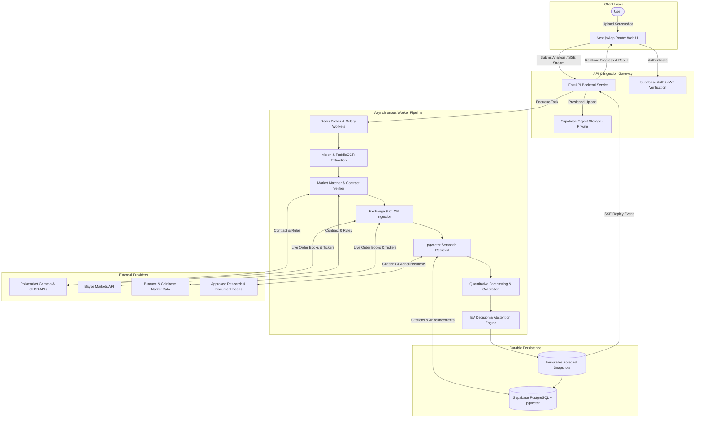

# Prediction Intelligence Platform

> **Next-Generation Probabilistic Prediction Market Intelligence & Decision Support Platform**

The Prediction Intelligence Platform is an enterprise-grade analysis and probabilistic forecasting engine for prediction markets (supporting Polymarket and Bayse). Beginning with a market screenshot or direct market identifier, the platform performs multi-stage vision extraction, authoritative platform cross-verification, real-time and historical order-book analysis, documentary evidence synthesis, calibrated probabilistic forecasting, and expected-value (EV) decision evaluation.

---

## System Overview

---

## Core Principles & Product Boundaries

1. **Analysis and Decision Support, Not Execution:** The platform does not place orders, custody user funds, or manage private wallet keys.
2. **Evidence Before Opinion:** No recommendation is emitted without verified resolution rules, fresh order-book depth, and traceable documentary evidence.
3. **Abstention as a Core Feature:** The engine emits `NO_TRADE` whenever estimated edge fails to clear execution costs (spread, fees, slippage), data feeds are stale, or the market cannot be verified.
4. **Calibrated Probabilities:** The system outputs rigorous probabilities $P(\text{YES}) \in [0, 1]$ accompanied by uncertainty intervals, Brier scores, and proper scoring evaluation.
5. **Point-in-Time Truth:** Every prediction is recorded as an immutable snapshot capturing the exact features, quotes, and evidence available at forecast time.

---

## Technical Stack Summary

- **Frontend:** Next.js 15+ (App Router, React Server Components, TypeScript strict mode, TanStack Query, Tailwind CSS, Lucide Icons).
- **Backend:** Python 3.12+, FastAPI, Pydantic v2, SQLAlchemy 2.x (async), `httpx`, Celery + Redis.
- **Persistence & Identity:** Supabase PostgreSQL, `pgvector`, Supabase Auth (JWT), Supabase Storage (private S3 buckets with presigned access).
- **Vision & Extraction:** Hybrid PaddleOCR (text & bounding boxes) + Vision-Language Model (VLM) structured schema parsing.
- **Machine Learning & Forecasting:** LightGBM / XGBoost, scikit-learn, Platt scaling, Isotonic regression, walk-forward time-series validation.
- **Infrastructure & Observability:** Docker Compose, OpenTelemetry, `structlog` (JSON), Redis single-flight distributed locking.

---

## Documentation Architecture

All technical specifications, architectural decisions, and operational standards are located in the [`docs/`](file:///Users/mac/prediction-market/docs/) directory:

| Document | Purpose & Key Topics |
|---|---|
| [`AGENTS.md`](file:///Users/mac/prediction-market/AGENTS.md) | Mandatory coding agent operating manual, boundary rules, and Definition of Done. |
| [`docs/ARCHITECTURE.md`](file:///Users/mac/prediction-market/docs/ARCHITECTURE.md) | Modular monolith architecture, dataflow diagrams, subsystem boundaries, and execution lifecycle. |
| [`docs/TECH_STACK.md`](file:///Users/mac/prediction-market/docs/TECH_STACK.md) | Detailed technology choices, versions, dependencies, and infrastructure topology. |
| [`docs/BUILD_PLAN.md`](file:///Users/mac/prediction-market/docs/BUILD_PLAN.md) | Phase-by-phase implementation plan (Phases 0 through 6) with acceptance criteria. |
| [`docs/DATA_MODEL.md`](file:///Users/mac/prediction-market/docs/DATA_MODEL.md) | Complete PostgreSQL schema, table definitions, foreign keys, indexes, and RLS policies. |
| [`docs/FORECASTING_AND_SCORING.md`](file:///Users/mac/prediction-market/docs/FORECASTING_AND_SCORING.md) | Probabilistic forecasting mathematics, Brier scores, Log loss, calibration, and EV decision logic. |
| [`docs/REALTIME_PROTOCOL.md`](file:///Users/mac/prediction-market/docs/REALTIME_PROTOCOL.md) | Server-Sent Events (SSE) protocol, event schemas, Redis pub/sub backplane, and WebSocket feeds. |
| [`docs/EDGE_CASES.md`](file:///Users/mac/prediction-market/docs/EDGE_CASES.md) | Fail-closed failure modes, resolution discrepancies, feed staleness, and prompt injection defense. |
| [`docs/INTEGRATIONS_GUIDE.md`](file:///Users/mac/prediction-market/docs/INTEGRATIONS_GUIDE.md) | Integration specifications for Polymarket (Gamma/CLOB), Bayse, Binance, and Coinbase. |
| [`docs/DESIGN_DIRECTION.md`](file:///Users/mac/prediction-market/docs/DESIGN_DIRECTION.md) | UI/UX specifications, design tokens, layout hierarchy, and uncertainty visualizations. |
| [`docs/adr/`](file:///Users/mac/prediction-market/docs/adr/) | Architecture Decision Records capturing foundational technical decisions. |

---

## Canonical Architecture Decision Records (ADRs)

- [`ADR 0000: Monorepo and Technology Stack Selection`](file:///Users/mac/prediction-market/docs/adr/0000-stack-choices.md)
- [`ADR 0001: Server-Side Authoritative Verification (Server is the Referee)`](file:///Users/mac/prediction-market/docs/adr/0001-server-is-the-referee.md)
- [`ADR 0002: Asynchronous Job Orchestration with SSE Progress Replay`](file:///Users/mac/prediction-market/docs/adr/0002-asynchronous-job-orchestration.md)
- [`ADR 0003: Strict Decoupling of Probabilistic Forecasting and Decision Engine`](file:///Users/mac/prediction-market/docs/adr/0003-forecasting-and-decision-separation.md)
- [`ADR 0004: Point-in-Time Data Immutability and Anti-Leakage Controls`](file:///Users/mac/prediction-market/docs/adr/0004-point-in-time-truth-and-anti-leakage.md)
- [`ADR 0005: Hybrid PaddleOCR and Vision-Language Model Pipeline`](file:///Users/mac/prediction-market/docs/adr/0005-vision-ocr-hybrid-pipeline.md)
- [`ADR 0006: Untrusted External Content Boundary & Prompt Injection Defense`](file:///Users/mac/prediction-market/docs/adr/0006-untrusted-data-boundary-and-prompt-injection.md)

---

## Foundational Repository Rules

1. **Inspect Before Changing:** Read existing architecture, tests, and database migrations before modifying any code.
2. **Preserve Point-in-Time Truth:** Never mutate historical forecast snapshots.
3. **No Speculative Implementation:** Do not invent APIs or package methods; always cross-reference official provider documentation.
4. **Follow Engineering Rules:** Adhere strictly to [`prediction-intelligence-engineering-rules.md`](file:///Users/mac/prediction-market/prediction-intelligence-engineering-rules.md).
