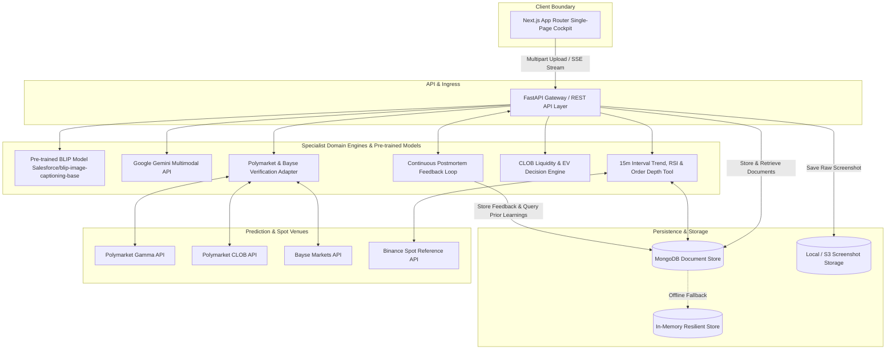
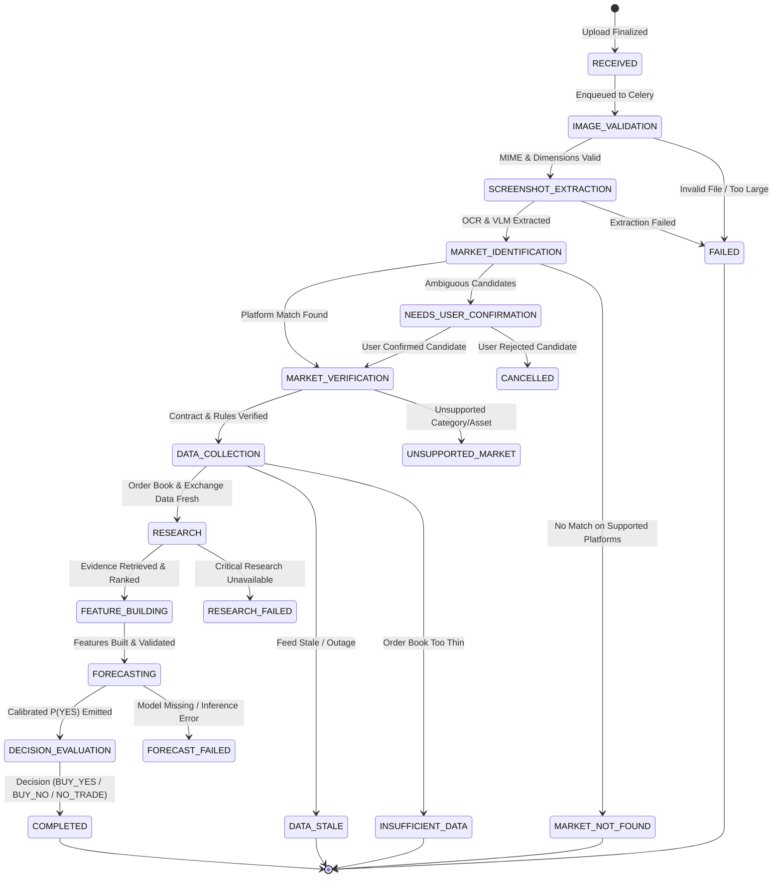
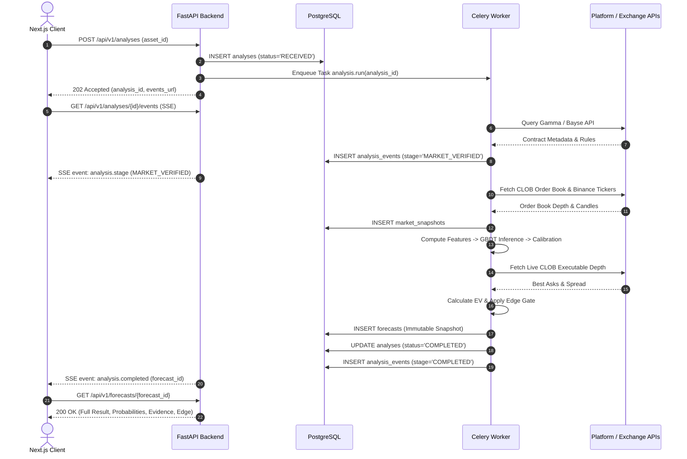

# System Architecture — Prediction Intelligence Platform

> **Governing Standards:** This document outlines the physical, logical, and execution architecture of the Prediction Intelligence Platform. It directly implements the principles established in [`prediction-intelligence-engineering-rules.md`](file:///Users/mac/prediction-market/prediction-intelligence-engineering-rules.md) and [`prediction-intelligence-platform-technical-plan.md`](file:///Users/mac/prediction-market/prediction-intelligence-platform-technical-plan.md).

---

## 1. Architectural Philosophy: The Modular Monolith

The platform is designed as an **event-driven, asynchronous modular monolith**. 
Rather than decomposing the application into distributed microservices prematurely—which introduces network latency, distributed transaction failure modes, and operational overhead—we enforce strict domain boundaries in a single codebase with separate deployable worker execution pools.

### Core Architectural Axioms
1. **Unidirectional Dependency Flow:** Inward dependencies only. Domain entities and mathematical logic never import HTTP routers, database clients, or external API wrappers.
2. **Asynchronous Execution by Default:** All multi-step analysis operations run as background tasks orchestrated via Celery and Redis. HTTP handlers return in sub-second timeframes with `202 Accepted`.
3. **Immutability of Historical Decisions:** Forecasts and verified resolutions are recorded immutably. Point-in-time state cannot be altered retroactively.
4. **Boundary Validation:** Runtime validation via Pydantic v2 (backend) and Zod (frontend) occurs at all I/O boundaries (HTTP, database, queues, external APIs, LLMs).

---

## 2. High-Level Component Topology



    CeleryResearch <--> NewsFeeds
    CeleryResearch --> VectorStore

    CeleryAnalysis --> CryptoEngine
    CryptoEngine --> DecisionEngine
    DecisionEngine <--> PolyCLOB
    DecisionEngine -->|Persist Immutable Snapshot| DB
    DecisionEngine -->|Broadcast Event| Redis
    Redis -->|Pub/Sub SSE Replay| FastAPI
```

---

## 3. Logical Subsystem Boundaries

The codebase is organized into isolated, cohesive domain modules:

| Subsystem | Namespace | Core Responsibilities | Invariants & Guardrails |
|---|---|---|---|
| **API & Auth** | `prediction_ai.api`, `prediction_ai.auth` | Route definition, JWT verification, rate limiting, request validation, SSE event streaming. | Must never run synchronous heavy CPU work. Must never expose stack traces or raw provider errors. |
| **Vision & Extraction** | `prediction_ai.vision` | Image normalization, EXIF stripping, PaddleOCR bounding box extraction, VLM structured parsing. | Must output `ScreenshotMarketCandidate`. Must never assume extracted text is verified ground truth. |
| **Market Matching** | `prediction_ai.markets` | Matching extracted candidate against platform APIs, verifying resolution rules, calculating match confidence. | Critical conflicts (asset, expiry, strike) veto matching. Requires `VERIFIED_EXACT` to proceed. |
| **Platform Integrations** | `prediction_ai.integrations` | Normalized clients for Polymarket (Gamma & CLOB), Bayse, Binance, and Coinbase. | Translates provider JSON into normalized DTOs. Handles provider rate limits, retries, and errors. |
| **Market Data Ingestion** | `prediction_ai.ingestion` | Real-time WebSocket listening, 1m/5m candle normalization, order-book snapshot maintenance, data freshness gating. | Must fail closed when critical feeds exceed horizon-specific freshness thresholds (e.g., $> 3\text{s}$ for quotes). |
| **Research & Evidence** | `prediction_ai.research` | Approved source management, SSRF-filtered document fetchers, semantic chunking, `pgvector` indexing, claim graphs. | Treats all retrieved text as untrusted. Enforces point-in-time timestamp cutoffs ($t \le t_{\text{forecast}}$). |
| **Domain Specialists** | `prediction_ai.specialists` | Feature engineering for specific asset classes (BTC: return moments, book imbalance, realized vol). | Specialist outputs feature vectors and diagnostic flags; does not output final trade recommendations. |
| **Forecasting Engine** | `prediction_ai.forecasting` | GBDT inference (LightGBM/XGBoost), baseline scoring, probability calibration (Isotonic/Platt). | Emits calibrated $P(\text{YES}) \in [0, 1]$ and uncertainty bounds. Never invents probabilities via LLM. |
| **Decision Engine** | `prediction_ai.decision` | Executable CLOB depth inspection, fee & slippage deductions, Expected Value ($EV$) calculation, `NO_TRADE` gating. | Emits `BUY_YES`, `BUY_NO`, or `NO_TRADE`. Never modifies raw underlying forecast probabilities. |
| **Continuous Learning** | `prediction_ai.learning` | Official platform resolution polling, postmortem root-cause classification, Brier scoring, candidate experiment logging. | Cannot self-modify production prompts or models without offline review and evaluation gates. |

---

## 4. End-to-End Analysis State Machine

Every user-submitted analysis traverses a deterministic finite state machine. Transitions are atomic, timestamped, and persisted in `analysis_events`.



### State Machine Recovery & Idempotency Rules
- **At-Least-Once Delivery Resilience:** If a worker crashes mid-pipeline, the task is redelivered. Workers inspect `analysis_events` to determine the last verified state and resume idempotently.
- **Fail-Closed States:** States like `DATA_STALE`, `INSUFFICIENT_DATA`, and `MARKET_NOT_FOUND` terminate the analysis cleanly, recording diagnostic reasons and persisting an explicit `NO_TRADE` resolution without throwing unhandled exceptions.

---

## 5. Data Flow & Communication Contracts



---

## 6. Security & Trust Architecture

1. **Identity & Authentication:** Handled exclusively via Supabase Auth. The client attaches `Authorization: Bearer <JWT>` to every request. FastAPI validates the token signature against Supabase JWKS, claims, issuer, and expiry. The `user_id` is derived from verified JWT claims.
2. **Data-Layer Multi-Tenancy (RLS):** Every user-owned table (`analyses`, `uploaded_assets`, `forecasts`, `user_prediction_feedback`) enforces PostgreSQL Row Level Security (RLS). Policies verify `auth.uid() = user_id`.
3. **Private Object Storage:** Uploaded screenshots reside in a private Supabase Storage bucket. Access requires server-generated, short-lived presigned URLs (expiring in $\le 60\text{ seconds}$).
4. **Untrusted Data Isolation:** All external documents, news feeds, and OCR outputs are treated as untrusted data. They are wrapped in explicit boundary delimiters before being provided to LLMs.
5. **Secret Management:** Secrets (Supabase service role keys, API signing credentials, model provider keys) reside in environment secret managers and are never exposed to the client or written to logs.
