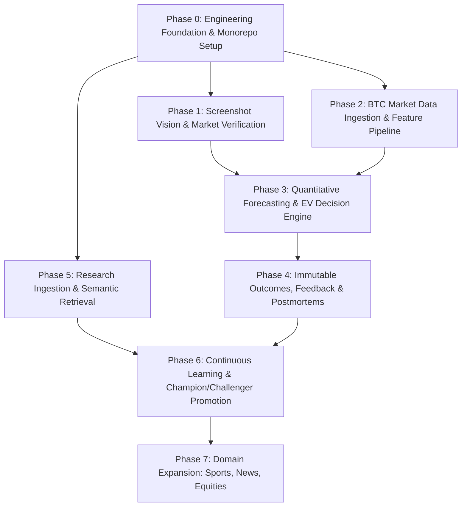

# Engineering Build Plan & Roadmap — Prediction Intelligence Platform

> **Governing Standards:** This document outlines the sequential implementation roadmap for the platform. It establishes hard deliverables, technical dependencies, and verification criteria for each phase. See also [`prediction-intelligence-platform-technical-plan.md`](file:///Users/mac/prediction-market/prediction-intelligence-platform-technical-plan.md) and [`prediction-intelligence-engineering-rules.md`](file:///Users/mac/prediction-market/prediction-intelligence-engineering-rules.md).

---

## 1. Roadmap Dependency Graph

---

## 2. Phase 0: Engineering Foundation & Core Infrastructure

### 2.1 Objectives & Deliverables
Establish the end-to-end monorepo infrastructure, containerized local development environment, database migrations baseline, authenticated communication pipeline, and background task transport.

- [ ] **Monorepo Architecture:** Scaffold `apps/web/` (Next.js 15+ App Router, TypeScript strict) and `backend/` (Python 3.12+, FastAPI, Pydantic v2). Configure unified linting and formatting (`ruff`, `eslint`).
- [ ] **Database & Migrations Baseline:** Initialize Supabase PostgreSQL with `alembic` or Supabase CLI migrations. Apply foundational schemas (`profiles`, `uploaded_assets`, `analyses`, `analysis_events`, `audit_events`).
- [ ] **Row-Level Security (RLS) Baseline:** Enforce RLS on all user tables with comprehensive test coverage for authenticated owner access vs cross-user denial.
- [ ] **Authentication Integration:** Connect Next.js `@supabase/ssr` with backend FastAPI JWT verification using Supabase JWKS.
- [ ] **Task Queue & Broker:** Stand up Redis 7.2 and Celery worker pools with heartbeat monitoring and structured task error handling.
- [ ] **API Gateway Standards:** Implement standardized JSON response envelopes, RFC-7807 error models, request/correlation ID injection, and OpenTelemetry instrumentation.

### 2.2 Phase 0 Exit Criteria
- Authenticated user can log in via frontend and issue an authenticated request to FastAPI.
- FastAPI verifies JWT claims, derives `user_id`, and enforces tenant scoping.
- Background worker processes an idempotent test task and commits progress to PostgreSQL.
- Automated CI pipeline runs linting, type checks, unit tests, and migration validation.

---

## 3. Phase 1: Screenshot Vision & Market Verification Pipeline

### 3.1 Objectives & Deliverables
Transform untrusted user screenshots into verified platform prediction contracts.

- [ ] **Private Upload Pipeline:** Implement `POST /api/v1/uploads` generating presigned Supabase Storage URLs. Enforce MIME verification (PNG, JPEG, WebP) and 10 MB payload caps.
- [ ] **Dual-Pass Extraction Engine:**
  - Pass 1: Stand up PaddleOCR worker extracting text tokens, coordinates, and bounding boxes.
  - Pass 2: Multimodal VLM adapter generating `ScreenshotMarketCandidate` adhering to strict Pydantic schema.
  - Pass 3: Reconcile VLM outputs against OCR bounding boxes; flag numeric discrepancies.
- [ ] **Platform Adapters (Read-Only):**
  - **Polymarket Adapter:** Connect to Gamma API (market metadata, resolution rules) and CLOB API (order book quotes).
  - **Bayse Adapter:** Connect to Bayse API (market discovery, ticker, resolution criteria).
- [ ] **Market Matching Algorithm:** Implement weighted matching algorithm (title similarity, outcome labels, expiration timestamp, underlying symbol). Critical field discrepancies veto matches.
- [ ] **User Confirmation UI:** Build interactive diff modal when extraction is ambiguous (`NEEDS_USER_CONFIRMATION`), allowing the user to select the correct market.
- [ ] **Real-Time Progress Streaming:** Implement Server-Sent Events (SSE) endpoint `/api/v1/analyses/{id}/events` with `Last-Event-ID` reconnection backed by `analysis_events`.

### 3.2 Phase 1 Exit Criteria
- Annotated screenshot test suite achieves $> 95\%$ field extraction accuracy.
- Critical platform parameters (resolution source, exact question, expiry) are verified before proceeding.
- Unmatched or ambiguous screenshots halt cleanly; zero unverified markets reach the forecasting layer.

---

## 4. Phase 2: BTC Market Data Ingestion & Feature Pipeline

### 4.1 Objectives & Deliverables
Construct high-fidelity point-in-time market data ingestion and microstructure feature extraction for Bitcoin (crypto MVP).

- [ ] **Exchange Ingestion Adapters:** Build asynchronous WebSocket and REST clients for Binance and Coinbase spot/futures (order book depth, trades, 1m/5m/1h klines).
- [ ] **Feed Freshness & Quality Gates:** Implement automated staleness detection:
  - Top-of-book quotes: $> 3\text{ seconds}$ triggers `DATA_STALE`.
  - Order-book depth: $> 5\text{ seconds}$ triggers `DATA_STALE`.
  - 1-minute candles: Latest closed bar $> 90\text{ seconds}$ triggers alert.
- [ ] **Time-Series Storage:** Implement `market_data_observations` and `market_snapshots` with composite indexing and time partitioning.
- [ ] **Feature Engineering Pipeline:** Calculate versioned microstructure feature vectors:
  - Multi-window log returns ($1\text{m}, 5\text{m}, 15\text{m}, 1\text{h}$).
  - Realized volatility and Parkinson volatility ratios.
  - Bid-ask spread and multi-level CLOB depth imbalance ($I_{\text{depth}} = \frac{Q_{\text{bid}} - Q_{\text{ask}}}{Q_{\text{bid}} + Q_{\text{ask}}}$).
  - Trade-flow aggressor imbalances and volume acceleration.
- [ ] **Point-in-Time Historical Dataset:** Build backtesting dataset generator aligned strictly with platform contract resolution timestamps.

### 4.2 Phase 2 Exit Criteria
- System detects simulated exchange feed disconnects within 3 seconds and safely enters `DATA_STALE`.
- Feature computation is vectorized, deterministic, and free of forward-looking data leakage.
- Historical dataset can be reconstructed exactly as of any arbitrary past timestamp $t$.

---

## 5. Phase 3: Quantitative Forecasting & Expected Value Decision Engine

### 5.1 Objectives & Deliverables
Build the probabilistic modeling engine and decouple statistical probabilities from executable trade decisions.

- [ ] **Baseline Statistical Models:** Implement empirical class base rates and market-implied probability extraction from CLOB midpoints.
- [ ] **Production GBDT Model:** Train LightGBM / XGBoost classifier on engineered features for binary BTC target definitions (`BTC > Strike at Expiry`).
- [ ] **Probability Calibration Pipeline:** Implement Platt scaling (logistic) and Isotonic regression. Validate calibration using reliability diagrams and Expected Calibration Error (ECE).
- [ ] **Walk-Forward Validation:** Execute chronological walk-forward cross-validation with purged embargo windows. Compare out-of-sample Brier scores against market baselines.
- [ ] **CLOB Liquidity & Slippage Engine:** Calculate effective entry cost ($\text{Ask}_{\text{effective}}$) by walking the platform CLOB order book for a defined size. Include taker fees and gas allowances.
- [ ] **Expected Value ($EV$) Decision Policy:**
  $$EV_{\text{YES}} = P(\text{YES}) - \text{Cost}_{\text{YES}}$$
  Enforce minimum edge gate $\delta_{\text{min}} \ge 0.04$. If edge is insufficient or feeds are stale, strictly emit **`NO_TRADE`**.
- [ ] **Immutable Forecast Ledger:** Persist full analysis snapshot to `forecasts` table, including probability distributions, decision metrics, and model versions.

### 5.2 Phase 3 Exit Criteria
- Quantitative GBDT model outperforms the market-implied probability baseline on out-of-sample Brier score.
- Decision engine successfully emits `NO_TRADE` whenever edge $< \delta_{\text{min}}$ or spread $> 5\%$.
- All emitted forecasts are immutably persisted with complete point-in-time audit trails.

---

## 6. Phase 4: Outcome Resolution, User Feedback & Postmortems

### 6.1 Objectives & Deliverables
Close the learning loop by tracking verified outcomes and diagnosing forecast errors.

- [ ] **Resolution Polling Worker:** Scheduled Celery task checking official platform resolution (Polymarket UMA oracle / Bayse settlement). Update `market_resolutions`.
- [ ] **User Feedback Portal:** Build UI allowing users to submit outcome confirmation, dispute discrepancies, and rate explanation clarity (`user_prediction_feedback`).
  - *Invariant:* User feedback is stored as diagnostic feedback; it never alters official resolution records.
- [ ] **Automated Postmortem Engine:** When a market resolves, generate structured postmortem classifying error root causes (`DATA_STALENESS`, `MODEL_MISSPECIFICATION`, `CALIBRATION_ERROR`, `REGIME_SHIFT`, `RANDOM_VARIANCE`).
- [ ] **Model Performance Dashboard:** Build frontend interface displaying Brier scores, log loss, calibration curves, and realized returns segmented by horizon and probability bucket.

### 6.2 Phase 4 Exit Criteria
- Completed forecasts automatically reconcile against official platform settlements.
- Discrepancies between user feedback and platform resolution generate audit flags.
- Postmortem reports generate structured candidate hypotheses without touching production code.

---

## 7. Phase 5: Research & Knowledge Infrastructure

### 7.1 Objectives & Deliverables
Incorporate unstructured documentary context (regulatory releases, exchange announcements, news) without introducing prompt injection or hallucination.

- [ ] **Source Registry:** Implement admin-governed `research_sources` catalog with domain authority tiers and licensing classifications.
- [ ] **SSRF-Protected Document Ingestion:** Build isolated fetcher blocking loopback/private IP ranges and validating MIME types (PDF, HTML).
- [ ] **Semantic Chunking & Embedding:** Process documents into semantic chunks with attached metadata (`published_at`, source, canonical URL). Generate embeddings via versioned model and store in `pgvector`.
- [ ] **Hybrid Search & Reranking:** Implement keyword + vector similarity retrieval with hard point-in-time filtering ($t_{\text{published}} \le t_{\text{forecast}}$).
- [ ] **Claim-Level Evidence Graph:** Extract and link material claims, classifying evidence as supporting, contradicting, or neutral with traceable evidence IDs.

### 7.2 Phase 5 Exit Criteria
- Document retrieval enforces strict point-in-time cutoffs; zero post-dated articles appear in search results.
- Prompt injection test payloads embedded inside research documents fail to alter system behavior.
- All factual claims cited in LLM explanations link to verified `forecast_evidence` records.

---

## 8. Phase 6: Continuous Learning & Controlled Model Governance

### 8.1 Objectives & Deliverables
Establish enterprise champion/challenger model promotion and operational monitoring.

- [ ] **Model Registry:** Implement `model_versions` tracking artifact hashes, training periods, validation metrics, and approval states (`candidate`, `shadow`, `champion`, `retired`).
- [ ] **Shadow Deployment Engine:** Run candidate challenger models in parallel on live analyses without impacting user-facing recommendations.
- [ ] **Evaluation Gates:** Enforce automated gating before promotion:
  - Out-of-sample Brier score improvement $> 2\%$.
  - Maximum Expected Calibration Error (ECE) $< 0.05$.
  - Zero data leakage on purged embargo benchmarks.
- [ ] **Instant Rollback Mechanism:** Implement administrative command allowing immediate fallback to the previous champion model artifact.

### 8.2 Phase 6 Exit Criteria
- Zero autonomous self-modification: model promotion requires automated evaluation gate passes and explicit administrative approval.
- Rollback to prior champion model executes in $< 60\text{ seconds}$ without service interruption.

---

## 9. Phase 7: Domain Expansion (Post-MVP)

- **Sports Specialist:** Integration of official match fixtures, confirmed starting lineups, injury reports, and expected goals (xG) models for football/soccer markets.
- **News & Event Specialist:** Timeline tracking for regulatory, political, and macro-economic announcement markets.
- **Financial Equities Specialist:** Session-aware market calendars, earnings releases, and SEC filings.
