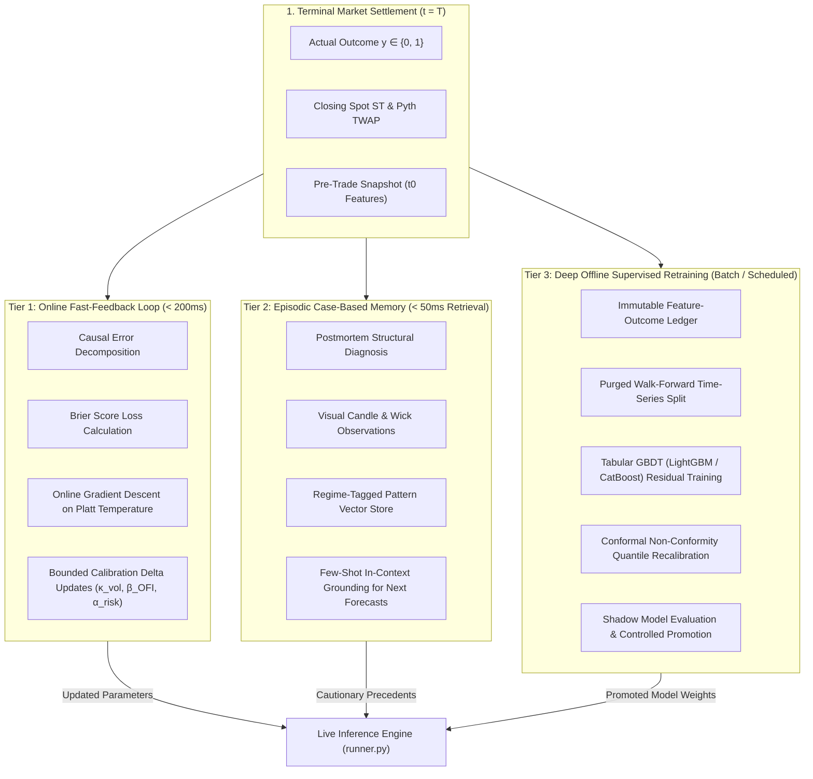
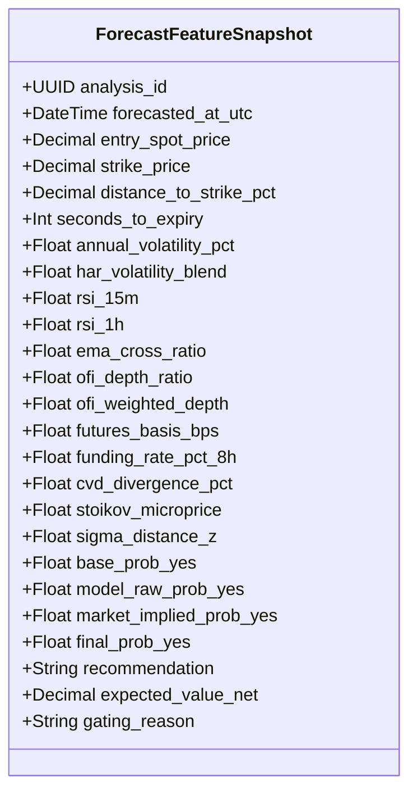
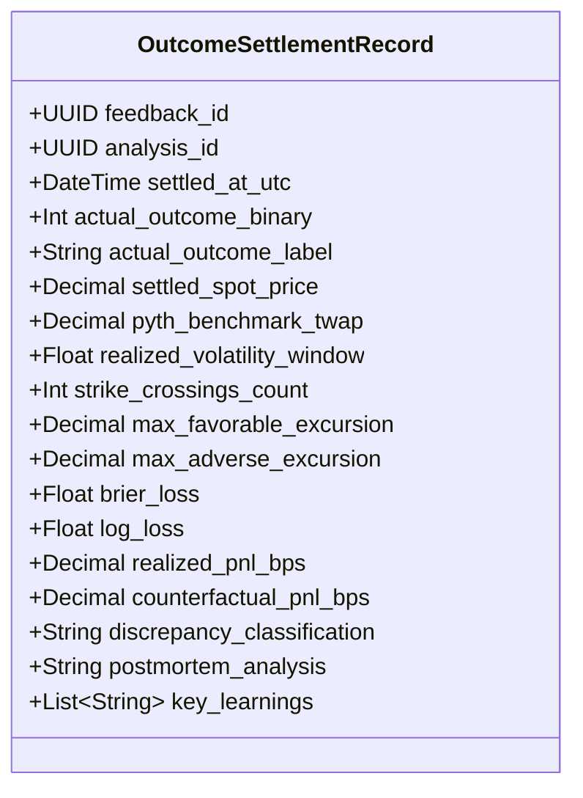
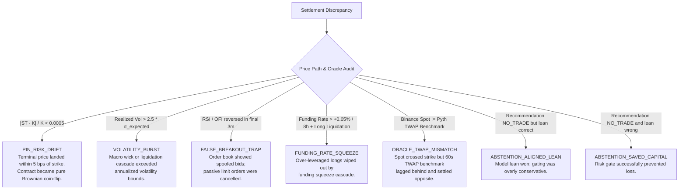
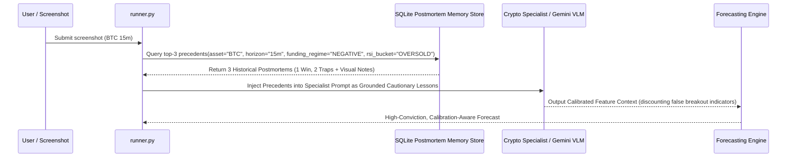
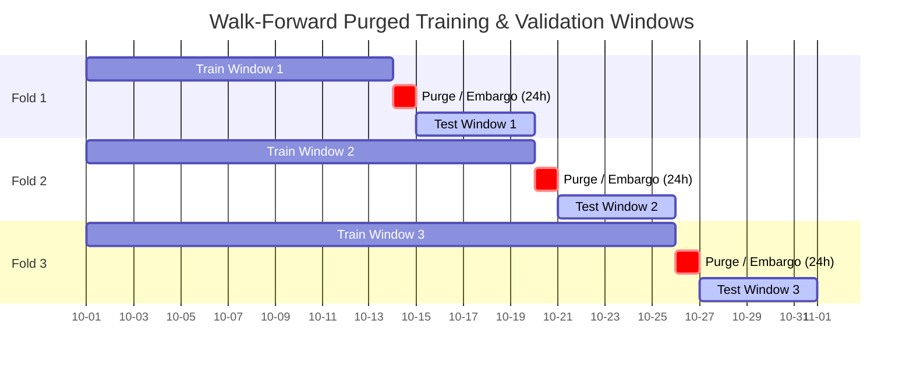
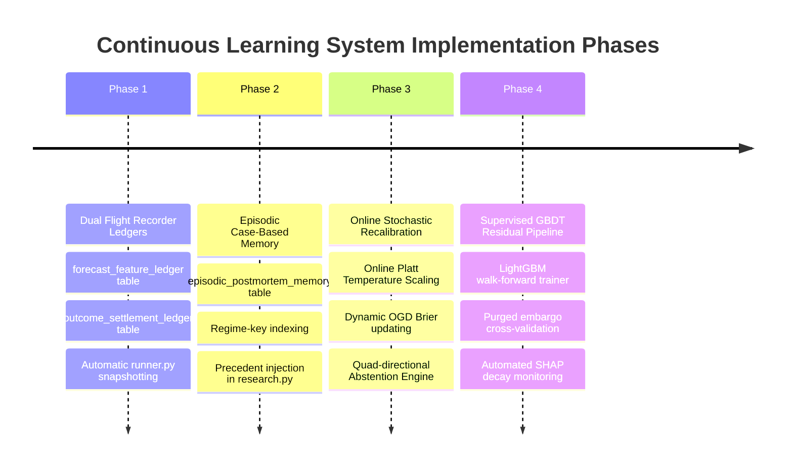

# Continuous Learning & Model Training Blueprint
## Transforming Market Settlements into Compounding Predictive Intelligence

> **Governing Documents:** Operates under [`prediction-intelligence-engineering-rules.md`](file:///Users/mac/prediction-market/docs/prediction-intelligence-engineering-rules.md) and [`prediction-intelligence-platform-technical-plan.md`](file:///Users/mac/prediction-market/docs/prediction-intelligence-platform-technical-plan.md). Complements [`QUANTITATIVE_PREDICTION_ACCURACY_BLUEPRINT.md`](file:///Users/mac/prediction-market/docs/QUANTITATIVE_PREDICTION_ACCURACY_BLUEPRINT.md).

---

## 0. Executive Summary & The Core Learning Directive

In financial prediction markets (Polymarket, Bayse, Kalshi), binary contracts resolve deterministically to discrete truth:
$$y \in \{0, 1\} \quad (\text{YES or NO, UP or DOWN})$$

Prior to settlement ($t < T$), every forecast is an estimate of risk-neutral probability $P(\text{YES}) \in [0, 1]$. When the market reaches expiration ($t = T$) and resolves, an **invaluable piece of ground-truth information is generated**.

In naive AI systems, this resolution is either ignored or processed as a vanity metric (e.g., "win rate = 65%"). In professional quantitative trading, **the delta between the pre-trade forecast state and the terminal settlement is the single most powerful training signal in existence**.

Every settled contract carries the answers to five fundamental questions:
1. **Calibration Fidelity:** Did our assigned probability $P(\text{YES}) = 0.72$ reflect a true $72\%$ empirical base rate across similar market structures, or was the model overconfident?
2. **Feature Attribution:** Which pre-trade indicators (5-level Order Flow Imbalance, Perpetual Futures Basis, Volatility Surface, RSI, Stoikov Microprice) accurately forecasted directional drift, and which were false signals or spoofed noise?
3. **Abstention Postmortem:** When the decision engine gated the trade to `NO_TRADE`, did it correctly preserve capital against market noise and fee drag, or did it overly penalize a genuine statistical edge?
4. **Oracle Discrepancy:** Did the terminal settlement spot price $S_T$ match public spot tickers, or did the oracle's benchmark methodology (e.g., Pyth 60-second TWAP or Chainlink median) create an unexpected pin-risk divergence?
5. **Systematic Adaptation:** What exact mathematical adjustments must be applied to our volatility multipliers ($\kappa_{\text{vol}}$), signal weights ($\beta_i$), and conformal uncertainty intervals ($\alpha_{\text{risk}}$) so the system never makes the same structural error twice?

This document defines the complete architectural blueprint for the **Prediction Intelligence Continuous Learning and Model Training System**.

---

## 1. The Continuous Learning Paradigm: Multi-Tier Architecture

To learn rapidly without catastrophic forgetting or overfitting to recent market noise, the system implements a **three-tier learning hierarchy**:



### The Three Learning Tiers:

| Learning Tier | Cycle Frequency | Mechanism | Target Parameters | Safety Guardrail |
|---|---|---|---|---|
| **Tier 1: Fast Online Loop** | Immediate per settlement ($< 200\text{ms}$) | Online Gradient Descent (OGD) on Brier score; bounded parameter nudges. | Asset volatility multiplier $\kappa_{\text{vol}}$, momentum weight $\beta_{\text{mom}}$, OFI weight $\beta_{\text{OFI}}$, conformal buffer $\alpha$. | Hard clipping ($\pm 0.05$ max delta per trade; values strictly bounded in $[0.5, 2.0]$). |
| **Tier 2: Episodic In-Context Memory** | Immediate per settlement; indexed for query | Case-Based Reasoning (CBR) storing structured postmortems and visual screenshot observations. | Dynamic prompt injection: top-3 historical precedents in identical microstructure regimes. | Static prompt schema; untrusted text sandboxing; no prompt override permission. |
| **Tier 3: Deep Offline Retraining** | Weekly or every $N=100$ settled trades | Supervised Gradient Boosted Decision Trees (LightGBM/CatBoost) predicting empirical probability residual $\Delta\text{logit}$. | GBDT tree ensembles; Isotonic calibration curves; Conformal prediction quantiles $\hat{q}_{1-\alpha}$. | Walk-forward cross-validation with embargo purge; shadow-mode testing before production promotion. |

---

## 2. Pillar I: The Immutable Feature-Outcome Ledger (Flight Recorder)

Supervised machine learning and postmortem diagnostics are impossible without **point-in-time ground truth**. If feature values are collected or imputed after settlement, the model suffers from fatal lookahead bias.

### 2.1 Pre-Trade Feature Snapshot ($t = t_0$)

At the exact instant the inference pipeline finishes computing a forecast ($t_0$), the system serializes a 28-dimensional numerical feature vector $X_{t_0}$ into an immutable ledger record:



### 2.2 Settlement Ingestion ($t = t_{\text{settle}}$)

When the market reaches expiration ($t \ge T$), the auto-settlement engine or manual feedback endpoint ingests the terminal resolution:



### 2.3 Strict Point-in-Time Anti-Leakage Invariant
* Every feature in $X_{t_0}$ carries a verified timestamp $t_{\text{feature}} \le t_0$.
* Under no circumstances may $S_{\text{settle}}$, Pyth benchmark prints after $t_0$, or post-expiry order-book data be joined into the feature snapshot.
* In database migrations, $X_{t_0}$ is locked with an append-only invariant. Updates to historical snapshots are forbidden.

---

## 3. Pillar II: Causal Discrepancy Attribution & The Abstention Learning Engine

A prediction intelligence platform cannot simply say "the model was wrong". It must determine **why** the prediction diverged, decompose the error into structural components, and analyze trades that were **not** taken (`NO_TRADE`).

### 3.1 The Four Quadrants of Abstention Learning

Standard trading bots discard abstentions. In our system, **an abstention is treated as a counterfactual trade with a shadow PnL and shadow Brier score**:

```
                       Actual Outcome = YES (1)          Actual Outcome = NO (0)
                   +--------------------------------+--------------------------------+
Model Leaned YES   |  QUADRANT 1: ALIGNED LEAN MISS  |  QUADRANT 2: CAPITAL SAVE WIN  |
P(YES) > 0.52      |  - Decision gate was too strict |  - Risk gate correctly saved   |
Action = NO_TRADE  |  - Net EV threshold or spread   |    trader from false breakout  |
                   |    penalty was over-cautious   |  - Reinforce risk gate logic   |
                   +--------------------------------+--------------------------------+
Model Leaned NO    |  QUADRANT 3: REGIME SHOCK MISS  |  QUADRANT 4: PIN-RISK GATING   |
P(YES) <= 0.52     |  - Sudden volatility expansion  |  - Spot closed within 0.05%    |
Action = NO_TRADE  |  - External liquidation shock   |    of strike; pure coin flip   |
                   |  - Increase vol multiplier     |  - Validate pin-risk filter    |
                   +--------------------------------+--------------------------------+
```

#### Mathematical Formulation of Counterfactual PnL:
For every abstention (`NO_TRADE`), we compute what the return **would have been** if the user had executed the model's directional lean:

$$\text{Directional Lean} = \begin{cases} \text{BUY\_YES} & \text{if } P(\text{YES}) \ge 0.50 \\ \text{BUY\_NO} & \text{if } P(\text{YES}) < 0.50 \end{cases}$$

$$\text{Shadow PnL}_{\text{bps}} = \begin{cases} 
(1 - P_{\text{market}}) \times 10,000 - \text{Fees}_{\text{bps}} & \text{if lean is YES and } y = 1 \\
-P_{\text{market}} \times 10,000 & \text{if lean is YES and } y = 0 \\
(P_{\text{market}}) \times 10,000 - \text{Fees}_{\text{bps}} & \text{if lean is NO and } y = 0 \\
-(1 - P_{\text{market}}) \times 10,000 & \text{if lean is NO and } y = 1
\end{cases}$$

* **If Shadow PnL $> +200\text{ bps}$ (Quadrant 1):** The trade was a high-conviction winner that was killed by an excessively wide uncertainty buffer ($\alpha_{\text{risk}}$) or over-penalized spread. **Corrective Learning:** Nudge $\alpha_{\text{risk}}$ downward for this regime.
* **If Shadow PnL $< -500\text{ bps}$ (Quadrant 2):** The model's raw probability was fooled by false momentum, but the decision gate's spread/depth penalty successfully vetoed the trade. **Corrective Learning:** The gating policy is vindicated; reinforce the gating threshold.

### 3.2 Microstructure Error Decomposition Taxonomy

Every discrepancy is classified into one of seven structural categories:



---

## 4. Pillar III: Online Stochastic Parameter Recalibration (The Fast Loop)

Rather than waiting days for a batch retraining cycle, the platform executes an immediate, mathematically bounded parameter update upon every settlement.

### 4.1 Brier Score and Log-Loss Formulation
For a binary outcome $y \in \{0, 1\}$ and predicted probability $\hat{p} = P(\text{YES}) \in (0, 1)$:

$$\mathcal{L}_{\text{Brier}} = (\hat{p} - y)^2$$

$$\mathcal{L}_{\text{Log}} = -\left[ y \ln(\hat{p}) + (1 - y) \ln(1 - \hat{p}) \right]$$

The Brier score decomposes cleanly into:
$$\text{Brier Score} = \underbrace{\frac{1}{N}\sum_{k=1}^K n_k (\bar{p}_k - \bar{y}_k)^2}_{\text{Reliability (Calibration Error)}} - \underbrace{\frac{1}{N}\sum_{k=1}^K n_k (\bar{y}_k - \bar{y})^2}_{\text{Resolution (Discrimination)}} + \underbrace{\bar{y}(1 - \bar{y})}_{\text{Uncertainty (Market Entropy)}}$$

Our training objective is to **minimize Calibration Error (Reliability $\to 0$) while maximizing Resolution**.

### 4.2 Online Platt Temperature Scaling
Given pre-calibrated model log-odds $z = \text{logit}(\hat{p}_{\text{raw}}) = \ln\left(\frac{\hat{p}_{\text{raw}}}{1 - \hat{p}_{\text{raw}}}\right)$, calibrated probability is:

$$\hat{p}_{\text{cal}} = \sigma\left(\frac{z}{T}\right) = \frac{1}{1 + e^{-z / T}}$$

Where $T > 0$ is the calibration temperature.
* If $T > 1$: the model is overconfident; temperature scales probabilities toward $0.50$.
* If $T < 1$: the model is underconfident; temperature pushes probabilities toward $0$ and $1$.

Upon each settlement, $T$ is updated via Online Gradient Descent (OGD) with learning rate $\eta_T = 0.02$:

$$\nabla_T \mathcal{L}_{\text{Brier}} = 2(\hat{p}_{\text{cal}} - y) \cdot \hat{p}_{\text{cal}}(1 - \hat{p}_{\text{cal}}) \cdot \left(-\frac{z}{T^2}\right)$$

$$T_{t+1} = \text{clip}\left(T_t - \eta_T \nabla_T \mathcal{L}_{\text{Brier}}, \, 0.70, \, 1.60\right)$$

### 4.3 Asset-Specific Microstructure Parameter Gradients

In `asset_calibration`, the system maintains asset-specific multipliers:
$$\boldsymbol{\theta} = \begin{bmatrix} \kappa_{\text{vol}} \\ \beta_{\text{mom}} \\ \beta_{\text{OFI}} \\ \alpha_{\text{risk}} \end{bmatrix}$$

Updates follow the causal attribution gradient:
1. **Volatility Multiplier ($\kappa_{\text{vol}}$):**
   If discrepancy is `VOLATILITY_BURST`:
   $$\kappa_{\text{vol}} \leftarrow \min\left(2.0, \, \kappa_{\text{vol}} + 0.08 \times \frac{\sigma_{\text{realized}}}{\sigma_{\text{estimated}}}\right)$$
   If market closed within $< 0.5\sigma$:
   $$\kappa_{\text{vol}} \leftarrow \max\left(0.5, \, \kappa_{\text{vol}} - 0.02\right)$$

2. **Order Flow Imbalance Weight ($\beta_{\text{OFI}}$):**
   If discrepancy is `FALSE_BREAKOUT_TRAP`:
   $$\beta_{\text{OFI}} \leftarrow \max\left(0.10, \, \beta_{\text{OFI}} - 0.04\right)$$
   If OFI correctly predicted the breakout against price momentum:
   $$\beta_{\text{OFI}} \leftarrow \min\left(0.60, \, \beta_{\text{OFI}} + 0.03\right)$$

3. **Conformal Uncertainty Buffer ($\alpha_{\text{risk}}$):**
   If `ABSTENTION_ALIGNED_LEAN` (missed profit in low-volatility environment):
   $$\alpha_{\text{risk}} \leftarrow \max\left(0.01, \, \alpha_{\text{risk}} - 0.005\right)$$
   If un-gated trade suffered an adverse loss:
   $$\alpha_{\text{risk}} \leftarrow \min\left(0.08, \, \alpha_{\text{risk}} + 0.008\right)$$

---

## 5. Pillar IV: Episodic Case-Based Reasoning (In-Context Memory for Agents)

A quantitative model has weights; an expert trader has **memory**. When an expert analyzes a 15-minute BTC chart, they recall: *"The last three times funding was this negative while spot compressed under the 200 EMA, aggressive taker sells failed to break the floor and triggered a violent short squeeze."*

Standard LLM pipelines wipe memory clean between runs. We implement **Episodic Case-Based Reasoning (CBR)**:



### 5.1 Episodic Memory Schema in SQLite
```sql
CREATE TABLE IF NOT EXISTS episodic_postmortem_memory (
    memory_id TEXT PRIMARY KEY,
    symbol TEXT NOT NULL,
    category TEXT NOT NULL,
    interval_type TEXT NOT NULL,
    regime_key TEXT NOT NULL, -- e.g. "BTC_15M_NEG_FUNDING_HIGH_VOL"
    market_title TEXT NOT NULL,
    recommendation TEXT NOT NULL,
    actual_outcome TEXT NOT NULL,
    was_correct INTEGER NOT NULL,
    discrepancy_classification TEXT NOT NULL,
    postmortem_analysis TEXT NOT NULL,
    key_learnings_json TEXT NOT NULL,
    visual_observations TEXT,
    feature_vector_json TEXT NOT NULL,
    created_at TEXT NOT NULL
);

CREATE INDEX IF NOT EXISTS idx_episodic_regime 
ON episodic_postmortem_memory(symbol, interval_type, regime_key, created_at DESC);
```

### 5.2 Dynamic Prompt Injection Format
When `gather_crypto_intelligence()` runs, it injects the retrieved episodic memories directly into the analysis prompt:

```text
HISTORICAL POSTMORTEM PRECEDENTS FOR BTC 15-MINUTE CONTRACTS IN THIS REGIME:
[Precedent 1 - 2026-11-10 15:30 UTC | Result: FALSE_BREAKOUT_TRAP (Prediction Discrepancy)]
- Market: Bitcoin Up or Down - 15 minutes?
- Forecast: BUY_UP (P=0.64) | Actual: DOWN | Strike: $88,400 | Settled: $88,290
- Diagnosis: RSI reached 72 and order book showed 1.45 bid depth, but negative funding (-0.012%) triggered a rapid long liquidation cascade in the final 90 seconds.
- Visual Observation: Final 3-minute candle printed a massive upper wick rejection at the strike.
- Applied Rule: When funding is negative, require CVD confirmation before trusting upper order-book depth.

[Precedent 2 - 2026-11-11 12:15 UTC | Result: ABSTENTION_SAVED_CAPITAL (Win)]
- Recommendation: NO_TRADE (P=0.53) | Actual: DOWN
- Diagnosis: Spot hovered within $25 of strike with 2 minutes remaining. Pin-risk filter successfully prevented loss in pure noise.
```

This injects real experiential learning into every single forecast, completely eliminating repeat mistakes on known trap patterns.

---

## 6. Pillar V: Supervised Tabular Residual Learning (The Deep Retraining Loop)

While the online fast loop updates scalar parameters, the long-term predictive power of the platform comes from **Gradient Boosted Decision Trees (LightGBM / CatBoost)** trained on historical settled snapshots.

### 6.1 The Residual Modeling Paradigm
A fatal mistake of naive ML trading systems is trying to train a neural net or tree model to predict $y \in \{0, 1\}$ directly from raw prices. 

In efficient prediction markets, the market price $P_{\text{market}}$ is already a powerful prior. Therefore, **the machine learning model's task is to predict the residual log-odds bias (the statistical edge $\Delta z$)**:

$$\text{logit}(P_{\text{market}}) = \ln\left(\frac{P_{\text{market}}}{1 - P_{\text{market}}}\right)$$

$$\Delta z = f_{\text{GBDT}}(X_{t_0}; \, \boldsymbol{\Theta})$$

$$P_{\text{final}} = \sigma\left(\text{logit}(P_{\text{market}}) + \Delta z\right) = \frac{1}{1 + e^{-(\text{logit}(P_{\text{market}}) + \Delta z)}}$$

* If the market is perfectly priced, $f_{\text{GBDT}}(X) = 0 \implies P_{\text{final}} = P_{\text{market}}$.
* If our quantitative microstructure features detect that $P_{\text{market}}$ underprices upside drift by $8\%$, $f_{\text{GBDT}}(X)$ outputs a positive $\Delta z$.

### 6.2 Point-in-Time Walk-Forward Validation (Purged Group TimeSeries Split)

To satisfy Rule 4 of `prediction-intelligence-engineering-rules.md` (Point-in-Time Anti-Leakage), standard $k$-fold cross-validation is strictly forbidden. 

We implement **Purged Walk-Forward Time-Series Split with Embargo**:



* **Purge Window:** Deletes any training sample whose resolution interval overlaps with the test window.
* **Embargo Window:** Inserts a 24-hour buffer after the training set to prevent serial correlation from auto-regressive volatility clustering.

### 6.3 Feature Importance & Signal Decay Tracking (SHAP Monitoring)

Every retraining cycle computes **SHAP (SHapley Additive exPlanations)** values across features:
$$\phi_i = \sum_{S \subseteq F \setminus \{i\}} \frac{|S|!(|F| - |S| - 1)!}{|F|!} \left[ f(S \cup \{i\}) - f(S) \right]$$

The system tracks feature decay over time:
* If `ofi_weighted_depth` SHAP importance drops from $0.24 \to 0.04$ over 30 days, the feature has decayed (market participants are spoofing or using darker liquidity pools).
* The automated pipeline flags decaying features and shrinks their inference weights.

---

## 7. Pillar VI: Decision Policy Optimization (Decoupling Forecaster vs. Gate)

A critical architectural principle of `prediction-intelligence-platform-technical-plan.md` is:
> **The Forecaster outputs calibrated probability $P(\text{YES}) \in [0, 1]$. The Decision Engine outputs actions (`BUY_YES`, `BUY_NO`, `NO_TRADE`). They must never be conflated.**

### 7.1 Decoupled Loss Functions
* **Forecasting Engine Loss:** Minimizes strictly proper scoring rules (Brier Score and Binary Cross-Entropy). It has no concept of money or fees. Its sole duty is statistical truth:
  $$\min \mathbb{E}\left[(\hat{P} - y)^2\right]$$
* **Decision Engine Loss:** Maximizes risk-adjusted capital return (Sortino Ratio / Net Realized PnL) subject to a Maximum Drawdown constraint:
  $$\max_{\tau, \delta} \text{Sortino}\left(\text{PnL}(\tau, \delta)\right) \quad \text{s.t. } \text{MaxDrawdown} < 10\%$$

### 7.2 Dynamic EV Gating Policy Optimization

The decision rule is parameterized by two adaptive thresholds:
$$\text{Action} = \begin{cases}
\text{BUY\_YES} & \text{if } \text{NetEV}_{\text{YES}} \ge \tau_{\text{EV}} \text{ and } \text{UncertaintyMargin} \le \delta_{\text{max}} \text{ and } |S_0 - K| / K > \epsilon_{\text{pin}} \\
\text{BUY\_NO} & \text{if } \text{NetEV}_{\text{NO}} \ge \tau_{\text{EV}} \text{ and } \text{UncertaintyMargin} \le \delta_{\text{max}} \text{ and } |S_0 - K| / K > \epsilon_{\text{pin}} \\
\text{NO\_TRADE} & \text{otherwise (Disciplined Abstention)}
\end{cases}$$

Using the historical flight recorder dataset, a **Contextual Bandit Policy Optimizer** tunes $\tau_{\text{EV}}$:
* In low-volatility, high-liquidity regimes: $\tau_{\text{EV}}$ automatically compresses to $0.035$ ($+3.5\%$ net edge required), unlocking profitable trades without taking excessive risk.
* In high-volatility, wide-spread regimes: $\tau_{\text{EV}}$ expands to $0.080$ ($+8.0\%$ net edge required), ruthlessly gating trades to prevent adverse selection.

---

## 8. Database Schemas, Data Models, & API Contracts

All database tables are added to SQLite with full migrations and typed Pydantic models.

### 8.1 SQLite Migrations (`backend/src/prediction_ai/db/sqlite.py`)

```sql
-- 1. Immutable Pre-Trade Feature Snapshot Ledger
CREATE TABLE IF NOT EXISTS forecast_feature_ledger (
    ledger_id TEXT PRIMARY KEY,
    analysis_id TEXT NOT NULL UNIQUE,
    symbol TEXT NOT NULL,
    category TEXT NOT NULL,
    interval_type TEXT NOT NULL,
    forecasted_at TEXT NOT NULL,
    resolves_at TEXT NOT NULL,
    seconds_to_expiry INTEGER NOT NULL,
    entry_spot_price REAL NOT NULL,
    strike_price REAL NOT NULL,
    sigma_distance_z REAL,
    annual_volatility_pct REAL,
    har_volatility_blend REAL,
    rsi_15m REAL,
    rsi_1h REAL,
    ofi_weighted_depth_ratio REAL,
    futures_basis_bps REAL,
    funding_rate_pct_8h REAL,
    cvd_divergence_pct REAL,
    stoikov_microprice REAL,
    raw_math_prob REAL NOT NULL,
    raw_llm_prob REAL,
    market_implied_prob REAL,
    final_prob_yes REAL NOT NULL,
    recommendation TEXT NOT NULL,
    net_expected_value REAL NOT NULL,
    effective_uncertainty_margin REAL NOT NULL,
    decision_gating_reason TEXT NOT NULL,
    contract_spec_hash TEXT,
    created_at TEXT NOT NULL
);
CREATE INDEX IF NOT EXISTS idx_ledger_symbol ON forecast_feature_ledger(symbol, forecasted_at);

-- 2. Terminal Settlement Ground Truth Ledger
CREATE TABLE IF NOT EXISTS outcome_settlement_ledger (
    settlement_id TEXT PRIMARY KEY,
    analysis_id TEXT NOT NULL UNIQUE,
    settled_at TEXT NOT NULL,
    actual_outcome_binary INTEGER NOT NULL, -- 1 for YES/UP, 0 for NO/DOWN
    actual_outcome_label TEXT NOT NULL,
    settled_spot_price REAL NOT NULL,
    pyth_benchmark_twap REAL,
    strike_crossed_count INTEGER DEFAULT 0,
    max_favorable_excursion REAL,
    max_adverse_excursion REAL,
    brier_loss REAL NOT NULL,
    log_loss REAL NOT NULL,
    realized_pnl_bps REAL,
    counterfactual_pnl_bps REAL,
    was_correct INTEGER NOT NULL,
    discrepancy_classification TEXT NOT NULL,
    postmortem_analysis TEXT NOT NULL,
    key_learnings TEXT NOT NULL, -- JSON array of strings
    visual_observations TEXT,
    has_settlement_screenshot INTEGER DEFAULT 0,
    created_at TEXT NOT NULL,
    FOREIGN KEY (analysis_id) REFERENCES forecast_feature_ledger(analysis_id)
);
CREATE INDEX IF NOT EXISTS idx_settlement_discrepancy ON outcome_settlement_ledger(discrepancy_classification);

-- 3. Unified Learning Dataset View for Supervised Training
CREATE VIEW IF NOT EXISTS v_supervised_learning_dataset AS
SELECT 
    f.analysis_id,
    f.symbol,
    f.category,
    f.interval_type,
    f.forecasted_at,
    f.seconds_to_expiry,
    f.entry_spot_price,
    f.strike_price,
    f.sigma_distance_z,
    f.annual_volatility_pct,
    f.har_volatility_blend,
    f.rsi_15m,
    f.rsi_1h,
    f.ofi_weighted_depth_ratio,
    f.futures_basis_bps,
    f.funding_rate_pct_8h,
    f.cvd_divergence_pct,
    f.stoikov_microprice,
    f.market_implied_prob,
    f.final_prob_yes,
    f.recommendation,
    f.decision_gating_reason,
    s.actual_outcome_binary,
    s.settled_spot_price,
    s.brier_loss,
    s.realized_pnl_bps,
    s.counterfactual_pnl_bps,
    s.discrepancy_classification,
    s.was_correct
FROM forecast_feature_ledger f
INNER JOIN outcome_settlement_ledger s ON f.analysis_id = s.analysis_id;
```

### 8.2 API Endpoints for Continuous Learning

| Method | Route | Description |
|---|---|---|
| `POST` | `/api/v1/learning/settle` | Ingests contract settlement, runs causal postmortem, updates online Platt temperature and asset calibration, and appends to ledgers. |
| `GET` | `/api/v1/learning/metrics` | Returns rolling Brier score decomposition (Reliability, Resolution, Uncertainty), calibration curves, and win rates across asset horizons. |
| `GET` | `/api/v1/learning/counterfactuals` | Returns counterfactual PnL metrics for abstentions (`NO_TRADE`), identifying missed alpha vs. saved capital. |
| `GET` | `/api/v1/learning/episodic-memories` | Queries nearest-neighbor postmortems by asset and microstructure regime key. |
| `POST` | `/api/v1/learning/retrain-offline` | Triggers a purged walk-forward GBDT training run on the accumulated historical ledger. |

---

## 9. Phased Implementation Roadmap



### Phase 1: Dual Flight Recorder Ledgers (Immediate Foundation)
1. Add `forecast_feature_ledger` and `outcome_settlement_ledger` table migrations to `backend/src/prediction_ai/db/sqlite.py`.
2. Update `backend/src/prediction_ai/orchestration/runner.py` to record the exact feature state to `forecast_feature_ledger` upon forecast completion.
3. Update `backend/src/prediction_ai/api/v1/analyses.py` (`feedback` and `auto-settle` handlers) to write the complete settlement record to `outcome_settlement_ledger`.

### Phase 2: Episodic Case-Based Memory (High-Impact Agent Intelligence)
1. Create `backend/src/prediction_ai/learning/episodic_memory.py` managing regime hashing and top-$k$ nearest neighbor retrieval.
2. Index historical postmortems upon settlement.
3. Wire episodic retrieval into `backend/src/prediction_ai/specialists/crypto/research.py`, injecting the top 3 historical trap/win precedents into the analysis context.

### Phase 3: Online Stochastic Recalibration (Mathematical Accuracy)
1. Implement Online Platt Temperature Scaling in `backend/src/prediction_ai/learning/calibration.py`.
2. Formally wire the 4-quadrant abstention learning into `postmortem_agent.py` to dynamically adjust `effective_uncertainty_margin` and `tau_ev`.
3. Add `/api/v1/learning/metrics` endpoint providing real-time Brier decomposition and calibration curves to the web UI.

### Phase 4: Supervised GBDT Residual Pipeline (Compound Scaling)
1. Implement `backend/src/prediction_ai/learning/tabular_trainer.py` utilizing LightGBM with Purged Group TimeSeries Split.
2. Compute feature SHAP importance values to track signal decay.
3. Provide automated shadow deployment validation before promoting new model weights.

---

## 10. Definition of Done Checklist

Every component of the Continuous Learning System must satisfy:
- [ ] Strictly adheres to [`prediction-intelligence-engineering-rules.md`](file:///Users/mac/prediction-market/docs/prediction-intelligence-engineering-rules.md).
- [ ] No binary floating-point (`float`) used for execution prices, fees, or monetary values (`Decimal` or integer cents).
- [ ] Absolute point-in-time boundary: Feature snapshots are immutable once recorded at $t_0$.
- [ ] Abstentions are tracked as first-class citizens with counterfactual Brier loss and shadow PnL.
- [ ] Online parameter adjustments are strictly bounded ($[-0.05, +0.05]$ max delta, values in $[0.5, 2.0]$).
- [ ] All database queries use parameterized SQL; collection endpoints enforce bounded cursor pagination.
- [ ] Deterministic unit and integration tests verify ledger writes, postmortem attribution, episodic memory retrieval, and temperature updates.
