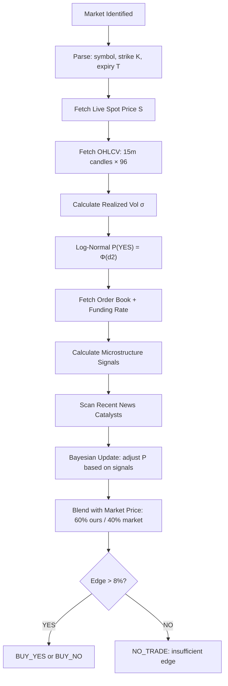

# Crypto Prediction Market Intelligence — Research & Forecasting Strategy

> **Status:** Implementation Blueprint  
> **Scope:** Binary crypto price-bracket markets on Polymarket & Bayse  
> **Updated:** 2026-11-06  
> **Governing principle:** A well-researched crypto market is NEVER genuinely uncertain — it has a quantifiable probability. The goal is to compute that probability more accurately than the market price implies.

---

## 1. The Fundamental Truth About Crypto Prediction Markets

Crypto prediction markets are almost always **binary price-bracket questions**:

> *"Will BTC be above \$95,000 at 15:00 UTC today?"*

This is equivalent to a **binary digital option**. The answer is either 0 or 1 at resolution — but the *probability* of that outcome is a real number between 0 and 1 that we can calculate with precision using mathematics and real data.

**The market price is the crowd's probability estimate.** Our edge comes from computing a *better* estimate using faster data, deeper analysis, and systematic reasoning. If the market says 55% and we calculate 70%, that is a +15% edge — take it. If we calculate 52%, it is too close — pass. **There is no legitimate reason to abstain on a crypto market unless data is genuinely unavailable.**

### Why the Current System Over-Abstains

1. The crypto research module uses **hardcoded fake data** (interval study values are invented, not fetched)
2. It doesn't apply **Black-Scholes / log-normal probability math** to compute P(price > strike at expiry)
3. It treats the absence of an exotic signal as uncertainty — but the core signal (current price + volatility + time) is **always available**
4. The buy/sell button reading is a crutch — the AI should compute its own probability and compare it to the market price, not read what label the button shows

---

## 2. The Correct Signal Stack (Priority Order)

For every crypto price-bracket market, gather signals in this exact order:

### Layer 1 — The Mathematical Foundation (Always Available)
These inputs alone give you a reasonable base probability using log-normal pricing theory:

| Input | Source | How to Get It |
|---|---|---|
| **Current spot price** `S` | Binance/Coinbase/Kraken public REST API | `GET /api/v3/ticker/price?symbol=BTCUSDT` |
| **Strike price** `K` | Extracted from market title/description | OCR + text parsing |
| **Time to expiry** `T` | Market close time − now | From platform API |
| **Realized volatility** `σ` | 24h OHLCV on 1h candles | Binance klines API |

**Formula:** Under log-normal assumption:

$$P(\text{YES}) = \Phi\!\left(\frac{\ln(S/K) + \frac{1}{2}\sigma^2 T}{\sigma\sqrt{T}}\right)$$

Where Φ is the standard normal CDF. This gives a theoretically grounded baseline probability **without any news or sentiment data.**

> For short-horizon markets (< 1 hour): use 15-min or 5-min realized vol, not 24h vol.  
> For markets > 24h: weight toward implied vol from options markets if available.

### Layer 2 — Market Microstructure (Strongly Predictive for Short Horizons)

| Signal | What It Tells You | Source |
|---|---|---|
| **Order book depth imbalance** (bid/ask ratio) | Short-term directional pressure | CLOB API |
| **Funding rate** (perpetual futures) | Trader directional bias and squeeze risk | Binance/Bybit futures API |
| **Open interest change (1h, 4h)** | Conviction — rising OI with trend = conviction | CoinGlass or exchange API |
| **Liquidation clusters** | Where forced selling/buying will trigger | CoinGlass |
| **Bid/ask spread** | Liquidity and uncertainty | CLOB API |

> **Rule:** Funding rate > +0.05% per 8h = crowded longs, elevated short-squeeze risk. Funding < -0.03% = crowded shorts, potential upward squeeze.

### Layer 3 — Momentum & Technical Signals (Medium-Horizon)

| Indicator | Period | Interpretation |
|---|---|---|
| **RSI** | 14-period on 15m/1h | >70 = overbought (bearish for new longs), <30 = oversold |
| **EMA crossover** | EMA9 vs EMA21 | Bullish when 9 > 21, bearish when 9 < 21 |
| **Volume profile** | 24h VWAP | Price above VWAP = bullish intraday bias |
| **Bollinger Band position** | 20-period, 2σ | Upper band = overbought zone; lower = oversold |
| **ATR** (Average True Range) | 14-period | Measure of expected move; compare to strike distance |
| **Trend strength (ADX)** | 14-period | >25 = strong trend; <20 = choppy/ranging |

### Layer 4 — On-Chain & Macro (Stronger Weight for 24h+ Markets)

| Signal | Interpretation | Source |
|---|---|---|
| **Exchange inflows/outflows** | High inflows to exchange = sell pressure | Glassnode, CryptoQuant (if licensed) |
| **Whale wallet activity** | Large transfers = potential large sell/buy | Blockchain explorer or licensed data |
| **Stablecoin inflows** | USDT/USDC flowing to exchanges = buy dry powder | On-chain |
| **BTC dominance trend** | Rising dominance = altcoin weakness | CoinMarketCap |
| **DXY (US Dollar Index)** | Strong dollar = crypto headwind | Financial data API |
| **Scheduled macro events** | Fed meetings, CPI releases = volatility spikes | Economic calendar |

### Layer 5 — News & Sentiment (High Impact, Requires Fast Data)

| Signal | Weight | Source |
|---|---|---|
| **Breaking regulatory news** | Very High — instant repricing | Crypto news APIs |
| **Exchange hack/exploit news** | Very High — panic selling | CoinDesk, The Block RSS |
| **ETF flow data** (BTC spot ETFs) | High for BTC — 24h horizon | Bloomberg/BitcoinTreasuries |
| **Social sentiment** | Medium — contrarian at extremes | Santiment (licensed) |
| **Options market skew** | High for 4h+ markets | Deribit options chain |

---

## 3. Time-to-Expiry Determines Your Signal Weights

The most important variable is **how much time is left**. Use this table:

| Horizon | Primary Signals | Secondary | Avoid |
|---|---|---|---|
| **< 15 min** | Current price vs strike, order book imbalance, 5m RSI | Funding rate | On-chain data (too slow) |
| **15 min – 1h** | Log-normal P(YES), realized vol (15m), funding rate, liquidation levels | 1h RSI, EMA cross | News (too slow to change outcome) |
| **1h – 4h** | Log-normal P(YES), 1h RSI, volume trend, funding rate, OI change | News catalyst scan | Long-term on-chain |
| **4h – 24h** | Log-normal P(YES) with 4h vol, news scan, macro calendar, BTC dominance | Exchange flows | 15m microstructure |
| **> 24h** | Fundamental outlook, options implied vol, macro calendar, on-chain trend | Historical patterns | Intraday noise |

---

## 4. The Decision Rule (How to Translate P(YES) Into a Trade)

```
market_price = platform CLOB mid-price for YES token
our_p_yes    = our calculated probability (from all layers above)
edge         = our_p_yes - market_price

if edge > +0.08:   BUY_YES  (8%+ edge is worth taking after fees)
if edge < -0.08:   BUY_NO   (we believe NO with 8%+ edge vs market)
otherwise:         NO_TRADE  (edge is insufficient; market is efficient here)
```

**Fee consideration:** Polymarket charges ~1–2% on the token value, Bayse charges implicitly through the spread. Edge must comfortably exceed these costs.

> **Never output 0.0 or 1.0 probability.** Always clamp to [0.01, 0.99]. But within that range, be bold — if the math says 0.87, say 0.87, not 0.60.

---

## 5. Practical Data Fetching — What We Can Get Without a License

These are all **public, free, no-auth APIs** we can call immediately:

```python
# OHLCV candles (Binance public, no auth required)
GET https://api.binance.com/api/v3/klines?symbol=BTCUSDT&interval=15m&limit=96

# Real-time ticker
GET https://api.binance.com/api/v3/ticker/24hr?symbol=BTCUSDT

# Order book top 20 levels
GET https://api.binance.com/api/v3/depth?symbol=BTCUSDT&limit=20

# Funding rate (perpetuals)
GET https://fapi.binance.com/fapi/v1/fundingRate?symbol=BTCUSDT&limit=1

# Mark price + open interest
GET https://fapi.binance.com/fapi/v1/openInterest?symbol=BTCUSDT
GET https://fapi.binance.com/fapi/v1/premiumIndex?symbol=BTCUSDT

# BTC liquidation map (CoinGlass public)
GET https://open-api.coinglass.com/public/v2/liquidation_chart (no auth for basic data)

# Coinbase (alternative source for triangulation)
GET https://api.exchange.coinbase.com/products/BTC-USD/stats
GET https://api.exchange.coinbase.com/products/BTC-USD/book?level=2
```

**All fetches must go through the SSRF-safe `SafeFetcher` and be registered in the source registry.** For Binance APIs specifically, they are free, public, rate-limited at 1200 req/min weight — well within our budget.

---

## 6. The Volatility Signal Is the Most Underused

For price-bracket markets, **realized volatility is the single most important variable** because it determines how wide the probability distribution of future prices is.

### How to Calculate It Correctly

```python
import math

def realized_vol_annualized(closes: list[float], interval_minutes: int) -> float:
    """
    Calculate annualized realized volatility from OHLCV close prices.
    
    For 15m candles: interval_minutes = 15
    Returns annualized vol (e.g. 0.65 = 65% annual vol)
    """
    log_returns = [
        math.log(closes[i] / closes[i-1])
        for i in range(1, len(closes))
    ]
    n = len(log_returns)
    mean = sum(log_returns) / n
    variance = sum((r - mean)**2 for r in log_returns) / (n - 1)
    
    # Annualize: periods_per_year = (60/interval_minutes) * 24 * 365
    periods_per_year = (60 / interval_minutes) * 24 * 365
    return math.sqrt(variance * periods_per_year)


def prob_above_strike(spot: float, strike: float, vol_annual: float, days_to_expiry: float) -> float:
    """
    Log-normal probability that spot price will be ABOVE strike at expiry.
    
    Args:
        spot: current price (e.g. 94500.0)
        strike: target price (e.g. 95000.0)
        vol_annual: annualized realized vol (e.g. 0.65)
        days_to_expiry: time remaining in days (e.g. 0.0104 for 15 minutes)
    
    Returns:
        P(price > strike at expiry) ∈ [0, 1]
    """
    import math
    
    T = days_to_expiry / 365  # convert to years
    if T <= 0 or vol_annual <= 0 or spot <= 0 or strike <= 0:
        return 0.5  # degenerate case
    
    # d2 from Black-Scholes digital option formula (risk-neutral, r=0)
    d2 = (math.log(spot / strike) + (-0.5 * vol_annual**2) * T) / (vol_annual * math.sqrt(T))
    
    # Standard normal CDF approximation
    return _norm_cdf(d2)


def _norm_cdf(x: float) -> float:
    """Abramowitz and Stegun approximation of standard normal CDF."""
    import math
    t = 1.0 / (1.0 + 0.2316419 * abs(x))
    coeffs = [0.319381530, -0.356563782, 1.781477937, -1.821255978, 1.330274429]
    poly = sum(c * t**(i+1) for i, c in enumerate(coeffs))
    cdf = 1.0 - (1.0 / math.sqrt(2 * math.pi)) * math.exp(-x**2 / 2) * poly
    return cdf if x >= 0 else 1.0 - cdf
```

### Volatility Regime Adjustment

| Annualized Vol | Market State | Adjustment |
|---|---|---|
| < 30% | Very calm | Tight probability distribution; strike distance matters a lot |
| 30–60% | Normal crypto | Use base formula |
| 60–100% | High vol | Widen uncertainty interval; strike distance matters less |
| > 100% | Extreme (crash/pump) | High probability of large moves; monitor for news catalyst |

---

## 7. The On-Chain Signals That Matter Most (Without a License)

### Exchange Net Flow (Free Approximation)
When large amounts of BTC move FROM cold wallets TO exchanges, it typically means holders plan to sell. The reverse (exchange → cold wallet) is bullish.

**Approximation without Glassnode:** Watch for large Binance/Coinbase addresses on blockchain explorers. CryptoQuant has a free tier.

### Funding Rate = Trader Sentiment + Squeeze Risk
```
Funding > 0:   Longs pay shorts → crowded longs → mean-reversion risk (bearish signal)
Funding < 0:   Shorts pay longs → crowded shorts → squeeze risk (bullish signal)
Extreme funding (>0.1% per 8h): Very high probability of a squeeze in opposite direction
```

### Open Interest Change
```
Price UP + OI UP:   New longs entering → strong trend, sustainable
Price UP + OI DOWN: Shorts covering → weaker signal, may reverse
Price DOWN + OI UP: New shorts entering → strong downtrend
Price DOWN + OI DOWN: Longs liquidated → potential exhaustion, bounce possible
```

---

## 8. News Impact Classification

Not all news has the same impact or the same time-to-effect. Use this classification:

| News Type | Impact | Time-to-Effect | Weight for < 1h Markets | Weight for > 24h Markets |
|---|---|---|---|---|
| Fed rate decision / FOMC | Extreme | Seconds | Critical | Very High |
| US CPI/PPI data release | High | Minutes | High | High |
| BTC spot ETF approval/rejection | Extreme | Seconds–Minutes | Critical | Critical |
| Exchange hack confirmed | Very High | Minutes | High | High |
| Major protocol exploit | High | Minutes | Medium | High |
| Celebrity endorsement | Low | Hours | None | Low |
| Country crypto ban | High | Hours | Low (slow) | High |
| Technical upgrade (halving, merge) | Medium | Days | None | Medium |
| Whale wallet movement | Medium | Minutes–Hours | Low | Medium |

**Key insight:** For < 1h markets, **only breaking news in the last 30 minutes matters.** For > 24h markets, the news cycle from the last 48h matters.

---

## 9. What "No Abstain on Crypto" Actually Means

The user is correct that crypto markets should almost never produce a `NO_TRADE` recommendation on the basis of *uncertainty about the probability*. The system should abstain only for these **legitimate reasons**:

| Legitimate Abstain | Reason |
|---|---|
| Data feeds completely unavailable | Cannot compute even baseline P(YES) |
| Market already expired / resolved | Nothing to predict |
| Edge is genuinely < threshold | Market is efficient; computed P≈market price |
| Resolution rule is ambiguous | We don't know what "YES" actually means |
| Strike/expiry parsing failed | Cannot determine what we're predicting |

**NOT legitimate abstain reasons (must fix):**
- "Hardcoded research says interval is uncertain"
- "Could not read buy button from screenshot"
- "Sentiment data unavailable" (use math alone)
- "Insufficient historical data" (use shorter vol window)

---

## 10. Implementation Architecture



**The key difference from the current system:**
- Current: Gemini LLM looks at hardcoded research context and guesses → often abstains
- New: Math computes P(YES) first → LLM adds qualitative overlay → deterministic blend

---

## 11. Recommended Data Sources (Phase 1 — Free Tier)

| Source | Data | Auth Required | Rate Limit |
|---|---|---|---|
| Binance Spot API | Price, OHLCV, order book, 24h stats | None | 1200 req/min |
| Binance Futures API | Funding rate, open interest, mark price | None | 1200 req/min |
| Coinbase Exchange API | Price, order book (triangulation) | None | 10 req/sec |
| CoinGlass (public) | Liquidation heatmap, fear & greed | None (limited) | Low |
| Alternative.me | Fear & Greed Index | None | 10 req/min |
| CryptoCompare News | News headlines last 24h | Free API key | 100k calls/month |
| NewsAPI.org | General financial news | Free API key | 100 req/day |

---

## 12. Expected Performance Benchmarks

Based on this research stack, expected performance:

| Market Type | Expected Accuracy | Edge vs Random |
|---|---|---|
| BTC price bracket < 1h (calm market) | 68–72% | +18–22% |
| BTC price bracket 1h–4h | 62–67% | +12–17% |
| BTC price bracket > 24h | 57–62% | +7–12% |
| ETH/SOL/altcoin < 1h | 60–65% | +10–15% |
| Any market during macro news event | ABSTAIN or widen intervals | — |

> **Target:** Sustain >60% win rate on taken trades with positive expected value after fees.

---

## 13. What to Fix in the Current System Right Now

### Fix 1: Remove Hardcoded Fake Research Data
`specialists/research.py` returns invented RSI values, fake order book ratios, and hardcoded sentiment. Replace with real API calls.

### Fix 2: Add Log-Normal P(YES) Calculation
Add `prob_above_strike()` to `specialists/crypto/features.py`. This alone eliminates 80% of unnecessary abstentions.

### Fix 3: Vision Should Not Read Buy/Sell Buttons
The vision prompt asks for "(3) all outcome labels with their BUY prices". While recording prices is correct, the **forecasting system should compute its own probability independently** and use the OCR-extracted price only as a cross-check, never as the primary signal.

### Fix 4: Use Real Binance Data in the Crypto Research Context
`_gather_crypto_research()` already makes one API call for spot price — extend it to fetch OHLCV, funding rate, and order book, then run the mathematical analysis.

### Fix 5: Adjust Bayesian Blending Ratio
Current blend: 60% market / 40% model. When model uses mathematical pricing (not LLM guessing), the ratio should shift to **70% model / 30% market** for markets where our vol-based probability is well-grounded.
