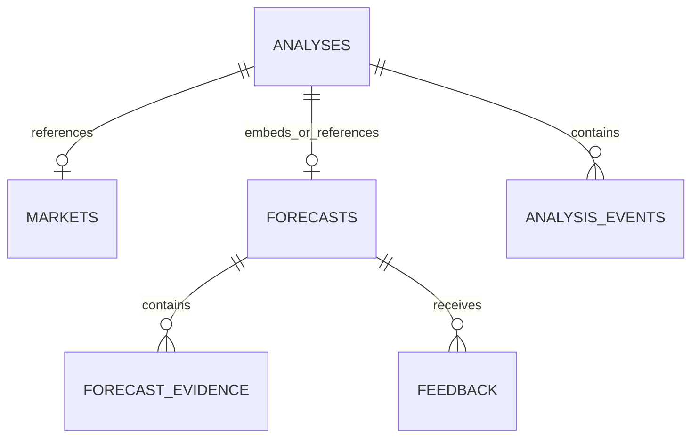

# Database Architecture & Data Model — Prediction Intelligence Platform

> **Governing Standards:** This document provides the database and persistence specification for the platform. It documents the MongoDB document store architecture as the primary authority, along with schema definitions and collections. See also [`prediction-intelligence-engineering-rules.md`](file:///Users/mac/prediction-market/prediction-intelligence-engineering-rules.md) and [`prediction-intelligence-platform-technical-plan.md`](file:///Users/mac/prediction-market/prediction-intelligence-platform-technical-plan.md).

---

## 1. MongoDB Document Collections Overview



The database operates on four primary MongoDB collections managed asynchronously via `motor.motor_asyncio` and `pymongo`:

| Collection | Role | Key Fields |
|---|---|---|
| `analyses` | Multi-stage analysis state & visual extraction | `analysis_id`, `status`, `events`, `hint`, `object_path`, `extraction_result`, `image_description`, `verification_result`, `forecast` |
| `markets` | Verified venue contracts (Polymarket/Bayse) | `_id`, `platform`, `platform_market_id`, `title`, `slug`, `category`, `outcomes`, `resolves_at`, `status` |
| `forecasts` | Calibrated probabilistic decisions & evidence | `_id`, `analysis_id`, `probability_yes`, `probability_no`, `recommendation`, `decision_metrics`, `evidence`, `specialist_context` |
| `feedback` | Continuous learning & trade postmortems | `_id`, `analysis_id`, `actual_outcome`, `was_correct`, `postmortem_analysis`, `key_learnings`, `created_at` |

---

## 2. Document Collection Specifications

### 2.1 `analyses` Collection
Stores the complete lifecycle of a screenshot analysis:
```json
{
  "_id": "9b1deb4d-3b7d-4bad-9bdd-2b0d7b3dcb6d",
  "analysis_id": "9b1deb4d-3b7d-4bad-9bdd-2b0d7b3dcb6d",
  "user_id": "00000000-0000-0000-0000-000000000001",
  "status": "COMPLETED",
  "hint": "polymarket.com/market/bitcoin-100k-15m",
  "object_path": "00000000-0000-0000-0000-000000000001/asset-uuid.webp",
  "created_at": "2026-11-04T12:00:00Z",
  "updated_at": "2026-11-04T12:00:05Z",
  "completed_at": "2026-11-04T12:00:05Z",
  "image_description": "A dark mode screenshot of a Polymarket crypto contract displaying Bitcoin 15-minute price bracket.",
  "extraction_result": {
    "platform": "polymarket",
    "market_title": "Will Bitcoin break $100k in next 15 mins?",
    "visual_caption": "A dark mode screenshot...",
    "category": "crypto",
    "overall_confidence": 0.94
  },
  "verification_result": {
    "status": "VERIFIED",
    "score": 0.96,
    "discrepancies": []
  },
  "events": [
    {
      "sequence_number": 1,
      "event_type": "analysis.stage",
      "stage": "IMAGE_VALIDATION",
      "payload": { "status": "completed" },
      "created_at": "2026-11-04T12:00:01Z"
    }
  ],
  "forecast": { /* Embedded Forecast Document */ }
}
```

### 2.2 `feedback` Collection (Continuous Learning)
Stores actual trade settlement outcomes and AI postmortem lessons for self-improvement:
```json
{
  "_id": "feedback-uuid",
  "analysis_id": "9b1deb4d-3b7d-4bad-9bdd-2b0d7b3dcb6d",
  "user_id": "00000000-0000-0000-0000-000000000001",
  "category": "crypto",
  "market_title": "Will Bitcoin break $100k in next 15 mins?",
  "recommendation": "BUY_YES",
  "actual_outcome": "YES",
  "was_correct": true,
  "settled_price": 1.0,
  "user_notes": "Target reached at minute 8 of the candle.",
  "postmortem_analysis": "Prediction successfully aligned with market resolution (YES). Confluence of order book momentum and specialist intervals validated.",
  "key_learnings": [
    "Validation successful on CRYPTO: order book momentum and interval depth accurately indicated outcome.",
    "Preserve conservative Kelly sizing discipline and minimum net edge threshold."
  ],
  "created_at": "2026-11-04T12:15:30Z"
}
```

---

## 3. Relational Schema Reference (Optional PostgreSQL Compatibility)
    owner_id UUID NOT NULL REFERENCES profiles(id) ON DELETE CASCADE,
    bucket TEXT NOT NULL DEFAULT 'screenshots',
    object_path TEXT NOT NULL UNIQUE,
    mime_type TEXT NOT NULL CHECK (mime_type IN ('image/png', 'image/jpeg', 'image/webp', 'application/pdf')),
    size_bytes BIGINT NOT NULL CHECK (size_bytes > 0 AND size_bytes <= 10485760), -- Max 10MB
    sha256 TEXT NOT NULL,
    asset_type TEXT NOT NULL CHECK (asset_type IN ('screenshot', 'research_document')),
    created_at TIMESTAMPTZ NOT NULL DEFAULT timezone('utc', now())
);

CREATE INDEX idx_uploaded_assets_owner ON uploaded_assets(owner_id, created_at DESC);
CREATE INDEX idx_uploaded_assets_hash ON uploaded_assets(sha256);
```

---

### 2.2 Analysis Lifecycle & Real-Time Events

#### `analyses`
Root record tracking user screenshot submissions.
```sql
CREATE TYPE analysis_status AS ENUM (
    'RECEIVED',
    'IMAGE_VALIDATION',
    'SCREENSHOT_EXTRACTION',
    'MARKET_IDENTIFICATION',
    'NEEDS_USER_CONFIRMATION',
    'MARKET_VERIFICATION',
    'DATA_COLLECTION',
    'RESEARCH',
    'FEATURE_BUILDING',
    'FORECASTING',
    'DECISION_EVALUATION',
    'COMPLETED',
    'UNSUPPORTED_MARKET',
    'MARKET_NOT_FOUND',
    'DATA_STALE',
    'INSUFFICIENT_DATA',
    'RESEARCH_FAILED',
    'FORECAST_FAILED',
    'CANCELLED',
    'FAILED'
);

CREATE TABLE analyses (
    id UUID PRIMARY KEY DEFAULT gen_random_uuid(),
    user_id UUID NOT NULL REFERENCES profiles(id) ON DELETE CASCADE,
    status analysis_status NOT NULL DEFAULT 'RECEIVED',
    platform TEXT CHECK (platform IN ('polymarket', 'bayse', 'unknown')),
    market_id UUID REFERENCES prediction_markets(id) ON DELETE SET NULL,
    screenshot_asset_id UUID REFERENCES uploaded_assets(id) ON DELETE RESTRICT,
    extraction_result JSONB,
    verification_result JSONB,
    error_code TEXT,
    error_message TEXT,
    created_at TIMESTAMPTZ NOT NULL DEFAULT timezone('utc', now()),
    updated_at TIMESTAMPTZ NOT NULL DEFAULT timezone('utc', now()),
    completed_at TIMESTAMPTZ
);

CREATE INDEX idx_analyses_user_created ON analyses(user_id, created_at DESC);
CREATE INDEX idx_analyses_status ON analyses(status);
CREATE INDEX idx_analyses_market ON analyses(market_id);
```

#### `analysis_events`
Append-only log of pipeline progress for Server-Sent Events (SSE) streaming and replay.
```sql
CREATE TABLE analysis_events (
    id BIGSERIAL PRIMARY KEY,
    analysis_id UUID NOT NULL REFERENCES analyses(id) ON DELETE CASCADE,
    sequence_number INT NOT NULL,
    stage TEXT NOT NULL,
    payload JSONB NOT NULL DEFAULT '{}'::jsonb,
    created_at TIMESTAMPTZ NOT NULL DEFAULT timezone('utc', now()),
    CONSTRAINT uq_analysis_event_seq UNIQUE (analysis_id, sequence_number)
);

CREATE INDEX idx_analysis_events_replay ON analysis_events(analysis_id, id ASC);
```

---

### 2.3 Prediction Markets & Exchange Data

#### `prediction_markets`
Normalized prediction-market identity across Polymarket and Bayse.
```sql
CREATE TABLE prediction_markets (
    id UUID PRIMARY KEY DEFAULT gen_random_uuid(),
    platform TEXT NOT NULL CHECK (platform IN ('polymarket', 'bayse')),
    platform_market_id TEXT NOT NULL,
    platform_event_id TEXT,
    slug TEXT,
    title TEXT NOT NULL,
    description TEXT,
    category TEXT NOT NULL CHECK (category IN ('crypto', 'sports', 'news', 'finance', 'other')),
    market_type TEXT NOT NULL, -- e.g. binary_threshold, expiry_range
    underlying_symbol TEXT,    -- e.g. BTC/USD
    outcomes JSONB NOT NULL,   -- Array of {outcome_id, label, token_id}
    opens_at TIMESTAMPTZ,
    closes_at TIMESTAMPTZ,
    resolves_at TIMESTAMPTZ,
    resolution_source TEXT NOT NULL,
    resolution_criteria TEXT NOT NULL,
    status TEXT NOT NULL DEFAULT 'active' CHECK (status IN ('active', 'closed', 'resolved', 'void', 'disputed')),
    raw_metadata JSONB NOT NULL DEFAULT '{}'::jsonb,
    last_verified_at TIMESTAMPTZ,
    created_at TIMESTAMPTZ NOT NULL DEFAULT timezone('utc', now()),
    updated_at TIMESTAMPTZ NOT NULL DEFAULT timezone('utc', now()),
    CONSTRAINT uq_platform_market UNIQUE (platform, platform_market_id)
);

CREATE INDEX idx_markets_platform_slug ON prediction_markets(platform, slug);
CREATE INDEX idx_markets_status_resolves ON prediction_markets(status, resolves_at);
CREATE INDEX idx_markets_underlying ON prediction_markets(underlying_symbol);
```

#### `market_snapshots`
Point-in-time quotes, spreads, and order-book depth for verified markets.
```sql
CREATE TABLE market_snapshots (
    id UUID PRIMARY KEY DEFAULT gen_random_uuid(),
    market_id UUID NOT NULL REFERENCES prediction_markets(id) ON DELETE CASCADE,
    observed_at TIMESTAMPTZ NOT NULL,
    ingested_at TIMESTAMPTZ NOT NULL DEFAULT timezone('utc', now()),
    outcome_quotes JSONB NOT NULL, -- {outcome_id: {best_bid, best_ask, mid, depth}}
    liquidity NUMERIC(18, 4),
    spread NUMERIC(10, 6),
    provider_sequence TEXT,
    quality_flags JSONB NOT NULL DEFAULT '{}'::jsonb
);

CREATE INDEX idx_market_snapshots_lookup ON market_snapshots(market_id, observed_at DESC);
```

#### `market_data_observations`
High-volume normalized exchange time-series (candles, tickers, volume).
```sql
CREATE TABLE market_data_observations (
    id BIGSERIAL,
    source TEXT NOT NULL,              -- e.g. 'binance', 'coinbase'
    symbol TEXT NOT NULL,              -- e.g. 'BTCUSDT'
    data_type TEXT NOT NULL,           -- 'candle', 'ticker', 'depth_imbalance'
    interval TEXT,                     -- '1m', '5m', '15m', '1h'
    event_at TIMESTAMPTZ NOT NULL,
    ingested_at TIMESTAMPTZ NOT NULL DEFAULT timezone('utc', now()),
    open_price NUMERIC(18, 8),
    high_price NUMERIC(18, 8),
    low_price NUMERIC(18, 8),
    close_price NUMERIC(18, 8),
    volume NUMERIC(24, 8),
    feature_payload JSONB,
    quality_flags JSONB NOT NULL DEFAULT '{}'::jsonb,
    PRIMARY KEY (id, event_at)
) PARTITION BY RANGE (event_at);

-- Partitioning example: Monthly partitions
CREATE TABLE market_data_obs_2026_11 PARTITION OF market_data_observations
    FOR VALUES FROM ('2026-11-01 00:00:00+00') TO ('2026-12-01 00:00:00+00');

CREATE INDEX idx_market_data_query ON market_data_observations(source, symbol, interval, event_at DESC);
```

---

### 2.4 Research, Document Ingestion & `pgvector`

#### `research_sources`
Admin-governed registry of approved information sources.
```sql
CREATE TABLE research_sources (
    id UUID PRIMARY KEY DEFAULT gen_random_uuid(),
    name TEXT NOT NULL UNIQUE,
    domain TEXT UNIQUE,
    source_type TEXT NOT NULL CHECK (source_type IN ('official_oracle', 'exchange', 'publisher', 'academic', 'social', 'macro_calendar')),
    authority_score NUMERIC(3, 2) NOT NULL CHECK (authority_score >= 0.0 AND authority_score <= 1.0),
    topics TEXT[] NOT NULL DEFAULT '{}',
    permissions JSONB NOT NULL DEFAULT '{}'::jsonb,
    enabled BOOLEAN NOT NULL DEFAULT true,
    created_at TIMESTAMPTZ NOT NULL DEFAULT timezone('utc', now())
);
```

#### `research_documents`
Retrieved articles, official announcements, and regulatory filings.
```sql
CREATE TABLE research_documents (
    id UUID PRIMARY KEY DEFAULT gen_random_uuid(),
    source_id UUID REFERENCES research_sources(id) ON DELETE SET NULL,
    canonical_url TEXT,
    title TEXT NOT NULL,
    author TEXT,
    published_at TIMESTAMPTZ,
    event_at TIMESTAMPTZ,
    retrieved_at TIMESTAMPTZ NOT NULL DEFAULT timezone('utc', now()),
    ingested_at TIMESTAMPTZ NOT NULL DEFAULT timezone('utc', now()),
    content_hash TEXT NOT NULL UNIQUE,
    language TEXT DEFAULT 'en',
    document_type TEXT NOT NULL CHECK (document_type IN ('article', 'announcement', 'filing', 'paper')),
    storage_path TEXT,
    metadata JSONB NOT NULL DEFAULT '{}'::jsonb
);

CREATE INDEX idx_research_docs_pub ON research_documents(published_at DESC);
CREATE INDEX idx_research_docs_retrieved ON research_documents(retrieved_at DESC);
```

#### `research_chunks`
Vectorized semantic passages with HNSW cosine index.
```sql
CREATE EXTENSION IF NOT EXISTS vector;

CREATE TABLE research_chunks (
    id UUID PRIMARY KEY DEFAULT gen_random_uuid(),
    document_id UUID NOT NULL REFERENCES research_documents(id) ON DELETE CASCADE,
    chunk_index INT NOT NULL,
    content TEXT NOT NULL,
    embedding VECTOR(1536) NOT NULL,
    embedding_model TEXT NOT NULL, -- e.g. 'text-embedding-3-small'
    metadata JSONB NOT NULL DEFAULT '{}'::jsonb,
    created_at TIMESTAMPTZ NOT NULL DEFAULT timezone('utc', now()),
    CONSTRAINT uq_doc_chunk UNIQUE (document_id, chunk_index)
);

CREATE INDEX idx_research_chunks_hnsw 
ON research_chunks 
USING hnsw (embedding vector_cosine_ops)
WITH (m = 16, ef_construction = 64);
```

---

### 2.5 Forecasts, Evidence & Decision Ledger

#### `model_versions`
Registry tracking candidate, champion, and retired forecasting models.
```sql
CREATE TABLE model_versions (
    id UUID PRIMARY KEY DEFAULT gen_random_uuid(),
    model_name TEXT NOT NULL,
    version TEXT NOT NULL UNIQUE,
    domain TEXT NOT NULL CHECK (domain IN ('crypto', 'sports', 'news', 'finance')),
    model_type TEXT NOT NULL,      -- e.g. 'lightgbm', 'xgboost', 'logistic_regression'
    artifact_uri TEXT NOT NULL,
    artifact_sha256 TEXT NOT NULL,
    feature_schema JSONB NOT NULL,
    training_window_start TIMESTAMPTZ NOT NULL,
    training_window_end TIMESTAMPTZ NOT NULL,
    validation_brier_score NUMERIC(6, 5) NOT NULL,
    validation_log_loss NUMERIC(6, 5) NOT NULL,
    status TEXT NOT NULL DEFAULT 'candidate' CHECK (status IN ('candidate', 'shadow', 'champion', 'retired')),
    approved_by TEXT,
    approved_at TIMESTAMPTZ,
    rollback_version TEXT,
    created_at TIMESTAMPTZ NOT NULL DEFAULT timezone('utc', now())
);
```

#### `forecasts`
Immutable prediction ledger. Records the complete point-in-time snapshot.
```sql
CREATE TYPE recommendation_type AS ENUM (
    'BUY_YES',
    'BUY_NO',
    'SELL_YES',
    'SELL_NO',
    'NO_TRADE'
);

CREATE TABLE forecasts (
    id UUID PRIMARY KEY DEFAULT gen_random_uuid(),
    analysis_id UUID NOT NULL UNIQUE REFERENCES analyses(id) ON DELETE RESTRICT,
    user_id UUID NOT NULL REFERENCES profiles(id) ON DELETE CASCADE,
    market_id UUID NOT NULL REFERENCES prediction_markets(id) ON DELETE RESTRICT,
    forecasted_at TIMESTAMPTZ NOT NULL DEFAULT timezone('utc', now()),
    target_definition JSONB NOT NULL,
    probability_yes NUMERIC(5, 4) NOT NULL CHECK (probability_yes >= 0.0 AND probability_yes <= 1.0),
    probability_no NUMERIC(5, 4) NOT NULL CHECK (probability_no >= 0.0 AND probability_no <= 1.0),
    uncertainty_interval NUMERIC(5, 4)[] CHECK (array_length(uncertainty_interval, 1) = 2),
    recommendation recommendation_type NOT NULL,
    decision_metrics JSONB NOT NULL, -- {net_edge, min_required_edge, ask_yes, fee, slippage}
    data_quality JSONB NOT NULL,     -- {market_verified, critical_feeds_fresh, warnings}
    model_version TEXT NOT NULL REFERENCES model_versions(version) ON DELETE RESTRICT,
    calibration_version TEXT,
    prompt_version TEXT NOT NULL,
    decision_policy_version TEXT NOT NULL,
    input_snapshot JSONB NOT NULL,   -- Cryptographic hashes and IDs of all inputs
    explanation JSONB NOT NULL,      -- Structured points, bullish/bearish signals
    created_at TIMESTAMPTZ NOT NULL DEFAULT timezone('utc', now()),
    CONSTRAINT chk_prob_sum CHECK (probability_yes + probability_no = 1.0)
);

CREATE INDEX idx_forecasts_user ON forecasts(user_id, forecasted_at DESC);
CREATE INDEX idx_forecasts_market ON forecasts(market_id, forecasted_at DESC);
CREATE INDEX idx_forecasts_model ON forecasts(model_version);

-- Immutability enforcement trigger: Block updates and deletions
CREATE OR REPLACE FUNCTION enforce_forecast_immutability()
RETURNS TRIGGER AS $$
BEGIN
    RAISE EXCEPTION 'Updates and deletions are strictly prohibited on the forecasts table.';
END;
$$ LANGUAGE plpgsql;

CREATE TRIGGER trg_forecasts_immutable
BEFORE UPDATE OR DELETE ON forecasts
FOR EACH ROW EXECUTE FUNCTION enforce_forecast_immutability();
```

#### `forecast_evidence`
Traceable links between forecasts and documentary research chunks.
```sql
CREATE TABLE forecast_evidence (
    id UUID PRIMARY KEY DEFAULT gen_random_uuid(),
    forecast_id UUID NOT NULL REFERENCES forecasts(id) ON DELETE CASCADE,
    chunk_id UUID REFERENCES research_chunks(id) ON DELETE SET NULL,
    evidence_type TEXT NOT NULL CHECK (evidence_type IN ('document_chunk', 'market_depth', 'candle_trend', 'announcement')),
    stance TEXT NOT NULL CHECK (stance IN ('supports_yes', 'supports_no', 'neutral')),
    relevance_score NUMERIC(3, 2) NOT NULL,
    snippet TEXT NOT NULL,
    source_citation TEXT NOT NULL,
    source_timestamp TIMESTAMPTZ
);

CREATE INDEX idx_forecast_evidence_f ON forecast_evidence(forecast_id);
```

---

### 2.6 Settlements, Feedback & Postmortems

#### `market_resolutions`
Official platform settlement results.
```sql
CREATE TABLE market_resolutions (
    id UUID PRIMARY KEY DEFAULT gen_random_uuid(),
    market_id UUID NOT NULL REFERENCES prediction_markets(id) ON DELETE RESTRICT,
    outcome TEXT NOT NULL CHECK (outcome IN ('YES', 'NO', 'VOID', 'DISPUTED', 'UNVERIFIABLE')),
    resolution_source TEXT NOT NULL,
    source_url TEXT,
    resolved_at TIMESTAMPTZ NOT NULL,
    retrieved_at TIMESTAMPTZ NOT NULL DEFAULT timezone('utc', now()),
    verified_by TEXT NOT NULL,
    raw_proof JSONB NOT NULL DEFAULT '{}'::jsonb,
    created_at TIMESTAMPTZ NOT NULL DEFAULT timezone('utc', now()),
    CONSTRAINT uq_market_resolution UNIQUE (market_id)
);
```

#### `user_prediction_feedback`
User outcome reporting, extraction error reports, and satisfaction scores.
```sql
CREATE TABLE user_prediction_feedback (
    id UUID PRIMARY KEY DEFAULT gen_random_uuid(),
    forecast_id UUID NOT NULL REFERENCES forecasts(id) ON DELETE CASCADE,
    user_id UUID NOT NULL REFERENCES profiles(id) ON DELETE CASCADE,
    reported_outcome TEXT CHECK (reported_outcome IN ('YES', 'NO', 'VOID', 'UNKNOWN')),
    is_extraction_correct BOOLEAN,
    explanation_usefulness_score INT CHECK (explanation_usefulness_score BETWEEN 1 AND 5),
    comment TEXT,
    created_at TIMESTAMPTZ NOT NULL DEFAULT timezone('utc', now())
);

CREATE INDEX idx_feedback_forecast ON user_prediction_feedback(forecast_id);
```

#### `forecast_postmortems`
Automated error diagnostics and post-resolution analysis.
```sql
CREATE TABLE forecast_postmortems (
    id UUID PRIMARY KEY DEFAULT gen_random_uuid(),
    forecast_id UUID NOT NULL UNIQUE REFERENCES forecasts(id) ON DELETE CASCADE,
    resolution_id UUID NOT NULL REFERENCES market_resolutions(id) ON DELETE RESTRICT,
    was_direction_correct BOOLEAN NOT NULL,
    brier_score_contribution NUMERIC(6, 5) NOT NULL,
    log_loss_contribution NUMERIC(6, 5) NOT NULL,
    root_cause_categories TEXT[] NOT NULL,
    diagnostic_report JSONB NOT NULL,
    proposed_experiments JSONB NOT NULL DEFAULT '[]'::jsonb,
    created_at TIMESTAMPTZ NOT NULL DEFAULT timezone('utc', now())
);
```

#### `audit_events`
Administrative and security event audit trail.
```sql
CREATE TABLE audit_events (
    id BIGSERIAL PRIMARY KEY,
    actor_id UUID REFERENCES profiles(id) ON DELETE SET NULL,
    action TEXT NOT NULL,
    resource_type TEXT NOT NULL,
    resource_id TEXT NOT NULL,
    ip_address INET,
    payload JSONB NOT NULL DEFAULT '{}'::jsonb,
    created_at TIMESTAMPTZ NOT NULL DEFAULT timezone('utc', now())
);

CREATE INDEX idx_audit_events_resource ON audit_events(resource_type, resource_id);
CREATE INDEX idx_audit_events_created ON audit_events(created_at DESC);
```

---

## 3. Row-Level Security (RLS) Policies

All user-facing tables enforce RLS:

```sql
-- Enable RLS on all user-owned tables
ALTER TABLE profiles ENABLE ROW LEVEL SECURITY;
ALTER TABLE uploaded_assets ENABLE ROW LEVEL SECURITY;
ALTER TABLE analyses ENABLE ROW LEVEL SECURITY;
ALTER TABLE analysis_events ENABLE ROW LEVEL SECURITY;
ALTER TABLE forecasts ENABLE ROW LEVEL SECURITY;
ALTER TABLE forecast_evidence ENABLE ROW LEVEL SECURITY;
ALTER TABLE user_prediction_feedback ENABLE ROW LEVEL SECURITY;

-- 1. Profiles: Users can read and update only their own profile
CREATE POLICY "Users view own profile" ON profiles
    FOR SELECT USING (auth.uid() = id);

CREATE POLICY "Users update own profile" ON profiles
    FOR UPDATE USING (auth.uid() = id);

-- 2. Uploaded Assets: Users can access only their own files
CREATE POLICY "Users view own assets" ON uploaded_assets
    FOR SELECT USING (auth.uid() = owner_id);

CREATE POLICY "Users insert own assets" ON uploaded_assets
    FOR INSERT WITH CHECK (auth.uid() = owner_id);

-- 3. Analyses: Users view and manage only their own analyses
CREATE POLICY "Users view own analyses" ON analyses
    FOR SELECT USING (auth.uid() = user_id);

CREATE POLICY "Users insert own analyses" ON analyses
    FOR INSERT WITH CHECK (auth.uid() = user_id);

-- 4. Analysis Events: Read-only access to events belonging to user's analyses
CREATE POLICY "Users view own analysis events" ON analysis_events
    FOR SELECT USING (
        EXISTS (
            SELECT 1 FROM analyses 
            WHERE analyses.id = analysis_events.analysis_id 
            AND analyses.user_id = auth.uid()
        )
    );

-- 5. Forecasts: Users view only their own forecasts
CREATE POLICY "Users view own forecasts" ON forecasts
    FOR SELECT USING (auth.uid() = user_id);

-- 6. Forecast Evidence: Accessible if parent forecast belongs to user
CREATE POLICY "Users view own forecast evidence" ON forecast_evidence
    FOR SELECT USING (
        EXISTS (
            SELECT 1 FROM forecasts 
            WHERE forecasts.id = forecast_evidence.forecast_id 
            AND forecasts.user_id = auth.uid()
        )
    );

-- 7. Feedback: Users insert and view their own feedback
CREATE POLICY "Users view own feedback" ON user_prediction_feedback
    FOR SELECT USING (auth.uid() = user_id);

CREATE POLICY "Users insert own feedback" ON user_prediction_feedback
    FOR INSERT WITH CHECK (auth.uid() = user_id);
```
