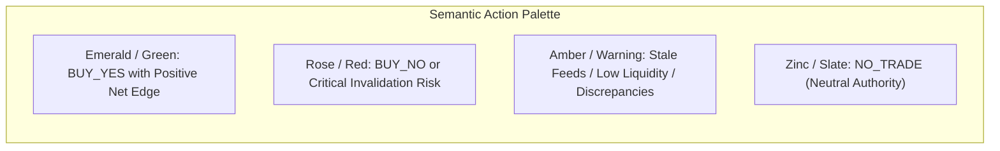

# Frontend Design Direction & UI/UX Standards — Prediction Intelligence Platform

> **Governing Standards:** This document details the visual design system, interaction patterns, information architecture, and accessibility standards for the frontend web application. See also [`prediction-intelligence-engineering-rules.md`](file:///Users/mac/prediction-market/prediction-intelligence-engineering-rules.md) and [`prediction-intelligence-platform-technical-plan.md`](file:///Users/mac/prediction-market/prediction-intelligence-platform-technical-plan.md).

---

## 1. Design Philosophy: The Institutional Intelligence Cockpit

The Prediction Intelligence Platform is an institutional decision-support and probabilistic reasoning tool. 
It is **not** a gamified gambling app or retail hype dashboard. 

### Core UI Axioms
1. **Financial Clarity Over Gamification:** Zero confetti, flashing neon badges, rocket ship emojis, or casino sounds.
2. **Uncertainty Must Be Visible:** Never display an artificial "99% Guaranteed" badge. Probabilities must always be accompanied by an uncertainty interval, calibration diagnostics, and source freshness indicators.
3. **Neutrality of Abstention:** A `NO_TRADE` recommendation is a successful analytical outcome. It must be styled with calm, neutral authority, never as an error or failure.
4. **Traceability of Every Claim:** Every supporting or contradicting factual statement displayed in the UI must feature an interactive citation badge linking directly to the verified source document.

---

## 2. Color System & Semantic Guardrails



### 2.1 The Non-Negotiable `NO_TRADE` Rule
> **MANDATORY RULE:** Under NO circumstances may a `NO_TRADE` recommendation be displayed using a green success badge. 
> Green is reserved exclusively for validated positive expected-value opportunities (`BUY_YES` or `BUY_NO`). 
> `NO_TRADE` must be rendered in **Zinc / Neutral Slate** (`bg-zinc-800 text-zinc-200 border-zinc-700`) with an explicit sub-caption explaining the gating reason (e.g., *"Statistical edge does not clear execution fees and uncertainty margin"*).

### 2.2 Color Token Palette (Dark Mode First)

| Token Name | Hex Code | Tailwind Utility | Semantic Role |
|---|---|---|---|
| `canvas-bg` | `#09090b` | `bg-zinc-950` | Primary application background |
| `surface-card` | `#18181b` | `bg-zinc-900` | Card containers and cockpit panels |
| `surface-border`| `#27272a` | `border-zinc-800` | Subtle structural division lines |
| `text-primary` | `#f4f4f5` | `text-zinc-100` | Market titles, recommendations, probabilities |
| `text-secondary`| `#a1a1aa` | `text-zinc-400` | Resolution criteria, metadata labels, timestamps |
| `brand-accent` | `#38bdf8` | `text-sky-400` | System status, active navigation, vector citations |
| `status-buy-yes`| `#10b981` | `text-emerald-500` | High-edge YES execution recommendations |
| `status-buy-no` | `#f43f5e` | `text-rose-500` | High-edge NO execution recommendations |
| `status-warning`| `#f59e0b` | `text-amber-500` | Stale feeds, thin depth, user confirmation required |
| `status-neutral`| `#71717a` | `text-zinc-500` | Inactive tabs, disabled states, unverified flags |

---

## 3. Screen Hierarchy & Component Specifications

### 3.1 Screen Layout Architecture

```text
+------------------------------------------------------------------------------------+
|  Top Navigation: Brand Logo | Active Market Breadcrumbs | User Profile | Mode Pill  |
+------------------------------------------------------------------------------------+
|                                                                                    |
|  [Market Header Cockpit]                                                          |
|  • Market Title: "Will Bitcoin exceed $100,000 on Binance by Nov 15, 2026?"        |
|  • Verification Badge: [VERIFIED EXACT - POLYMARKET] | Expiry: 2026-11-15 23:59 UTC |
|                                                                                    |
+--------------------------------------------------+---------------------------------+
|  [Left Column: Decision & Probability Engine]   |  [Right Column: Evidence Pack]  |
|                                                  |                                 |
|  1. Recommendation Banner:                       |  1. Data Quality & Freshness:   |
|     [ NO_TRADE ]                                 |     • Binance Spot Feed: 1.2s   |
|     "Estimated edge (0.8%) below threshold (4%)" |     • Polymarket CLOB: 1.8s     |
|                                                  |                                 |
|  2. Calibrated Probability Bar:                  |  2. Bullish Supporting Signals: |
|     YES: 64.0% [58.2% - 69.8%] | NO: 36.0%       |     • Multi-level book imbalance|
|     (Platt Sigmoid Calibrated | ECE: 0.038)      |     • ETF Inflow Net Acceleration|
|                                                  |                                 |
|  3. Executable Market Pricing (Live CLOB):       |  3. Bearish Counter-Signals:    |
|     • Best Ask (YES): $0.62 | Spread: 2.1%       |     • Futures Basis Contango Flat|
|     • Effective Cost (incl. fees): $0.632        |     • Regulatory Notice Pending |
|                                                  |                                 |
|  4. Expected Value Breakdown:                    |  4. Traceable Source Citations: |
|     • Net Edge: +0.8% | Required: +4.0%          |     • [Doc #84] SEC Filing (PDF)|
|     • Quarter-Kelly Sizing: 0.0% (Abstained)     |     • [Doc #12] Exchange Notice |
|                                                  |                                 |
+--------------------------------------------------+---------------------------------+
|  [Bottom Panel: Point-in-Time Audit & User Feedback Drawer]                       |
|  • Snapshot ID: 7c2deb4d | Model: lgbm_btc_v1.2 | Observed: 2026-11-04 10:45:00 UTC |
|  • [Submit Outcome Dispute] | [Rate Explanation] | [Download Immutable JSON]       |
+------------------------------------------------------------------------------------+
```

### 3.2 Key Interactive Components

#### 1. Screenshot Drag-and-Drop Uploader
- Accepts image files (PNG, JPEG, WebP) with drag-over hover feedback.
- Instant client-side file size verification ($< 10\text{ MB}$).
- Displays an instant image preview with visual bounding box highlights once extraction tokens return.
- Optional manual text input for market slug / URL override.

#### 2. Live SSE Progress Stage Bar
- Visual stepper indicating pipeline execution:
  `VALIDATING` $\rightarrow$ `EXTRACTING` $\rightarrow$ `MATCHING` $\rightarrow$ `INGESTING` $\rightarrow$ `FORECASTING` $\rightarrow$ `COMPLETED`.
- Active stage renders an animated pulse; completed stages render a solid checkmark.
- Reconnection banner displays automatically if network drops, showing reconnect countdown.

#### 3. Market Confirmation Diff Modal
- Renders side-by-side comparison between extracted screenshot text and official platform candidate:
  - Title comparison with highlighted diff words.
  - Expiry date & timezone comparison.
  - Resolution source comparison.
- Provides explicit *"Confirm & Run Analysis"* or *"Cancel / Try Different Screenshot"* actions.

---

## 4. Accessibility (WCAG 2.1 AA Compliance)

1. **Color Contrast:** All body text maintains a contrast ratio $> 4.5:1$ against `bg-zinc-950` and `bg-zinc-900`. Secondary text maintains $> 3:1$.
2. **No Color-Only State Communication:** Every recommendation uses both explicit text (`BUY_YES`, `BUY_NO`, `NO_TRADE`) and distinctive structural iconography (e.g., Checkmark, X-Circle, Neutral Shield).
3. **Screen Reader Announcements:** The SSE progress container uses `aria-live="polite"` and `role="status"` to announce stage transitions to assistive technology.
4. **Keyboard Navigation:** Full focus-visible rings (`ring-2 ring-sky-500 ring-offset-2`) on all interactive buttons, tabs, modal dialogs, and feedback drawers.
