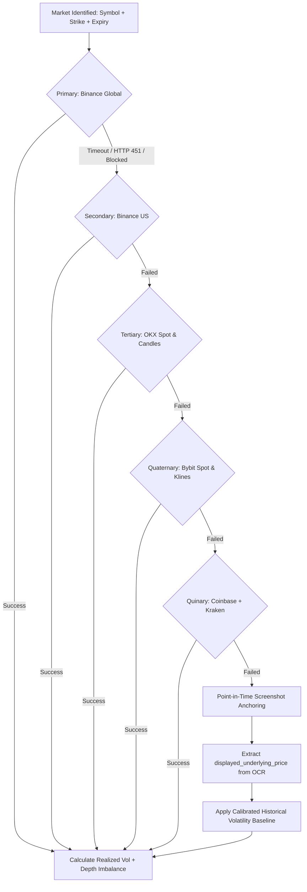

# Dynamic Multi-Venue Exchange Resilient Mesh & Screenshot Anchoring Strategy

> **Status:** Active Standard  
> **Related Documents:** [`CRYPTO_RESEARCH_AND_FORECASTING_STRATEGY.md`](file:///Users/mac/prediction-market/docs/CRYPTO_RESEARCH_AND_FORECASTING_STRATEGY.md), [`SELF_IMPROVING_FEEDBACK_LOOP_AND_TIME_TRACKING_PLAN.md`](file:///Users/mac/prediction-market/docs/SELF_IMPROVING_FEEDBACK_LOOP_AND_TIME_TRACKING_PLAN.md).

---

## 1. Executive Summary & Root Cause Analysis

In production, prediction market intelligence systems frequently encounter external API failures when fetching real-time crypto order books, OHLCV candles, and ticker prices:
1. **Geographic Restrictions & Regulatory Blocking:**
   - Binance Global (`api.binance.com`, `fapi.binance.com`) returns HTTP 451 (`Unavailable For Legal Reasons`) or drops connections via RST packets when accessed from IP addresses in the United States or restricted regions.
2. **HTTP Client Lifecycle & Premature Teardown:**
   - Running asynchronous multi-endpoint fetches in an isolated `try...finally` block that closes the HTTP client (`await client.aclose()`) prevents downstream secondary fallbacks (e.g., Coinbase spot) from completing.
3. **Connect Timeout Truncation:**
   - With tight connect timeouts (e.g., 4.0s) and default `str(exception)` logging, `httpx.ConnectTimeout` exceptions produce empty error strings (`"error": ""`), masking the underlying network cause.
4. **Binary Outcome Rigidity:**
   - Crypto interval prediction platforms (e.g. Bayse, Deriv) use `BUY UP` / `BUY DOWN` (or `HIGHER` / `LOWER`) rather than generic `BUY YES` / `BUY NO`. Hardcoded binary terminology confuses operators and risks misaligned settlement feedback.

---

## 2. Multi-Venue Exchange Resilience Mesh

Rather than relying single-threadedly on Binance Global, the prediction platform implements a **Dynamic Multi-Venue Exchange Mesh** with sequential fallback cascade:

### 2.1 Venue Endpoints Specification

| Venue | Primary Endpoints | Regional Accessibility | Data Provided |
|---|---|---|---|
| **Binance Global** | `https://api.binance.com/api/v3` `https://fapi.binance.com/fapi/v1` | Global (Blocked in US) | 15m/1h OHLCV, 20-level Depth, Funding Rate, OI |
| **Binance US** | `https://api.binance.us/api/v3` | United States | 15m/1h OHLCV, 20-level Depth, Spot Ticker |
| **OKX** | `https://www.okx.com/api/v5/market` | Global | 15m Candles (`candles`), 20-level Books (`books`), Tickers |
| **Bybit** | `https://api.bybit.com/v5/market` | Global | 15m Klines (`kline`), Orderbook (`orderbook`), Spot Tickers |
| **Coinbase** | `https://api.coinbase.com/v2/prices` `https://api.exchange.coinbase.com` | Global + US | Spot Price, Product Candles |
| **Kraken** | `https://api.kraken.com/0/public` | Global + US | OHLC (15m), Ticker, Order Book |
| **CoinGecko** | `https://api.coingecko.com/api/v3/simple` | Global Fallback | Spot Price, 24h Vol, 24h Change |

---

## 3. Infallible Point-in-Time Screenshot Anchoring

When a trader takes a screenshot of an active market, the screenshot itself contains rich, verified point-in-time ground truth:
1. **`displayed_underlying_price`:** The spot price of the asset at the instant of capture (e.g. `BTC: $76,342.10`).
2. **`target_price`:** The strike threshold $K$.
3. **`countdown_text`:** The remaining duration $T$.
4. **`chart_observation`:** Visual candle direction, wick rejection, and support/resistance structure.

### Fallback Principle
If all live external exchange connections fail or timeout:
- **Never Abstain Solely Due to External Outages:**
  $$S = \text{displayed\_underlying\_price}$$
- **Volatility Scaler:**
  Use the asset's SQLite calibrated volatility multiplier multiplied by the asset's annualized baseline ($\sigma_{\text{BTC}} = 55\%$, $\sigma_{\text{ETH}} = 65\%$, $\sigma_{\text{SOL}} = 85\%$).
- **Log-Normal Option Math:**
  Compute $d_2 = \frac{\ln(S/K) - 0.5\sigma^2 T}{\sigma\sqrt{T}}$ and $P(\text{YES}) = \Phi(d_2)$.
- **Signal Provenance:**
  Document in the forecast explanation:
  > *"Live exchange venue APIs were unreachable. Model anchored strictly on screenshot point-in-time underlying spot ($76,342.10), OCR strike ($76,000.00), and visual chart trend."*

---

## 4. UI Page Retention & Session Durability

During binary interval contracts (e.g., 5-minute or 15-minute rounds):
1. **Problem:** A trader uploads a screenshot at $7\text{m } 43\text{s}$, receives the prediction, and waits for the candle to close. If the page is refreshed or if background timers unmount the view, the user loses their place and cannot submit post-settlement feedback.
2. **Solution:**
   - **URL State Synchronization:** Automatically push `?id=<analysis_id>` to `window.history.replaceState`.
   - **Local Storage Continuity:** Persist active `analysis_id` in `localStorage.setItem('klocka_active_analysis_id', id)`.
   - **Cold Start Restoration:** On page load, if an `analysis_id` exists in the URL or local storage, automatically fetch and display the forecast cockpit and timer.
   - **Unconditional Expiration State:** When the timer reaches `00:00`, keep the cockpit mounted indefinitely and highlight the post-settlement training tools.

---

## 5. Dynamic Market Outcomes (`BUY UP` / `BUY DOWN`)

Binary prediction markets feature differing terminology depending on platform and asset class:
- **Bayse & Crypto Intervals:** `BUY UP` (Green / Trending Up) vs `BUY DOWN` (Red / Trending Down).
- **Polymarket & Political:** `BUY YES` vs `BUY NO`.
- **Financial Thresholds:** `BUY HIGHER` vs `BUY LOWER`.

The system dynamically adapts:
1. **Vision Parsing:** Captures the platform's native outcome text in `candidate.outcomes`.
2. **Decision Normalization:**
   - Recommendation maps to native affirmative (`BUY UP` or `BUY YES`) and native inverse (`BUY DOWN` or `BUY NO`).
3. **Interactive Feedback Buttons:**
   - Dynamically labels post-settlement feedback as `Resolved UP` / `Resolved DOWN` or `Resolved YES` / `Resolved NO`.
   - Canonicalizes user inputs on the backend into mathematical probability indicators: $Y = 1$ (affirmative) and $Y = 0$ (negative).
