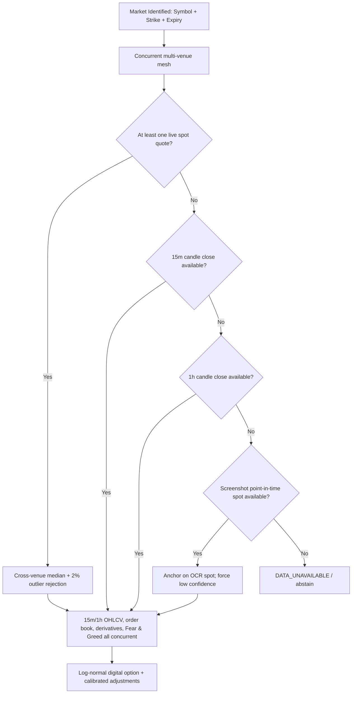

# Dynamic Multi-Venue Exchange Resilient Mesh & Screenshot Anchoring Strategy

> **Status:** Active Standard  
> **Related Documents:** [`CRYPTO_RESEARCH_AND_FORECASTING_STRATEGY.md`](file:///Users/mac/prediction-market/docs/CRYPTO_RESEARCH_AND_FORECASTING_STRATEGY.md), [`SELF_IMPROVING_FEEDBACK_LOOP_AND_TIME_TRACKING_PLAN.md`](file:///Users/mac/prediction-market/docs/SELF_IMPROVING_FEEDBACK_LOOP_AND_TIME_TRACKING_PLAN.md).

---

## 1. Executive Summary & Root Cause Analysis

In production, prediction market intelligence systems frequently encounter external API failures when fetching real-time crypto order books, OHLCV candles, and ticker prices:
1. **System DNS Resolution Failure (primary root cause):**
   - The operating-system resolver can time out or return `SERVFAIL` for financial API hostnames while other domains resolve normally. Every exchange attempt then fails as `httpx.ConnectTimeout` even though the exchange itself is healthy. This is common on hotspots, corporate networks, and some cloud egress gateways.
   - The resilient client in `integrations/network.py` retries the same hostname over DNS-over-HTTPS against IP-literal endpoints (Cloudflare `1.1.1.1` and Google `8.8.8.8`), then connects to the resolved address while preserving the original `Host` header and TLS `server_hostname`. Certificate verification is never disabled.
2. **Geographic Restrictions & Regulatory Blocking:**
   - Binance Global (`api.binance.com`, `fapi.binance.com`) and some other venues return HTTP 451 or drop connections via RST packets from restricted regions. The multi-venue mesh continues with the remaining official venues.
3. **HTTP Client Lifecycle & Premature Teardown:**
   - Running asynchronous multi-endpoint fetches in an isolated `try...finally` block that closes the HTTP client (`await client.aclose()`) prevents downstream secondary fallbacks (e.g., Coinbase spot) from completing. The shared market-data client now lives for the whole analysis run.
4. **Binary Outcome Rigidity:**
   - Crypto interval prediction platforms (e.g. Bayse, Deriv) use `BUY UP` / `BUY DOWN` (or `HIGHER` / `LOWER`) rather than generic `BUY YES` / `BUY NO`. Hardcoded binary terminology confuses operators and risks misaligned settlement feedback.
5. **Wrong-Direction Probability:**
   - A "below" market requires `P(below) = 1 - P(above)`. The research layer now records the direction-aware result as `final_adjusted_prob_yes`, and the forecaster consumes that field instead of the raw above-strike probability.

---

## 2. Multi-Venue Exchange Resilience Mesh

Rather than relying single-threadedly on Binance Global, the platform implements a
**Dynamic Multi-Venue Exchange Mesh**. All venue attempts within a data group run
concurrently, so a full outage costs roughly one group budget instead of one timeout
per venue in a sequential waterfall.

### 2.1 Venue Endpoints Specification

| Venue | Primary Endpoints | Regional Accessibility | Data Provided |
|---|---|---|---|
| **Binance Global** | `https://api.binance.com/api/v3` `https://fapi.binance.com/fapi/v1` | Global (Blocked in US) | Spot, 15m/1h OHLCV, 20-level Depth, Funding Rate, OI |
| **Binance US** | `https://api.binance.us/api/v3` | United States | Spot, 15m/1h OHLCV, 20-level Depth |
| **OKX** | `https://www.okx.com/api/v5` | Global | Spot, 15m/1h Candles, Books, Funding Rate, OI |
| **Bybit** | `https://api.bybit.com/v5/market` | Global | Spot, 15m/1h Klines, Orderbook, Funding Rate, OI, OI History |
| **Coinbase** | `https://api.coinbase.com/v2/prices` `https://api.exchange.coinbase.com` | Global + US | Spot, Product Candles, Book, 1m History |
| **Kraken** | `https://api.kraken.com/0/public` | Global + US | Ticker, OHLC, Depth, 1m History |
| **MEXC** | `https://api.mexc.com/api/v3` `https://api.mexc.com/api/v1/contract` | Global Fallback | Spot, 15m/1h Candles, 1m History, Depth, Funding Rate |
| **Gate.io** | `https://api.gateio.ws/api/v4` | Global Fallback | Spot, 15m/1h Candles, Depth, Funding Rate, 1m History |
| **Bitstamp** | `https://www.bitstamp.net/api/v2` | Global Fallback | 1m OHLC history (settlement) |
| **CoinGecko** | `https://api.coingecko.com/api/v3` | Global Fallback | Spot, Historical Point Prices |
| **DefiLlama** | `https://coins.llama.fi` | Global Fallback | Spot (confidence-weighted), Historical Point Prices |
| **CryptoCompare** | `https://min-api.cryptocompare.com/data/v2` | Global Fallback | 1m Historical Candles |
| **Pyth Network** | `https://benchmarks.pyth.network/v1/shims/tradingview` | Global Fallback | 1m Historical Benchmark Prices |
| **Alternative.me** | `https://api.alternative.me/fng/` | Global Fallback | Fear & Greed Index |

### 2.2 Auto-Settlement Resolver

`POST /api/v1/analyses/{analysis_id}/auto-settle` must never depend on a single exchange.

1. **Historical path** (whenever `exact_resolves_at` is in the past): race
   timestamp-validated observations from DefiLlama, CryptoCompare, Pyth Network,
   Bybit, OKX, Binance Global, Coinbase Exchange, Kraken, MEXC, Gate.io, Binance US,
   Bitstamp, and CoinGecko. A candidate is accepted only when its observation is
   within 300 seconds (±5 minutes) of the requested resolution time.
2. **Live path** (when the target is absent, in the future, or within the 30-minute
   live-fallback grace window but no validated historical observation exists): use
   the same cross-venue spot mesh as research and take its median.
3. **No silent time travel:** if the target is older than the 30-minute grace window
   and no validated historical observation exists, the resolver returns `None`
   instead of substituting a much-later live price. The API then returns HTTP 502
   and preserves manual settlement.
4. **No fabrication:** a price is never derived from the strike, and an open contract
   is never settled early.

Outbound requests are made through the resilient market-data client in
`integrations/network.py`. It tries the system resolver first, falls back to
DNS-over-HTTPS when the system resolver is filtered, caches positive and negative
answers, and automatically defers to an explicit environment proxy when one is set.

### 2.3 Why Not Scrape Exchange Websites?

The platform deliberately uses official public REST APIs rather than scraping exchange
front-ends:
- Exchange websites are JavaScript applications protected by bot management; the
  rendered DOM is unstable and changes without notice.
- Scraping would duplicate data that the public API programmes already expose with
  documented schemas and explicit rate limits.
- A scraper would still depend on the same broken DNS path, so it would not fix the
  observed root cause.
- Official APIs provide the order-book depth, candle history, funding, and open
  interest fields required by the model; the website UI often does not expose them.

---

## 3. Point-in-Time Screenshot Anchoring (Last Resort)

When a trader takes a screenshot of an active market, the screenshot contains
point-in-time observations:
1. **`displayed_underlying_price`:** The spot price of the asset at the instant of capture (e.g. `BTC: $76,342.10`).
2. **`target_price`:** The strike threshold $K$.
3. **`countdown_text`:** The remaining duration $T$.
4. **`chart_observation`:** Visual candle direction, wick rejection, and support/resistance structure.

### Strict Spot Resolution Order

Screenshot anchoring is **not** the first fallback. The research layer resolves the
underlying spot in this order and stops at the first usable source:

| Priority | Source | Accepted when | Quality treatment |
|---|---|---|---|
| 1 | Live cross-venue median | At least one official venue responds within the group budget | Normal confidence; 2% cross-venue outlier rejection |
| 2 | 15-minute candle close | Live spot unavailable and a closed 15m candle exists | Adds `SPOT_FROM_15M_CANDLE_CLOSE`; confidence downgraded one level |
| 3 | 1-hour candle close | Both above unavailable and a closed 1h candle exists | Adds `SPOT_FROM_1H_CANDLE_CLOSE`; confidence downgraded one level |
| 4 | Screenshot `displayed_underlying_price` | All live and candle sources unavailable | Adds `ANCHORED_TO_SCREENSHOT_SPOT`; **confidence forced to low** |
| 5 | `DATA_UNAVAILABLE` | No live, candle, or screenshot spot exists | Runner stops with `CRYPTO_SPOT_UNAVAILABLE`; no forecast is produced |

A candle source is only used after its close time has passed; the forming candle is
discarded. Screenshot anchoring is therefore a genuine last resort rather than a
shortcut around a transient network failure.

### Last-Resort Calculation
When priority 4 is reached:
- **Anchor price:**
  $$S = \text{displayed\_underlying\_price}$$
- **Volatility scaler:**
  Use the asset's SQLite calibrated volatility multiplier multiplied by the
  asset's annualized baseline ($\sigma_{\text{BTC}} = 55\%$,
  $\sigma_{\text{ETH}} = 65\%$, $\sigma_{\text{SOL}} = 85\%$).
- **Log-normal option math:**
  Compute $d_2 = \frac{\ln(S/K) - 0.5\sigma^2 T}{\sigma\sqrt{T}}$ and
  $P(\text{YES}) = \Phi(d_2)$.
- **Confidence:**
  The signal is always marked `low`, because the screenshot price may already be
  stale relative to the forecast instant and cannot be independently verified.
- **Signal provenance:**
  Document in the forecast explanation:
  > *"Live exchange venue APIs and closed candles were unreachable. Model anchored
  > on screenshot point-in-time underlying spot ($76,342.10), OCR strike
  > ($76,000.00), and visual chart trend. Confidence is low."*

---

## 4. UI Page Retention & Session Durability

During binary interval contracts (e.g., 5-minute or 15-minute rounds):
1. **Problem:** A trader uploads a screenshot at $7\text{m } 43\text{s}$, receives the prediction, and waits for the candle to close. If the page is refreshed or if background timers unmount the view, the user loses their place and cannot submit post-settlement feedback.
2. **Solution:**
   - **URL State Synchronization:** Automatically push `?id=<analysis_id>` to `window.history.replaceState`.
   - **Local Storage Continuity:** Persist active `analysis_id` in `localStorage.setItem('klocka_active_analysis_id', id)`.
   - **Cold Start Restoration:** On page load, if an `analysis_id` exists in the URL or local storage, automatically fetch and display the forecast cockpit and timer.
   - **Unconditional Expiration State:** When the timer reaches `00:00`, keep the cockpit mounted indefinitely and highlight the post-settlement training tools.

---

## 5. Dynamic Market Outcomes (`BUY UP` / `BUY DOWN`)

Binary prediction markets feature differing terminology depending on platform and asset class:
- **Bayse & Crypto Intervals:** `BUY UP` (Green / Trending Up) vs `BUY DOWN` (Red / Trending Down).
- **Polymarket & Political:** `BUY YES` vs `BUY NO`.
- **Financial Thresholds:** `BUY HIGHER` vs `BUY LOWER`.

The system dynamically adapts:
1. **Vision Parsing:** Captures the platform's native outcome text in `candidate.outcomes`.
2. **Decision Normalization:**
   - Recommendation maps to native affirmative (`BUY UP` or `BUY YES`) and native inverse (`BUY DOWN` or `BUY NO`).
3. **Interactive Feedback Buttons:**
   - Dynamically labels post-settlement feedback as `Resolved UP` / `Resolved DOWN` or `Resolved YES` / `Resolved NO`.
   - Canonicalizes user inputs on the backend into mathematical probability indicators: $Y = 1$ (affirmative) and $Y = 0$ (negative).
