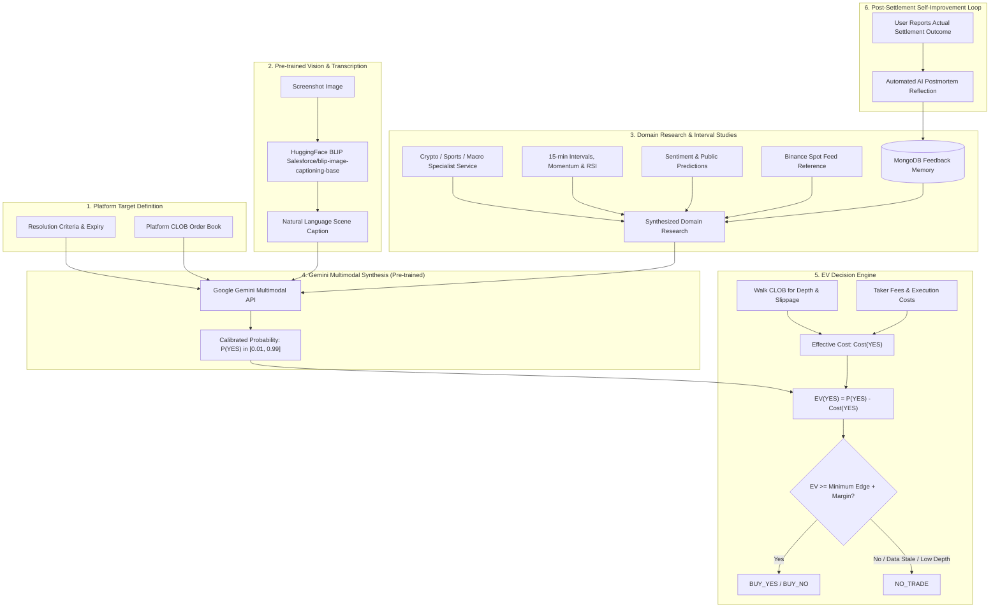
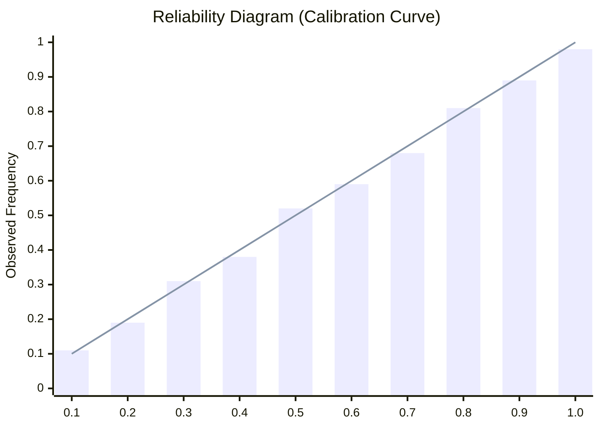
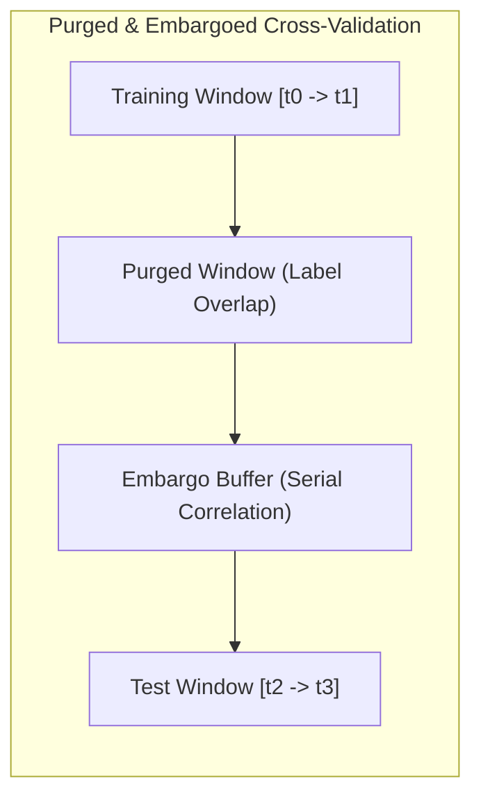

# Probabilistic Forecasting, Calibration & Decision Methodology

> **Governing Standards:** This document details the mathematical, statistical, and operational foundations of the forecasting engine and decision policy. It implements the standards defined in [`prediction-intelligence-engineering-rules.md`](file:///Users/mac/prediction-market/prediction-intelligence-engineering-rules.md) and [`prediction-intelligence-platform-technical-plan.md`](file:///Users/mac/prediction-market/prediction-intelligence-platform-technical-plan.md).

---

## 1. Mathematical Architecture Overview

> **Core Model Architecture Notice:** The platform explicitly avoids training foundational models from scratch. Instead, it utilizes pre-trained state-of-the-art vision models (`Salesforce/blip-image-captioning-base`) and foundational multimodal models (Google Gemini API via `google-genai`). High prediction accuracy is achieved through rich domain context, micro-interval order flow studies, disciplined Bayesian prior anchoring, and an iterative postmortem feedback loop.

---

## 2. Market-Implied Probability Extraction

A prediction market contract pays out $\$1.00$ upon successful resolution and $\$0.00$ otherwise. 
The naive assumption that the displayed midpoint price $\frac{Bid + Ask}{2}$ represents the true market-implied probability is flawed in real-world markets with wide spreads and asymmetric depth.

### 2.1 Micro-Price & Depth-Weighted Formulation
For a binary outcome token with order book bids $b_i$ with quantities $q_{b,i}$ and asks $a_i$ with quantities $q_{a,i}$:

1. **Top-of-Book Midpoint:**
   $$P_{\text{mid}} = \frac{a_1 + b_1}{2}$$

2. **Depth-Weighted Micro-Price ($P_{\text{micro}}$):**
   $$P_{\text{micro}} = \frac{q_{b,1} \cdot a_1 + q_{a,1} \cdot b_1}{q_{b,1} + q_{a,1}}$$
   Where $P_{\text{micro}}$ shifts the implied probability toward the side of the book with greater liquidity pressure.

3. **Executable Entry Price Function ($\text{Ask}_{\text{exec}}(V)$):**
   When executing an order of nominal volume $V$, the effective ask price $\text{Ask}_{\text{exec}}(V)$ is calculated by walking the order book ask ladder:
   $$\text{Ask}_{\text{exec}}(V) = \frac{\sum_{k=1}^m a_k \cdot v_k}{V}, \quad \text{where } \sum_{k=1}^m v_k = V$$

---

## 3. Quantitative Feature Engineering Pipeline (Crypto MVP)

All features are calculated using strictly point-in-time data timestamped at or before $t_{\text{forecast}}$.

### 3.1 Return and Momentum Dynamics
- **Log Returns:** Over horizons $\tau \in \{1\text{m}, 5\text{m}, 15\text{m}, 1\text{h}, 4\text{h}\}$:
  $$r_{\tau}(t) = \ln(S_t) - \ln(S_{t - \tau})$$
- **Exponential Moving Average Divergence:**
  $$\Delta_{\text{EMA}}(t) = \frac{S_t - \text{EMA}_{20}(S_t)}{\text{EMA}_{20}(S_t)}$$

### 3.2 Microstructure & Order-Book Imbalance
- **Multi-Level Order Book Imbalance ($I_{\text{depth}}$):**
  Calculated across top $K=5$ levels of the underlying exchange and platform CLOB:
  $$I_{\text{depth}}(t) = \frac{\sum_{k=1}^K q_{b,k} - \sum_{k=1}^K q_{a,k}}{\sum_{k=1}^K q_{b,k} + \sum_{k=1}^K q_{a,k}}$$
- **Trade Flow Aggressor Imbalance:**
  $$I_{\text{flow}}(t) = \frac{V_{\text{buy}}(\Delta t) - V_{\text{sell}}(\Delta t)}{V_{\text{buy}}(\Delta t) + V_{\text{sell}}(\Delta t)}$$

### 3.3 Volatility Dynamics
- **Realized Volatility:** Sample standard deviation of 1-minute returns over a rolling 1-hour window.
- **Parkinson High-Low Volatility:**
  $$\sigma_{\text{Parkinson}}^2 = \frac{1}{4 \ln 2} \sum_{i=1}^n \left( \ln\frac{H_i}{L_i} \right)^2$$

---

## 4. Probability Calibration Methodology

Raw outputs from tree-based algorithms (LightGBM/XGBoost) or uncalibrated neural nets tend to push probabilities toward extremes ($0$ or $1$) or cluster near the class base rate. Probability calibration ensures that if the model predicts $P(\text{YES}) = 0.70$, exactly $70\%$ of those historical events resolved YES.

### 4.1 Calibration Algorithms
1. **Platt Scaling (Sigmoid / Logistic):**
   Fits a logistic regression model over raw model scores $z_i$:
   $$P(y_i = 1 \mid z_i) = \frac{1}{1 + \exp(A \cdot z_i + B)}$$
   Fitted via cross-entropy loss minimization. Preferred for smaller datasets ($N < 1000$) to prevent overfitting.
2. **Isotonic Regression:**
   Fits a non-decreasing, non-parametric step function:
   $$\min \sum_{i=1}^N (y_i - \hat{p}_i)^2 \quad \text{subject to } \hat{p}_i \le \hat{p}_j \text{ whenever } z_i \le z_j$$
   Utilized when validation sample size $N \ge 1000$.

### 4.2 Calibration Diagnostics

- **Expected Calibration Error (ECE):**
  Partitions the probability space $[0, 1]$ into $M=10$ equally spaced bins $B_m$:
  $$\text{ECE} = \sum_{m=1}^M \frac{|B_m|}{N} \left| \text{acc}(B_m) - \text{conf}(B_m) \right|$$
  Where $\text{acc}(B_m)$ is empirical accuracy and $\text{conf}(B_m)$ is average predicted confidence within bin $B_m$. Production models must satisfy $\text{ECE} \le 0.05$.

---

## 5. Scoring Rules & Evaluation Metrics

Probabilistic predictions must be evaluated using strictly **proper scoring rules**, where the forecaster maximizes expected score if and only if they report their true subjective belief.

### 5.1 Brier Score
The mean squared difference between predicted probability $p_i$ and verified binary outcome $o_i \in \{0, 1\}$:
$$BS = \frac{1}{N} \sum_{i=1}^N (p_i - o_i)^2, \quad BS \in [0, 1]$$
- $BS = 0.0$: Perfect foresight.
- $BS = 0.25$: Naive coin-flip baseline ($p_i = 0.50$).

### 5.2 Log Loss (Cross-Entropy)
Penalizes confident mispredictions exponentially:
$$LL = -\frac{1}{N} \sum_{i=1}^N \left[ o_i \ln p_i + (1 - o_i) \ln(1 - p_i) \right]$$

### 5.3 Brier Skill Score (BSS)
Measures improvement relative to an explicit benchmark (e.g., market-implied probability $BS_{\text{market}}$):
$$BSS = 1 - \frac{BS_{\text{model}}}{BS_{\text{market}}}$$
- $BSS > 0$: Model adds predictive value beyond prevailing prediction-market prices.
- $BSS \le 0$: Model fails to beat prevailing market consensus.

---

## 6. Decision & Expected Value ($EV$) Engine

The decision engine compares the calibrated probability against executable order-book prices, fees, slippage, and model uncertainty.

### 6.1 Total Effective Entry Cost
$$\text{Cost}_{\text{YES}}(V) = \text{Ask}_{\text{exec}}(V) + \text{Fee}_{\text{taker}} + \text{Slippage}(V)$$
$$\text{Cost}_{\text{NO}}(V) = (1.00 - \text{Bid}_{\text{exec}}(V)) + \text{Fee}_{\text{taker}} + \text{Slippage}(V)$$

### 6.2 Net Expected Value
$$EV_{\text{YES}} = P(\text{YES}) \cdot 1.00 - \text{Cost}_{\text{YES}}(V) = P(\text{YES}) - \text{Cost}_{\text{YES}}(V)$$
$$EV_{\text{NO}} = (1.00 - P(\text{YES})) \cdot 1.00 - \text{Cost}_{\text{NO}}(V)$$

### 6.3 Recommendation Execution Gates
A recommendation is emitted according to the following truth table:

| Condition | Emitted Recommendation | Rationale |
|---|---|---|
| $EV_{\text{YES}} \ge \delta_{\text{min}} + U_{\text{margin}}$ AND Data Fresh | **`BUY_YES`** | Risk-adjusted positive expected value on YES. |
| $EV_{\text{NO}} \ge \delta_{\text{min}} + U_{\text{margin}}$ AND Data Fresh | **`BUY_NO`** | Risk-adjusted positive expected value on NO. |
| Neither side clears $\delta_{\text{min}} + U_{\text{margin}}$ | **`NO_TRADE`** | Insufficient statistical edge to clear execution friction. |
| Bid-Ask Spread $> 0.05$ | **`NO_TRADE`** | Market order book is too wide / illiquid. |
| Exchange or CLOB data stale ($> 3\text{s}$) | **`NO_TRADE`** | Feed staleness invalidates short-horizon pricing. |
| Market unverified or ambiguous | **`NO_TRADE`** | Strict fail-closed policy on unverified contracts. |

Default thresholds for 15-minute BTC markets:
- Minimum Net Edge: $\delta_{\text{min}} = 0.04$ ($4\%$).
- Uncertainty Buffer: $U_{\text{margin}} = \max(0.02, \text{ECE}_{\text{val}})$.

### 6.4 Position Sizing: Fractional Kelly Criterion
For educational and simulated decision tracking, position sizing is suggested via the **Quarter-Kelly ($\frac{1}{4}$-Kelly)** formula to protect against parameter estimation error:
$$f^* = \frac{1}{4} \cdot \frac{b \cdot p - q}{b}$$
Where:
- $b = \frac{1 - \text{Cost}}{\text{Cost}}$ (net decimal payout odds).
- $p = P(\text{YES})$, and $q = 1 - p$.
- Hard maximum position cap: $f_{\text{max}} = 0.05$ ($5\%$ of nominal bankroll).

---

## 7. Cross-Validation & Anti-Leakage Protocol

To eliminate look-ahead bias in time-series prediction:

1. **Strict Chronological Ordering:** Random $k$-fold cross-validation is strictly forbidden. Folds are generated chronologically.
2. **Purging:** Training observations whose event resolution windows overlap with the start of the evaluation set are purged.
3. **Embargoing:** An embargo window equal to the maximum forecast horizon (e.g., $1\text{ hour}$) is inserted between training and testing splits to eliminate autoregressive correlation leakage.
4. **Holdout Invariance:** A 3-month rolling holdout dataset is frozen and never utilized during hyperparameter tuning.

---

## 8. Market-Relative Evaluation

Brier and BSS are only meaningful when the market baseline comes from the same
point in time as the forecast. Historical market prices are stored in
`market_price_history`, Polymarket can be backfilled from CLOB
`/prices-history`, and the closing-line report measures entry-market BSS plus
CLV at settlement. See [`MARKET_PRICE_HISTORY.md`](MARKET_PRICE_HISTORY.md) for
the schema, bounds, and CLI commands. A negative BSS is a model-review signal,
not a reason to force a trade.
