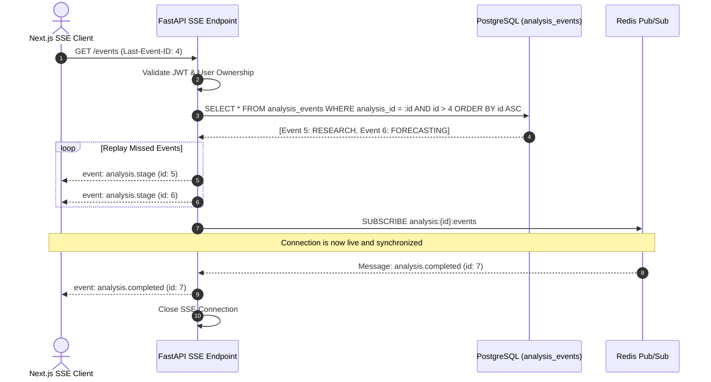

# Real-Time Protocol Specification — SSE, Redis Pub/Sub & WebSocket Streams

> **Governing Standards:** This document details the communication protocols, payload schemas, connection lifecycles, and reconnection semantics for real-time analysis streaming and external data ingestion. See also [`prediction-intelligence-engineering-rules.md`](file:///Users/mac/prediction-market/prediction-intelligence-engineering-rules.md) and [`prediction-intelligence-platform-technical-plan.md`](file:///Users/mac/prediction-market/prediction-intelligence-platform-technical-plan.md).

---

## 1. Real-Time Architecture Overview

```mermaid
flowchart TD
    subgraph ClientLayer ["Client Browser"]
        EventSource[Native EventSource / Custom Reconnecting Client]
    end

    subgraph APILayer ["FastAPI Ingress Layer"]
        SSEHandler[GET /api/v1/analyses/{id}/events]
        JWTMiddleware[JWT Ownership Check]
    end

    subgraph MessagingPlane ["Redis Pub/Sub & Event Store"]
        RedisPubSub[Redis Channel: analysis:{id}:events]
        DBEvents[(PostgreSQL: analysis_events Table)]
    end

    subgraph WorkerPlane ["Celery Worker Pipeline"]
        Worker[Analysis Orchestration Worker]
    end

    subgraph ExternalFeeds ["External Market Data Streams"]
        BinanceWS[Binance WebSocket: bookTicker / depth5]
        PolyWS[Polymarket CLOB WebSocket]
        IngestWorker[Dedicated Ingest Worker / Streamer]
    end

    EventSource -->|1. Connect with JWT & Last-Event-ID| SSEHandler
    SSEHandler --> JWTMiddleware
    JWTMiddleware -->|2. Verify Ownership| SSEHandler
    
    SSEHandler -->|3. Replay Historical Events| DBEvents
    SSEHandler -->|4. Subscribe to Live Channel| RedisPubSub

    Worker -->|Emit Event| DBEvents
    Worker -->|Broadcast Message| RedisPubSub
    RedisPubSub -->|Stream New Events| SSEHandler
    SSEHandler -->|5. text/event-stream| EventSource

    ExternalFeeds --> IngestWorker
    IngestWorker -->|Maintain Top-of-Book| RedisPubSub
```

---

## 2. Server-Sent Events (SSE) Protocol

### 2.1 Endpoint Specification
- **URL:** `GET /api/v1/analyses/{analysis_id}/events`
- **Headers Required:**
  - `Authorization: Bearer <Supabase_JWT>`
  - `Accept: text/event-stream`
  - `Last-Event-ID: <integer>` (optional, sent by client on reconnection)
- **Response Headers:**
  - `Content-Type: text/event-stream`
  - `Cache-Control: no-cache, no-transform`
  - `Connection: keep-alive`
  - `X-Accel-Buffering: no` (disables response buffering in NGINX / Cloudflare)

### 2.2 Event Envelope & Message Types
All messages adhere strictly to the standard SSE wire format:
```text
event: <event_type>
id: <sequential_event_id>
data: <json_payload>

```

#### Supported Event Types

| Event Name | Trigger Condition | Terminal State? | Payload Schema |
|---|---|---|---|
| `analysis.heartbeat` | Every 15 seconds of idle stream | No | `{"timestamp": "..."}` |
| `analysis.stage` | Pipeline transitions to a new stage | No | `AnalysisStageEvent` |
| `analysis.warning` | Non-fatal anomaly (e.g. minor OCR discrepancy) | No | `AnalysisWarningEvent` |
| `analysis.needs_confirmation` | Multiple candidate matches found | No (pauses) | `MarketConfirmationRequiredEvent` |
| `analysis.completed` | Forecast emitted & snapshot persisted | **Yes** (closes stream) | `AnalysisCompletedEvent` |
| `analysis.failed` | Unrecoverable error (e.g. invalid file, API outage) | **Yes** (closes stream) | `AnalysisFailedEvent` |

### 2.3 JSON Payload Schemas

#### 1. Stage Transition Event (`analysis.stage`)
```json
{
  "analysis_id": "9b1deb4d-3b7d-4bad-9bdd-2b0d7b3dcb6d",
  "stage": "MARKET_VERIFICATION",
  "status": "in_progress",
  "message": "Cross-verifying extracted market parameters with Polymarket Gamma API.",
  "percentage": null,
  "timestamp": "2026-11-04T10:45:00.123Z"
}
```
*Rule: Do not emit fabricated mathematical percentages when progress is discrete. Use `percentage: null`.*

#### 2. Market Confirmation Event (`analysis.needs_confirmation`)
```json
{
  "analysis_id": "9b1deb4d-3b7d-4bad-9bdd-2b0d7b3dcb6d",
  "stage": "NEEDS_USER_CONFIRMATION",
  "extracted_title": "Bitcoin above $100,000 in November?",
  "candidates": [
    {
      "candidate_id": "poly_btc_100k_nov15",
      "platform": "polymarket",
      "title": "Will Bitcoin reach $100,000 by November 15, 2026?",
      "resolves_at": "2026-11-15T23:59:59Z",
      "similarity_score": 0.88
    },
    {
      "candidate_id": "poly_btc_100k_nov30",
      "platform": "polymarket",
      "title": "Will Bitcoin reach $100,000 by November 30, 2026?",
      "resolves_at": "2026-11-30T23:59:59Z",
      "similarity_score": 0.92
    }
  ],
  "timestamp": "2026-11-04T10:45:02.450Z"
}
```

#### 3. Completed Event (`analysis.completed`)
```json
{
  "analysis_id": "9b1deb4d-3b7d-4bad-9bdd-2b0d7b3dcb6d",
  "status": "COMPLETED",
  "forecast_id": "7c2deb4d-1a2b-3c4d-5e6f-7a8b9c0d1e2f",
  "recommendation": "BUY_YES",
  "probability_yes": 0.68,
  "net_edge": 0.052,
  "result_url": "/api/v1/forecasts/7c2deb4d-1a2b-3c4d-5e6f-7a8b9c0d1e2f",
  "timestamp": "2026-11-04T10:45:08.890Z"
}
```

#### 4. Failed Event (`analysis.failed`)
```json
{
  "analysis_id": "9b1deb4d-3b7d-4bad-9bdd-2b0d7b3dcb6d",
  "status": "FAILED",
  "error_code": "DATA_STALE",
  "message": "Critical exchange feed exceeded freshness threshold (delay > 3.0s).",
  "can_retry": true,
  "timestamp": "2026-11-04T10:45:04.112Z"
}
```

---

## 3. Reconnection, Replay & Connection Lifecycle



### 3.1 Reconnection Rules
1. **Exponential Backoff with Jitter:** On connection failure, the frontend client retries with intervals:
   $$t_{\text{retry}} = \min(30000, 1000 \cdot 2^k) \pm \text{jitter}(0, 500\text{ ms})$$
2. **Replay Invariance:** When connecting with `Last-Event-ID: <k>`, the server queries `analysis_events` for rows where `id > k`. Only after replaying all historical records does the handler begin yielding live Redis Pub/Sub messages.
3. **Graceful Teardown:** When receiving `analysis.completed` or `analysis.failed`, the server cleanly terminates the HTTP stream. The client transitions from streaming state to static display.

---

## 4. External Market Data WebSocket Ingestion (Exchange & CLOB Feeds)

To power short-horizon BTC forecasting (5-minute, 15-minute, 1-hour), dedicated ingestion workers maintain persistent, low-latency WebSocket connections to primary venues.

### 4.1 Ingestion Specifications

| Venue | Stream Endpoint | Channels Subscribed | Target Freshness | Disconnect Action |
|---|---|---|---|---|
| **Binance** | `wss://stream.binance.com:9443/ws` | `btcusdt@bookTicker`, `btcusdt@kline_1m` | $\le 1000\text{ ms}$ | Reconnect + Backfill REST klines |
| **Coinbase**| `wss://ws-feed.exchange.coinbase.com`| `ticker`, `level2_batch` (`BTC-USD`) | $\le 1000\text{ ms}$ | Reconnect + Resync L2 Snapshot |
| **Polymarket**| `wss://ws-subscriptions-clob.polymarket.com/ws/market` | `book` (Active Market Token IDs) | $\le 2000\text{ ms}$ | REST Order Book Snapshot Fetch |

### 4.2 Sequence Gap Detection & Resynchronization
- **Sequence Verification:** For Level 2 order-book feeds that emit incremental diffs, the ingestion engine tracks message sequence numbers ($U_{\text{first}}, u_{\text{last}}$).
- **Gap Recovery:** If an incoming message sequence does not match the previous sequence $+ 1$:
  1. The local in-memory order book is marked `DIRTY`.
  2. The ingestion worker requests a fresh full snapshot via REST API.
  3. Incremental buffer messages are reapplied from the snapshot sequence forward.
  4. The market book is marked `SYNCHRONIZED`.
- **Feed Staleness Trigger:** If no message is received for $> 3\text{ seconds}$ on an active market, the feed state changes to `STALE`, immediately triggering fail-closed abstention (`NO_TRADE`) in the decision engine.
