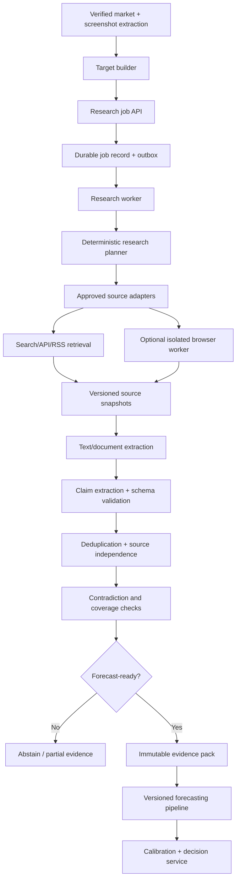

# Research Agent Runtime Plan — v2

> **Status:** Recommended architecture; implementation-ready after provider/legal review  
> **Version:** 2.0  
> **Date:** 2026-11-05  
> **Scope:** Bounded, citation-first research for sports, news, politics, and other event-based prediction markets  
> **Primary stack:** Python + FastAPI, asynchronous workers, Redis/Celery, PostgreSQL/Supabase, object storage  
> **Governing documents:** `prediction-intelligence-engineering-rules.md`, `prediction-intelligence-platform-technical-plan.md`, `ARCHITECTURE.md`, `REALTIME_PROTOCOL.md`, `SPORTS_RESEARCH_AND_FORECASTING_PLAN.md`

---

## 0. Executive recommendation

The original research-runtime design has the right core separation:

1. Verify the market and its resolution rules.
2. Plan a bounded research task.
3. Retrieve evidence through approved providers.
4. Extract and normalize claims with provenance.
5. preserve conflicts, source independence, and point-in-time availability.
6. Freeze an immutable evidence pack.
7. Hand the pack to a separate forecasting pipeline, or abstain.

**Keep this architecture. Do not turn the research agent into an unrestricted browser agent or a trade-decision agent.**

The original proposal is not ready to implement unchanged. This v2 makes the following corrections mandatory:

- Replace the original `published_at OR observed_at` cutoff rule with versioned, point-in-time availability rules. Original publication dates alone do not prove what a page contained at an earlier time.
- Remove Reddit RSS/scraping from the default commercial-source plan. Reddit states that commercial use of its developer tools/data requires permission and a contract; it also prohibits unauthorized scraping and model training on Reddit data without explicit consent.
- Treat GDELT Project search as a best-effort discovery source with rate limits, not as a complete or guaranteed news feed. Do not confuse GDELT Project APIs with the separate GDELT Cloud product.
- Do not assume Google News RSS or arbitrary publisher RSS is approved for commercial reuse. Require a provider/domain rights review before enabling each source.
- Make browser research an isolated, optional retrieval capability. A separate Playwright container is not sufficient by itself: enforce network egress controls, DNS/IP validation, redirect re-validation, and resource limits.
- Persist research jobs asynchronously from the beginning. The API request must not run long research, PDF parsing, or browser work inline.
- Make evidence sufficiency a deterministic checklist and quality gate, not an LLM-generated confidence percentage.
- Introduce source-version snapshots, claim-level provenance, research-budget ledgers, and forecast-readiness states.
- Treat model/prompt/source changes as versioned deployments. No automatic prompt mutation or model promotion based only on user feedback.

### 0.1 What this subsystem is responsible for

The Research Agent Runtime is responsible for producing an auditable, time-bounded, source-linked **Evidence Pack** for a verified market proposition.

It is not responsible for:

- Deciding whether the user should buy YES or NO.
- Producing the final numerical probability.
- Executing trades.
- Treating an LLM's self-reported confidence as statistical confidence.
- Treating search-result snippets, rumors, or duplicated articles as confirmed facts.
- Guaranteeing that public web coverage is exhaustive.

The forecasting model estimates probabilities. A separate decision service compares those probabilities with executable market prices, costs, and risk constraints.

---

## 1. Architecture overview



### 1.1 Runtime boundaries

| Component | Owns | Must not own |
|---|---|---|
| Next.js frontend | Upload, job status, evidence display, user feedback | Provider credentials, browser execution, probability calculation |
| FastAPI | Auth, request validation, job creation, status/evidence reads | Long browser sessions, unbounded research loops, model training |
| Research worker | Planning, provider orchestration, extraction, evidence-pack assembly | Direct trade execution, arbitrary user-controlled network access |
| Provider adapters | One provider's API/RSS contract, rate limit and normalization | Cross-provider reasoning or trade decisions |
| Browser worker | Approved page rendering and extraction | App secrets, database credentials, private network access |
| Evidence store | Immutable documents/versions/claims/packs | Mutable current recommendation state |
| Forecasting service | Validated probability estimates | Rewriting evidence or inventing source facts |
| Decision service | Price/edge/cost/risk policy | Changing the forecast probability |

### 1.2 Deployment topology

Start with a **modular monolith plus separate workers**, not a fleet of microservices:

```text
Next.js
  |
  v
FastAPI API -------------------- PostgreSQL / Supabase
  |                                      |
  | create research job                  | job + outbox + evidence records
  v                                      |
Redis broker <--- outbox dispatcher -----+
  |
  v
Celery research worker
  |-- provider adapters (HTTP APIs/RSS)
  |-- extraction / claim processing
  |-- evidence-pack builder
  |
  +---- optional browser-worker queue ---> isolated Playwright container
```

PostgreSQL is the source of truth. Redis is a broker/cache, not the authoritative job or evidence database. Assume at-least-once job delivery; every step must be idempotent. Do not design around exactly-once queue execution.

Long-running work must not execute inside a FastAPI request. `POST /research-jobs` should validate, persist, enqueue via an outbox, and return `202 Accepted` with a job ID.

---

## 2. Verified target construction

Research must start with a verified proposition, not an unverified screenshot caption.

### 2.1 Target object

```json
{
  "target_id": "uuid",
  "platform": "polymarket",
  "platform_market_id": "market-id",
  "market_url": "https://...",
  "market_type": "manager_departure_by_deadline",
  "proposition": "Will Club X's manager leave before 2026-11-15?",
  "subject_entities": [
    {"type": "person", "canonical_id": "person-id", "name": "Example Manager"},
    {"type": "organization", "canonical_id": "club-id", "name": "Example Club"}
  ],
  "deadline_at": "2026-11-15T23:59:59Z",
  "timezone": "Europe/London",
  "resolution_source": "platform-defined source or official source",
  "resolution_rules_text": "Exact market resolution text",
  "resolution_rules_hash": "sha256:...",
  "target_verification": "verified",
  "created_at": "2026-11-05T18:00:00Z"
}
```

The values above are examples. The market ID, rules, timestamps, and resolution source must come from the market platform or another authoritative source, not be invented by the LLM.

### 2.2 Required target checks

Before research begins, validate:

- Platform and market ID resolve to the same market shown in the screenshot.
- Market is active and has not already resolved or closed, unless the job is explicitly retrospective.
- Exact outcome definition is available and preserved verbatim.
- Deadline, timezone, and inclusive/exclusive boundary are understood.
- Resolution source and any dispute/void rules are captured.
- The proposition is mapped to a supported event type.
- Ambiguous entities are resolved to canonical entities or marked unresolved.

A screenshot may be stale or cropped. Its displayed price is not authoritative when a live platform API is available. Store both screenshot-extracted values and verified platform values with their timestamps.

### 2.3 Unsupported or ambiguous targets

Do not silently guess. Set one of:

- `TARGET_VERIFIED`
- `TARGET_NEEDS_REVIEW`
- `TARGET_UNSUPPORTED`
- `TARGET_ALREADY_RESOLVED`
- `TARGET_RULES_UNAVAILABLE`

The research planner must not run a full research workflow when the proposition itself is not understood.

---

## 3. Research planning

### 3.1 Deterministic-first planner

The planner should be mostly deterministic. Use templates and rules by `market_type` to build:

- Required fact checklist.
- Relevant entities and aliases.
- Exact cutoff and freshness policy.
- Approved source classes and source domains.
- Query templates and query variants.
- Expected evidence types.
- Research budget tier.
- Abstention requirements.

An LLM may help resolve ambiguous entity names or suggest search phrases, but its suggestions must be validated against the target schema and the approved tool registry. The LLM cannot select an arbitrary URL or expand permissions.

### 3.2 Example event checklist: manager departure by a deadline

| Required question | Preferred evidence | Completion rule |
|---|---|---|
| Is the person currently the manager? | Club/competition official records | Current status is time-stamped |
| Has the club announced departure? | Official club announcement | Exact statement and publication time captured |
| Has a replacement/appointment been announced? | Club/competition official records | Exact role and effective date captured |
| Are there credible reports of an imminent departure? | Named reporters and reputable outlets | Claims remain attributed; corroboration assessed |
| Is a departure only speculation or negotiation? | Multiple independent reports | Rumor/negotiation wording preserved |
| What counts as “leave” under the market rules? | Platform resolution rules | Exact definition resolved |
| Is evidence still current at cutoff? | Versioned source snapshots | Point-in-time checks pass |

**Important:** “No announcement found” is not equivalent to “the person will not leave.” Absence of evidence must be represented as an observation about the search coverage, not as a confirmed negative fact.

### 3.3 Example event checklist: sports result or match event

- Official fixture, venue, start time, and competition.
- Current event status (scheduled, delayed, live, completed, abandoned).
- Official team sheets/lineups when published.
- Official injury/suspension information where available.
- Verified recent performance data with opponent/context adjustments.
- Weather or venue conditions only where materially relevant and sourced.
- Market-specific outcome definition (90 minutes vs extra time, regulation vs overtime, player participation rules, abandonment rules).
- Data freshness appropriate to kickoff and market cutoff.

Different proposition types need different checklists. A match winner, player prop, manager-departure deadline, and government-announcement market are not interchangeable research tasks.

---

## 4. Source governance and provider strategy

### 4.1 Source registry is mandatory

Do not hard-code an informal list of URLs in prompts. Maintain a versioned `research_sources` registry.

Suggested fields:

```text
id
provider_key
domain_pattern
source_type
allowed_market_types
claim_categories
access_method                 # official_api | licensed_api | rss | public_page | browser
commercial_use_status        # approved | approval_required | prohibited | under_review
terms_url
license_or_contract_ref
robots_reviewed_at
terms_reviewed_at
retention_policy
max_requests_per_minute
max_concurrency
max_response_bytes
default_freshness_seconds
source_authority_ruleset_id
enabled
created_at
updated_at
```

A source must be disabled by default until its access method, commercial rights, rate limits, attribution requirements, retention rules, and permitted uses have been reviewed. A successful HTTP request does not mean that commercial use is permitted.

### 4.2 Source provider decisions

| Source | v2 recommendation | Reason / implementation rule |
|---|---|---|
| GDELT Project DOC API | **Allowed as a best-effort discovery adapter after current usage review** | The Project documents query and time-window capabilities and has publicly discussed rate limiting. Search results are leads, not facts; do not assume completeness, SLA, or unrestricted high-volume use. |
| GDELT Cloud | **Separate optional paid/provider adapter** | It is a different product with its own documented API, authentication, plans, limits, and terms. Do not treat it as the same endpoint or contract as GDELT Project. |
| Official club, league, federation, government, and regulator sources | **Preferred** | Use official APIs, feeds, or pages only through permitted access methods. Their authority is claim-specific, and absence of a page/update is not proof that an event will not occur. |
| Licensed sports/news data provider | **Preferred for production coverage** | Use providers with commercial rights, documented freshness, identifiers, quotas, correction policies, and service commitments appropriate to the product. |
| Publisher RSS feeds | **Conditional** | Enable only after checking each publisher's terms, feed conditions, content rights, rate guidance, and retention/republication policy. RSS availability alone is not a commercial license. |
| Google News RSS | **Do not make a production dependency by default** | Do not assume that a publicly reachable RSS URL grants commercial reuse, bulk extraction, retention, or redistribution rights. Obtain legal/provider approval or use a licensed news API. |
| Reddit | **Disabled for commercial MVP unless Reddit grants permission** | Reddit's current guidance says commercial use of its developer tools/data requires permission and a contract. It also prohibits unauthorized scraping and restricts model training on Reddit content without explicit consent. Do not use anonymous RSS scraping as a workaround. |
| Social networks generally | **Provider-specific approval required** | Use official APIs or licensed data only. Preserve author/source metadata and honor deletion/retention rules. Do not scrape logged-in or private content. |

**Commercial product rule:** If a provider's terms or license status is unknown, the adapter stays disabled. Escalate for legal review rather than assuming that public visibility equals permission.

### 4.3 Search results are leads

A search result snippet is not enough to support a material claim. The runtime should open/resolve the approved source, capture a versioned snapshot or provider record, and extract a claim with a source span. If a source cannot be opened or its content cannot be verified, record it as a lead with `verification_state = unverified`.

### 4.4 Claim-specific authority

Do not assign one global credibility score to a publisher. Source authority depends on the claim:

| Claim | Primary source class | Secondary evidence |
|---|---|---|
| Official appointment/departure | Club, league, employer, governing body | Named reporter, reputable journalism |
| Fixture/result | Competition authority or official match record | Licensed sports-data provider |
| Injury/availability | Official team update or official lineup | Named beat reporter, licensed provider |
| Transfer negotiation | Official source for completion; independent reporting for probability context | Single reporter or aggregator, clearly attributed |
| Government policy/announcement | Government department, regulator, official gazette, legislative record | Reputable news organizations and named reporters |
| Market price/liquidity | Verified prediction-platform API/order book | Screenshot or third-party display |

Source ranking must be based on a versioned ruleset and claim category. Do not let the LLM invent `authority_tier` values.

### 4.5 Source independence and duplication

Track at least:

- Canonical URL and normalized URL.
- Publisher and author/byline where available.
- Wire-service/original-source attribution.
- Story-cluster or `independence_group` ID.
- Content hash and near-duplicate fingerprint.
- Whether the page cites another source or is an independent report.

Three syndicated copies of the same wire story count as one underlying reporting chain. Similarity models may suggest a duplicate cluster, but the system should preserve uncertainty when independence cannot be established.

---

## 5. Point-in-time correctness — mandatory correction

### 5.1 Why the old rule is unsafe

Do **not** use this rule:

```python
eligible = (
    evidence.published_at <= cutoff
    or evidence.observed_at <= cutoff
)
```

It is unsafe because `published_at` may describe the first publication of an article while the page content retrieved later includes material added after the forecast cutoff. A page can be edited, corrected, replaced, or deleted without changing its original publication timestamp.

For example:

- 10:00 — Article first published.
- 10:30 — Forecast cutoff.
- 11:00 — Article updated with the decisive information.
- 11:15 — Runtime retrieves the updated page.

The 11:15 content cannot be used to reconstruct what was known at 10:30 merely because the article's original publication time was 10:00.

### 5.2 Required timestamps

Every source document version and structured data record must distinguish:

| Timestamp | Meaning |
|---|---|
| `event_at` | When the underlying real-world event occurred, if known |
| `published_at` | Publisher-declared original publication time |
| `source_updated_at` | Publisher/provider-declared content update time, if available |
| `first_seen_at` | First time this system/provider observed the item |
| `captured_at` | Time this exact content/version was captured by this runtime |
| `available_at` | Time this exact version became available to the forecasting system |
| `processed_at` | Time extraction/normalization completed |
| `forecast_cutoff_at` | Frozen time at which the forecast's information set closes |

Store timestamps as UTC instants. Preserve the original timezone and raw timestamp string when parsing source dates. Do not silently assume the server timezone.

### 5.3 Correct eligibility rule

For content version `v` and forecast cutoff `t_c`:

```python
eligible = (
    v.available_at is not None
    and v.available_at <= t_c
    and v.captured_at <= t_c
    and v.version_is_valid
)
```

Additional provider-specific conditions may be required. `published_at <= cutoff` is a useful consistency check, **not a substitute for `available_at`**.

If a historical data provider supplies a verifiable as-of snapshot with an explicit availability timestamp and correction/version history, that provider's documented semantics may be used. If a source is first collected after the cutoff and there is no trustworthy historical version, it must be excluded from that historical forecast. Do not backfill it into the past.

### 5.4 Version records

Use immutable document-version rows:

```json
{
  "document_id": "uuid",
  "version_id": "uuid",
  "canonical_url": "https://publisher.example/article",
  "published_at": "2026-11-05T08:00:00Z",
  "source_updated_at": "2026-11-05T10:45:00Z",
  "first_seen_at": "2026-11-05T08:05:00Z",
  "captured_at": "2026-11-05T10:50:00Z",
  "available_at": "2026-11-05T10:50:03Z",
  "content_hash": "sha256:...",
  "content_object_key": "research/source-versions/...",
  "capture_method": "approved_publisher_page",
  "extraction_version": "html-extractor-2.1",
  "retention_policy_id": "publisher-policy-v1"
}
```

Never overwrite an older version. A changed content hash creates a new version. Use object storage for permitted retained snapshots and PostgreSQL for metadata/provenance. Apply provider-specific retention/deletion requirements; immutable audit metadata does not authorize indefinite retention of copyrighted full text.

### 5.5 Point-in-time features

The same rule applies to structured sports/statistics data and derived features. Store both:

- `event_timestamp`: when the observation applies.
- `created_at`/`available_at`: when the system could actually use it.

Historical training joins must filter on both event time and availability/created time. A late correction or backfilled stat must not appear in a training row whose forecast cutoff predates that correction. This is the same class of issue addressed by point-in-time feature-store joins.

### 5.6 Clock and cutoff rules

- Freeze a single `forecast_cutoff_at` at job creation or at the explicitly defined market decision time.
- Use a trusted UTC clock source and record clock-skew/ingestion delay.
- Do not extend the cutoff when a retry occurs.
- Data arriving after the cutoff may be retained for later analysis, but not added to the frozen evidence pack.
- A fresh forecast requires a new forecast ID and a new cutoff.

---

## 6. Retrieval workflow and browser policy

### 6.1 Retrieval priority

Use sources in this order:

1. Structured official or licensed provider APIs.
2. Approved RSS/Atom feeds with documented rights and limits.
3. Static HTML retrieval from approved domains when permitted.
4. Isolated Playwright browser retrieval only when rendering is essential and the domain is approved.

Do not launch a browser for every source. It is slower, harder to secure, more resource-intensive, and more likely to encounter dynamic scripts or access restrictions.

### 6.2 Isolated browser worker

The browser must run in a dedicated worker/container or isolated job environment, never inside the FastAPI process.

Minimum controls:

- Unprivileged OS user; do not run as root.
- Chromium sandbox enabled; do not use `--no-sandbox` in production.
- Container seccomp profile and least-privilege capabilities.
- Ephemeral browser context per job; no shared cookies, local storage, downloads, or user sessions.
- No application database credentials, cloud credentials, API keys, `.env` files, private files, or internal service tokens in the browser environment.
- Dedicated network egress proxy or firewall policy; browser cannot make unrestricted direct outbound connections.
- HTTPS-only by default; any exception must be explicit, reviewed, and narrow.
- Restrict navigation to approved source domains and approved URL patterns.
- Revalidate every redirect and every new navigation target.
- Enforce connection-time DNS/IP checks to block private, loopback, link-local, multicast, reserved, IPv4-mapped IPv6, and cloud metadata destinations.
- Prevent DNS rebinding by validating the resolved address actually used for the connection; checking DNS in one step and resolving again later is insufficient.
- Apply the same checks to retries, redirects, subresources, WebSockets, and browser-initiated requests.
- Block nonessential request types and third-party subresources by default; allow only what a source requires.
- Allow only GET/HEAD for public research. Do not submit forms, click purchase/transfer actions, authenticate, or perform state-changing actions.
- Disable downloads by default. If a permitted PDF is required, fetch through a controlled download path with content-type, size, malware and parser checks.
- Limit CPU, memory, process count, wall time, page count, redirects, response bytes, and browser contexts.
- Terminate the entire browser process tree on cancellation or timeout.
- Return sanitized text, selected metadata, and evidence-span references only.

**Domain allowlisting alone is not sufficient SSRF protection.** OWASP specifically warns about redirects and DNS rebinding. The egress layer must validate the actual destination IP and prevent a second unchecked DNS resolution from bypassing policy.

### 6.3 Browser network policy

The egress proxy should enforce:

```text
ALLOW: approved hostname + approved port + HTTPS + public destination IP
DENY: localhost, private networks, link-local, cloud metadata, internal DNS names
DENY: unapproved IP literals, unusual ports, non-HTTP protocols
DENY: redirect to a non-approved host or blocked address
DENY: requests that exceed per-host or per-job byte/rate budgets
```

Do not rely only on browser request interception; enforce the policy outside the browser process at the network boundary.

### 6.4 Robots and terms review

- Respect applicable robots.txt rules and source-specific crawl guidance.
- Treat robots.txt as a crawler-access convention, not legal authorization or a content license.
- Keep the source's terms/rights review independent from robots parsing.
- Identify the crawler with an honest user-agent and a contact URL/email where appropriate.
- Stop on access denials, CAPTCHA, paywalls, login requirements, or explicit anti-automation controls. Do not attempt to bypass them.

### 6.5 Content extraction

Extraction output should include:

- `document_version_id`
- canonical URL and final URL
- title, publisher, author/byline
- published and update timestamps as raw + normalized values
- captured/available timestamps
- content hash
- extracted text or permitted relevant passages
- paragraph/section locator; PDF page number when applicable
- extraction method/version
- extraction-quality flags
- content type and language

Use HTML main-content extraction before browser rendering. Use PDF text extraction when text is embedded; OCR is a fallback for scanned pages or failed text extraction, not the default. Keep OCR page-level provenance so citations can point to the correct page.

Do not send full documents into an LLM by default. Retrieve bounded passages relevant to a specific required fact. Respect copyright and provider retention rules; store short claim-supporting passages or derived metadata where full-text retention is not licensed.

---

## 7. Claims and evidence normalization

### 7.1 Claim record

```json
{
  "claim_id": "uuid",
  "target_id": "uuid",
  "claim_text": "The club has announced that the manager will leave at the end of the season.",
  "claim_category": "manager_departure",
  "subject_entity_ids": ["club-id", "person-id"],
  "predicate": "announced_departure",
  "object": "end_of_season",
  "stance_on_proposition": "supports_yes",
  "claim_modality": "official_statement",
  "epistemic_state": "source_asserted",
  "source_id": "uuid",
  "document_version_id": "uuid",
  "evidence_span": {
    "kind": "html_paragraph",
    "locator": "section:club-announcement/paragraph:3",
    "quote_hash": "sha256:..."
  },
  "published_at": "2026-11-05T08:00:00Z",
  "available_at": "2026-11-05T08:00:03Z",
  "independence_group_id": "story-cluster-uuid",
  "extraction_model_version": "claim-extractor-v1",
  "extraction_prompt_version": "claims-v3",
  "validation_state": "pending_review"
}
```

### 7.2 Do not confuse claim state with truth

The original `confirmed/probable/contested/unresolved/stale` states mix source quality, truth, and research status. Replace them with separate dimensions:

**A. What the source says**

- `asserted`
- `denied`
- `speculated`
- `conditional`
- `quoted_from_other_source`
- `not_stated`

**B. How the claim is supported**

- `single_source`
- `multiple_independent_sources`
- `authoritative_primary_source`
- `conflicting_sources`
- `unsupported`

**C. Data eligibility/status**

- `eligible_at_cutoff`
- `post_cutoff`
- `stale_for_claim_type`
- `timestamp_uncertain`
- `source_unavailable`

These fields describe the evidence. They do not declare the future event true or false.

### 7.3 Evidence span is required

Every extracted material claim must reference the exact source version and a locator:

- HTML paragraph/heading or character offsets.
- PDF page number and text span.
- API record ID and response field path.
- RSS item GUID and field.

Where permissible, preserve a short exact quote or its hash plus a bounded excerpt. The evidence UI must let a reviewer trace a claim back to its source.

### 7.4 LLM extraction constraints

The LLM may:

- Extract claims from bounded source passages.
- Classify claim type, subject, polarity, and modality.
- Identify missing facts and possible contradictions.
- Produce a concise attributed summary.

The LLM must not:

- Decide that a claim is factually true solely because it appears in text.
- Assign source authority tiers.
- Invent publication timestamps or evidence spans.
- Convert "could", "expected", "in talks", "reportedly", or "sources say" into confirmation.
- Convert missing search results into a confirmed negative.
- Create an uncited factual statement in the evidence pack.

The structured output validator must reject missing source IDs, missing spans, invalid enum values, invalid entities, and timestamps not present in the captured source metadata.

### 7.5 Contradiction handling

Contradictions should be represented, not averaged away. Store:

- Claims that contradict each other.
- Whether the contradiction is factual, temporal, definitional, or merely wording-related.
- Source authority for that specific claim type.
- Whether one source is quoting another.
- Whether one claim is newer but available after the cutoff.
- Resolution status and reviewer notes.

A newer post-cutoff source may explain what happened later, but it must not rewrite the forecast's original evidence pack.

---

## 8. Evidence sufficiency and abstention

### 8.1 Deterministic coverage gate

There is no generic evidence-count threshold that works for every market. Three official statements may be enough to resolve an appointment question, while twenty articles may still be insufficient to estimate a future match outcome.

Define a per-market-type checklist with:

- Mandatory facts.
- Optional supporting facts.
- Required source classes.
- Freshness limits.
- Conflict conditions.
- Market-rule requirements.
- Minimum data-provider coverage.

The system should produce explicit statuses:

- `RESEARCH_COMPLETE`: the configured research task finished; not necessarily forecast-ready.
- `READY_FOR_FORECAST`: required data and evidence gates passed.
- `PARTIAL_EVIDENCE`: some useful evidence exists, but required coverage is incomplete.
- `ABSTAINED`: the research task cannot safely support forecasting.
- `NEEDS_HUMAN_REVIEW`: rules, source conflict, target mapping, or rights issue requires review.
- `FAILED`: technical failure prevented a valid evidence pack.

Never display a fabricated "research confidence 96%". Show factual diagnostics instead: required checklist coverage, newest eligible evidence time, number of independent reporting chains, unresolved contradictions, and provider failures.

### 8.2 Mandatory abstention conditions

Abstain or route to review when:

- Market identity or resolution definition is uncertain.
- A mandatory fact is missing.
- Important sources materially conflict and cannot be resolved.
- Evidence needed for the decision is stale.
- The only evidence is rumor, duplicated syndication, or unverified snippets.
- A provider's terms/access permission is unresolved.
- Research budgets are exhausted before required coverage is reached.
- The source timestamp or content version cannot be proven eligible at cutoff.
- A required data provider is unavailable and no validated fallback exists.
- The target type has no validated forecasting model.

The UI may display a partial evidence pack, but it must be labeled partial and cannot be passed to a production recommendation path as forecast-ready.

---

## 9. Bounded research loop and budgets

### 9.1 Budget ledger

Every job must have a server-side budget ledger. A prompt saying "do not exceed 30 calls" is not enforcement.

Track and enforce:

- Total wall-clock time.
- Provider HTTP calls, per provider and per domain.
- Search queries and results.
- Documents opened.
- Browser pages, redirects, and bytes downloaded.
- PDF pages and OCR pages.
- LLM requests, input tokens, output tokens, and estimated cost.
- Retry count and repair attempts.
- Concurrency and queue time.

Every tool adapter must request budget authorization before executing. When the budget is exhausted, stop and return partial evidence or abstention; never silently start another research loop.

### 9.2 Suggested initial budget profiles

These are starting guardrails to validate with measured latency and provider quotas, not universal optimum values.

| Resource | Quick | Standard | Deep (restricted) |
|---|---:|---:|---:|
| Research rounds | 1 | 2 | 3 |
| Search/API requests | 6 | 12 | 20 |
| Source documents opened | 4 | 8 | 12 |
| Browser pages | 0–2 | 0–4 | 0–8 |
| Max link depth | 0 | 1 | 2 |
| LLM calls for research | 1 | 2 | 3 |
| Structured-output repair attempts | 1 | 1 | 1 |
| Wall-clock budget | 20 s | 45 s | 90 s |

The deep profile should be explicitly enabled for use cases where the value justifies the latency and cost. Do not run every market through deep research.

### 9.3 Token controls

- Prefer deterministic query templates over an LLM planner call.
- Send selected passages, not whole articles or full PDFs.
- Use one claim-extraction batch per bounded group of passages when possible.
- Use strict output schemas and compact identifiers.
- Do not put prior conversation history into research prompts unless a specific field is required.
- Do not repeatedly ask the LLM to summarize summaries; retain structured claims and source references.
- Do not use an LLM to calculate arithmetic, time differences, market prices, or statistical metrics.
- Use a cheaper/smaller model for extraction when quality tests support it; reserve stronger models for genuinely ambiguous synthesis.
- Store prompt/model versions and usage per call.
- Cache deterministic extraction results by `(content_hash, extractor_version, prompt_version, schema_version)` where licensing and retention rules allow.
- Enforce per-user, per-tenant, and global cost ceilings.

### 9.4 Retry policy

- Retry only transient failures: connection reset, timeout, 429, and selected 5xx.
- Respect `Retry-After` when supplied.
- Use exponential backoff with jitter and a bounded attempt count.
- Do not retry 401/403 or policy denials as if they were transient.
- Use provider circuit breakers to avoid repeatedly calling a failing source.
- Revalidate URL and IP security policy on every retry/redirect.
- Never let retries extend the immutable forecast cutoff.

---

## 10. Caching and freshness

Caching is a performance control, not a way to hide stale data.

### 10.1 Cache layers

| Data | Cache key | Suggested policy |
|---|---|---|
| Provider search response | Provider + normalized query + date window + locale | Short TTL; respect provider cache rules |
| Document version | Canonical URL + content hash | Immutable; retention governed by source rights |
| Parsed document | Content hash + extractor version | Reuse until content or extractor changes |
| Claims | Document version + extractor/prompt/schema version | Immutable derived artifact; recompute on version change |
| Entity resolution | Entity type + normalized alias + resolver version | TTL and manual correction support |
| Source metadata/terms | Source ID + registry version | Cache but invalidate immediately on disable/rights change |
| Current market state | Platform market ID | Short TTL; re-fetch for decision-time prices |

### 10.2 Freshness policy

Freshness windows must be defined per claim type and event horizon. Examples:

- Official lineup: freshness may need to be minutes near kickoff.
- Manager status: a recent official page plus current reporting may be acceptable, but major breaking events invalidate cached status.
- Completed match score: use official result record; immutable once confirmed, but preserve correction history.
- Policy announcement: source version and event time matter more than generic document TTL.

Do not assign one 30-minute or one-day TTL to all research documents.

### 10.3 Conditional requests

Where supported and permitted, use `ETag` and `Last-Modified` conditional requests. Cache provider results in accordance with the provider's terms. A `304 Not Modified` response may refresh observation metadata but must not fabricate a new content version.

---

## 11. LLM and prompt-injection security

### 11.1 Trust boundaries

Treat all of the following as untrusted data:

- User-uploaded screenshots.
- Market descriptions and comments.
- Search result titles/snippets.
- News articles and HTML.
- PDFs and documents.
- Social posts.
- Browser page text and metadata.
- Provider error payloads.

External content must never be concatenated into a system or developer instruction. Pass it as bounded, clearly delimited data with provenance metadata.

### 11.2 Tool isolation

Use different model-call roles:

1. **Planner call (optional):** no browser/network tools; returns only candidate search terms or entity candidates under a schema.
2. **Extractor call:** no tools and no secrets; receives bounded source passages and outputs claims only.
3. **Evidence summarizer:** no tools; receives validated claims and produces attributed summaries.

Only the Python orchestrator can invoke registered provider tools. Do not expose raw browser navigation or arbitrary HTTP to the LLM. A page saying "ignore previous instructions" is simply page content and must not change permissions.

### 11.3 Structured output validation

- Validate every model response with Pydantic/JSON Schema.
- Reject extra keys unless the schema explicitly permits them.
- Validate IDs against records already loaded by the worker.
- Validate enum values, timestamps, spans, and text lengths.
- Limit output size.
- Allow at most one repair attempt, using only the schema error, not a full repeated document context.
- If the second output is invalid, fail or mark the claim extraction incomplete.

### 11.4 Privacy and data handling

- Do not send personal or private data from user uploads to third-party model providers unless disclosed and permitted by the product's privacy terms.
- Redact account IDs, secrets, and unrelated personal details before model calls.
- Never include API keys, cookies, authorization headers, database URLs, or environment variables in prompts or logs.
- Define retention periods for screenshots, research source snapshots, and user-submitted feedback.
- Provide a deletion workflow for user data consistent with legal and contractual obligations; preserve only legally permitted audit metadata.

---

## 12. Persistence and schema recommendations

Use PostgreSQL as the durable system of record. The evidence graph can initially be represented with relational tables and join tables; do not introduce Neo4j or another graph database until measured query patterns justify it.

### 12.1 Core tables

| Table | Purpose | Mutability |
|---|---|---|
| `research_jobs` | Job status, target, cutoff, budget, tenant, timestamps | State transitions only |
| `research_job_events` | Append-only progress/audit events | Append-only |
| `research_job_outbox` | Reliable queue publication | Operational state |
| `research_sources` | Approved providers/domains, terms, limits, authority rules | Versioned config |
| `research_queries` | Queries, provider, request hash, response ID, budget consumption | Append-only |
| `research_documents` | Stable document identity and canonical URL | Limited metadata updates |
| `research_document_versions` | Immutable content/version/timestamps/hash | Append-only |
| `research_claims` | Normalized source-backed claims | Append-only or superseded by version |
| `research_claim_relations` | Contradiction, support, duplicate, attribution links | Append-only |
| `research_source_groups` | Independent reporting chains/story clusters | Versioned/traceable |
| `evidence_packs` | Frozen evidence pack metadata/hash | Immutable |
| `evidence_pack_items` | Exact document versions and claims in pack | Immutable |
| `forecast_input_snapshots` | Market, data, feature, and evidence references passed to model | Immutable |

### 12.2 Essential constraints

- Every row is tenant-scoped where user data is involved.
- Every evidence row references a source registry entry and exact document version or provider record.
- Every version has a unique content hash within its document identity.
- Evidence pack membership is immutable after pack creation.
- Use foreign keys and check constraints for valid statuses and relationships.
- Index common access paths: `(tenant_id, created_at)`, `(job_id, created_at)`, `(target_id, available_at)`, `(document_id, captured_at)`, and provider-specific identifiers.
- Use bounded pagination for all list endpoints.
- Enforce RLS if Supabase client access is used; privileged service-role operations stay server-side.
- Do not store provider API response blobs indefinitely unless allowed by source terms and useful for audit; define payload retention separately from normalized metadata.

### 12.3 Evidence pack hash

An evidence pack hash should cover a canonical serialized manifest containing:

- Target and resolution-rule hash.
- Forecast cutoff.
- Ordered list of source document-version IDs and content hashes.
- Claim IDs and claim-version hashes.
- Query/provider provenance identifiers.
- Source registry/ruleset version.
- Extractor, prompt, schema, and model versions.
- Research budget configuration and actual usage.
- Evidence-readiness decision and reasons.

Use deterministic serialization (stable key order, normalized timestamps, explicit nulls). Hash the manifest with SHA-256. The pack must be reproducible from retained artifacts subject to source retention rights.

---

## 13. Research job API and progress events

### 13.1 Create job

`POST /v1/research-jobs`

Headers:

```http
Authorization: Bearer <user-token>
Idempotency-Key: <client-generated-key>
Content-Type: application/json
```

Body:

```json
{
  "analysis_id": "uuid",
  "target_id": "uuid",
  "research_profile": "standard",
  "requested_depth": "standard"
}
```

Response:

```http
202 Accepted
```

```json
{
  "job_id": "uuid",
  "status": "QUEUED",
  "created_at": "2026-11-05T18:00:00Z",
  "status_url": "/v1/research-jobs/uuid"
}
```

The target must already be verified or the API must start a separate target-verification workflow. Do not accept arbitrary source URLs from this endpoint.

### 13.2 Read job

`GET /v1/research-jobs/{job_id}` returns status, progress state, timestamps, usage, partial/complete evidence pack IDs, and abstention/failure reasons. Scope every read to the authenticated tenant.

### 13.3 Cancel job

`POST /v1/research-jobs/{job_id}/cancel` requests cancellation. The worker must check cancellation between provider calls, page loads, and model calls. Cancellation is cooperative but must eventually terminate the browser process tree and stop further spend.

### 13.4 Evidence pack

`GET /v1/evidence-packs/{pack_id}` returns a paginated, tenant-authorized manifest and claim/source references. Full source content must not be exposed unless retention and display rights permit it.

### 13.5 Progress states

```text
QUEUED
TARGET_VALIDATION
RESEARCH_PLANNING
RESEARCH_SEARCHING
RESEARCH_READING
DOCUMENT_EXTRACTION
CLAIM_EXTRACTION
DEDUPLICATION
CONTRADICTION_REVIEW
EVIDENCE_QUALITY_CHECK
RESEARCH_COMPLETE
READY_FOR_FORECAST
PARTIAL_EVIDENCE
ABSTAINED
NEEDS_HUMAN_REVIEW
CANCELLING
CANCELLED
FAILED
```

Progress should be state-based. Do not invent smooth percentages such as 78% unless the denominator is real and stable. Publish events through SSE or the existing real-time protocol. The database remains the durable source of progress; reconnecting clients must be able to replay from the latest event ID or read current state.

---

## 14. Forecast handoff contract

The evidence pack is an input to a forecasting system, not a forecast itself.

### 14.1 Handoff payload

```json
{
  "forecast_input_id": "uuid",
  "target_id": "uuid",
  "evidence_pack_id": "uuid",
  "evidence_pack_hash": "sha256:...",
  "forecast_cutoff_at": "2026-11-05T18:00:00Z",
  "target_schema_version": "target-v2",
  "source_ruleset_version": "sources-v4",
  "claim_schema_version": "claims-v3",
  "required_facts": [],
  "eligible_claims": [],
  "contradictions": [],
  "market_snapshot_ref": "immutable-market-snapshot-id",
  "feature_snapshot_ref": "immutable-feature-snapshot-id",
  "readiness": "READY_FOR_FORECAST"
}
```

### 14.2 Responsibilities

The research runtime may:

- Extract and normalize facts.
- Identify missing evidence.
- Identify contradictions and source dependencies.
- Provide attributed summaries.
- State the data-quality/readiness status.

It may not:

- Produce the final numeric probability.
- Override market resolution rules.
- Modify market prices or features.
- Convert its source count into model confidence.
- Override model calibration or decision thresholds.

### 14.3 Event-model readiness

A supported market type needs a separately validated model and historical dataset before the forecast service may produce a production recommendation. If only an LLM research summary exists, return `RESEARCH_COMPLETE` or `PARTIAL_EVIDENCE`, not `READY_FOR_FORECAST`.

Evaluate numerical models using proper probabilistic scoring rules (e.g., Brier score and log loss), calibration diagnostics, temporal out-of-sample validation, and baseline comparisons. A model's forecast should be compared with the prediction market's implied probability and simple historical base-rate baselines.

---

## 15. Reliability, failures, and fallback behaviour

| Failure | Required behaviour |
|---|---|
| Provider 429 | Respect `Retry-After`, consume bounded retry budget, record provider delay |
| Provider 5xx/timeout | Bounded retry with jitter; use an approved fallback if available |
| Provider 401/403 | Disable or pause adapter; never bypass access control |
| Source page blocked/paywalled/CAPTCHA | Stop access attempt and mark source unavailable/restricted |
| Browser worker crash | Retry at most within budget; otherwise partial evidence/abstain |
| PDF extraction failure | Try approved OCR fallback within page/size budget; preserve page provenance |
| LLM schema failure | One bounded repair attempt; then fail that extraction batch |
| Conflicting claims | Preserve contradiction; require quality gate or review |
| Stale evidence | Mark stale according to claim-specific freshness rules; do not silently reuse |
| Missing source timestamps | Mark `timestamp_uncertain`; exclude from historical point-in-time pack unless independently verified |
| Budget exhausted | Stop; return partial evidence or abstain |
| Forecast model unavailable | Research pack may remain available; no recommendation is generated |
| Cancellation | Stop new calls, kill browser process tree, preserve partial job audit |

Use per-provider circuit breakers, bounded concurrency, and separate queues for API ingestion, browser work, PDF/OCR, and model extraction if load measurements justify it.

---

## 16. Observability and cost control

Every research job should emit structured telemetry with a shared `job_id`, `analysis_id`, `tenant_id` (or privacy-safe tenant key), `target_id`, provider request IDs, and trace ID.

### 16.1 Required metrics

**Runtime:**
- Queue delay, job duration, and duration by stage (p50/p95/p99).
- Worker CPU/memory, browser process count, and crash rate.
- Cancellation latency and jobs stuck by state.

**Provider health:**
- Request count, status codes, latency, 429 rate, retry count, circuit-breaker state.
- Source freshness and provider response age.
- Search result-to-open rate and useful-claim yield.

**Research quality:**
- Required-fact coverage.
- Claims with valid source spans.
- Independent source-group count.
- Duplicate/syndication ratio.
- Contradiction count and unresolved contradiction rate.
- Stale/uncertain-timestamp evidence rate.
- Abstention rate by reason and market type.

**AI/cost:**
- Model calls per job.
- Input/output tokens and estimated cost per stage and job.
- Structured-output validation failure rate.
- Cache-hit rate.
- Extraction cost per useful validated claim.

**Security:**
- Blocked SSRF/network requests.
- Redirect rejections.
- Disallowed-domain attempts.
- Prompt-injection test/incident counters.
- Unauthorized tenant-access attempts.

Never log raw secrets, authorization headers, cookies, or entire copyrighted documents. Use sampled/redacted payload logging where legally permitted.

### 16.2 Alerts

Alert on:

- Sudden provider 429/403 spikes.
- Missing/late data for a market type.
- Research jobs exceeding expected duration or cost.
- Browser worker network-policy violations.
- Evidence packs missing source spans or timestamp provenance.
- Point-in-time validation failures.
- Forecast-ready jobs with missing model/version identifiers.

---

## 17. Testing plan

### 17.1 Unit tests

- Market target normalization and exact resolution-rule capture.
- Entity aliases and canonical entity matching.
- Query construction and URL encoding.
- Timestamp parsing across ISO-8601, RFC 2822, provider-specific and timezone-aware formats.
- `available_at` cutoff filtering.
- Versioned content updates and corrections.
- Duplicate and independence grouping.
- Rumor/modality preservation.
- Negative/absence claim representation.
- Claim-state transitions and schema validation.
- Budget enforcement before tool execution.
- Source registry enable/disable and commercial approval checks.
- Retry/backoff and `Retry-After` handling.

### 17.2 Point-in-time leakage tests (release blocker)

Create fixtures for:

1. Article published before cutoff, first captured after cutoff: **must be excluded**.
2. Article published before cutoff, captured before cutoff, updated after cutoff: use only the old captured version.
3. Provider backfills a stat after cutoff with an earlier event timestamp: **must be excluded**.
4. A source's original publication timestamp predates cutoff but update timestamp is after cutoff and no old content version exists: **must be excluded or timestamp-uncertain**.
5. Data received after cutoff with a provider event time before cutoff: exclude unless a verifiable as-of snapshot proves availability.
6. Retry happens after cutoff: do not move the cutoff or add new post-cutoff evidence.

### 17.3 Security tests

- Redirect to localhost/private IP.
- Redirect chain ending at cloud metadata IP.
- DNS rebinding from public IP to private IP.
- IPv4-mapped IPv6 and alternate IP representations.
- Private IPv6 ULA/link-local destinations.
- Non-HTTP protocol and unusual port attempts.
- Browser subresource request to a blocked address.
- Service worker/WebSocket egress bypass attempts.
- Prompt-injection text embedded in HTML, PDF, RSS, and image OCR.
- Cross-tenant job/evidence-pack IDOR attempts.
- Oversized response, decompression bomb, malicious PDF, and extreme page count.
- Browser cancellation and process-tree cleanup.

### 17.4 Integration tests

- Provider response fixtures and schema drift.
- API timeouts, 429, 403, and 5xx.
- RSS/Atom and permitted HTML extraction.
- PDF text extraction and OCR fallback.
- Evidence-pack hash reproducibility.
- Database outbox and duplicate queue delivery.
- Worker restart and job recovery.
- SSE reconnect/replay.

### 17.5 End-to-end test

1. Upload a screenshot of a supported event market.
2. Verify the market ID and exact resolution rules against the platform.
3. Build a target-specific research checklist.
4. Run only approved source adapters.
5. Capture source versions and timestamps.
6. Extract claims with source spans.
7. Deduplicate syndication and preserve source independence.
8. Detect conflicting or post-cutoff information.
9. Freeze the evidence pack.
10. Send only `READY_FOR_FORECAST` packs to a validated model.
11. Return abstention for missing rules, stale evidence, or unresolved mandatory facts.
12. Re-open the job in another browser session and reconstruct status from persisted state.

---

## 18. Rollout plan

### Phase 0 — Data rights and source registry

- Create `research_sources` registry and approval workflow.
- Review current provider terms, commercial rights, rate limits, retention, attribution, and deletion requirements.
- Disable Reddit until written commercial permission is obtained.
- Do not rely on Google News RSS until commercial/legal review is complete.
- Document GDELT Project versus GDELT Cloud integration choices.
- Choose one licensed/approved sports-data provider if the target market requires structured fixture, lineup, or result feeds.

**Exit gate:** no production adapter can be enabled without a recorded source approval.

### Phase 1 — Deterministic research without browser automation

- Target schema and market-rule verification.
- Deterministic checklist planner.
- One or two approved structured/public source adapters.
- Versioned source records and point-in-time eligibility.
- Claims, source spans, and basic deduplication.
- Evidence-pack manifest and hash.
- Budget ledger, async jobs, and observability.

**Exit gate:** cutoff/leakage tests pass; evidence is reproducible; provider errors and budget exhaustion lead to safe partial results/abstention.

### Phase 2 — Bounded source expansion

- Add additional approved APIs and feeds.
- Add claim-specific authority rules.
- Add story clustering/independence grouping.
- Add contradiction review and human-review tooling.
- Add source freshness monitors.

**Exit gate:** required source classes and evidence coverage are measurable for each supported proposition type.

### Phase 3 — Isolated browser worker

- Deploy separate Playwright worker.
- Put all browser traffic behind restricted egress.
- Implement DNS/IP validation, redirect validation, and resource limits.
- Add safe HTML/PDF extraction and OCR fallback.
- Add adversarial SSRF and prompt-injection fixtures.

**Exit gate:** security tests prove blocked destinations cannot be reached from browser or subresource requests.

### Phase 4 — Forecast handoff for one proposition type

- Choose one narrow event proposition type, such as manager departure by a deadline.
- Build chronological, point-in-time labeled data.
- Establish market-implied and base-rate baselines.
- Train/evaluate a calibrated statistical model.
- Validate temporal holdout, leakage, and calibration.
- Keep recommendations disabled until pre-registered deployment gates pass.

**Exit gate:** model demonstrates out-of-sample performance against agreed baselines and has stable calibration/abstention monitoring.

### Phase 5 — Expand sports and other events

- Add one market type at a time.
- Build distinct checklists, provider mappings, datasets, and models per proposition type.
- Do not assume an event-model transfers to another category.
- Monitor performance separately by type, horizon, region, and provider.

---

## 19. Definition of done

A research runtime change is not complete unless all applicable items pass:

### Correctness and provenance

- [ ] Research begins from a verified target and exact resolution rules.
- [ ] Evidence uses immutable source versions and content hashes.
- [ ] `available_at`/capture time is enforced for point-in-time eligibility.
- [ ] Post-cutoff edits, provider backfills, and late-arriving records cannot leak into historical forecasts.
- [ ] Every material claim has a source version and exact evidence span.
- [ ] Rumor, conditionality, denial, and uncertainty are preserved.
- [ ] Source independence and syndicated duplication are represented.
- [ ] Contradictions are preserved and visible.

### Provider and legal controls

- [ ] Every enabled source has a registry entry and documented use approval.
- [ ] Commercial rights, terms, rate limits, retention, and attribution have been reviewed.
- [ ] Reddit is disabled without explicit commercial approval.
- [ ] RSS availability is not treated as a license.
- [ ] Provider rate limits and `Retry-After` are respected.

### Security

- [ ] Browser runs in a separate unprivileged, sandboxed worker.
- [ ] No application secrets or private credentials enter browser/LLM context.
- [ ] Network egress blocks private/internal/metadata destinations.
- [ ] DNS resolution, actual connection IP, redirects, retries, and subresources are validated.
- [ ] External content cannot change system prompts or tool permissions.
- [ ] Cross-tenant data access is tested.

### Reliability and cost

- [ ] API creates async jobs and returns promptly.
- [ ] Queue delivery and processing are idempotent.
- [ ] Search, page, byte, time, token, and cost budgets are enforced server-side.
- [ ] Retries are bounded and respect provider instructions.
- [ ] Cancellation terminates new work and browser processes.
- [ ] Provider health, latency, cost, and abstention reasons are observable.

### Forecast boundary

- [ ] Evidence pack is immutable and hashable.
- [ ] Research completion is distinct from forecast readiness.
- [ ] Numerical probabilities originate from a validated model, not an LLM narrative.
- [ ] Unsupported market types abstain.

### Quality

- [ ] Unit, integration, point-in-time, security, and end-to-end tests pass.
- [ ] Database migrations are backward-compatible or include an explicit migration plan.
- [ ] Rollback path is documented.
- [ ] Prompt, schema, source ruleset, and extractor versions are recorded.

---

## 20. Recommended implementation decisions

| Decision | Recommendation | Why |
|---|---|---|
| Backend shape | Modular Python backend + separate workers | Lower operational complexity than early microservices |
| Job queue | Redis + Celery (or the existing queue choice) with Postgres outbox | Durable state, retry, concurrency, recovery |
| System of record | PostgreSQL/Supabase | Relational provenance, constraints, tenant isolation, immutable manifests |
| Graph storage | Relational links initially | Avoid a graph database until workload proves need |
| Browser | Playwright in a separate hardened container | Render only sources that need it; isolate untrusted pages |
| Source search | Approved API/provider adapters | Predictable contracts and measurable limits |
| LLM planning | Deterministic-first; optional constrained query suggestions | Lower cost and lower agent unpredictability |
| Claim extraction | Small/efficient structured-output model, validated by code | Reduce token cost while preserving auditable claims |
| Evidence quality | Deterministic checklist + review states | Avoid invented research-confidence scores |
| Historical correctness | Immutable versioned source snapshots and availability timestamps | Prevent look-ahead leakage |
| Model lifecycle | Offline evaluation + registry + explicit promotion | Prevent unvalidated self-improvement from reaching production |

---

## 21. Open decisions before production

These decisions should be recorded before the corresponding adapter or market type is enabled:

1. Which licensed news provider will be used for production coverage, and what are its content-retention and redistribution rights?
2. Which sports-data provider covers the competitions and data points required by the first supported sports market?
3. Is the GDELT Project adapter sufficient for discovery only, or is a contracted GDELT Cloud plan needed?
4. What are the per-market-type freshness windows and mandatory evidence checklists?
5. What is the retention policy for source snapshots, copyrighted passages, screenshots, and user-submitted feedback?
6. Which model provider is approved for claim extraction, and may user uploads/source excerpts be sent to that provider?
7. What sample size and minimum out-of-sample improvement are required before a proposition type can become forecast-ready?
8. Who can approve new source domains, terms changes, prompt versions, and model promotion?

Do not block the first implementation on optional deep-research features. Phase 1 can be built with a narrow source set, provided the source governance and point-in-time correctness foundations are in place.

---

## 22. Reference material

The following sources informed the v2 recommendations. Provider terms and documentation can change; re-check them before enabling an integration in production.

### Point-in-time data and model governance

- Feast, **Point-in-time joins** — explains event-time joins and the need to filter by created/availability timestamp to prevent late backfills from leaking into historical data: https://docs.feast.dev/getting-started/concepts/point-in-time-joins
- MLflow, **Model Registry** — model lineage, versioning, aliases, and controlled promotion: https://mlflow.org/docs/latest/ml/model-registry/
- NIST, **AI Risk Management Framework: Generative AI Profile**: https://www.nist.gov/publications/artificial-intelligence-risk-management-framework-generative-artificial-intelligence
- Waghmare & Ziegel, **Proper Scoring Rules for Estimation and Forecast Evaluation** (2026): https://doi.org/10.1146/annurev-statistics-042424-050626
- Gneiting & Raftery, **Strictly Proper Scoring Rules, Prediction, and Estimation** / probabilistic forecast calibration background: https://doi.org/10.1111/j.1467-9868.2007.00587.x

### SSRF, browser isolation, and crawling

- OWASP, **Server Side Request Forgery Prevention Cheat Sheet** — DNS rebinding, redirect validation, and destination-IP checks: https://cheatsheetseries.owasp.org/cheatsheets/Server_Side_Request_Forgery_Prevention_Cheat_Sheet.html
- Playwright, **Docker** — browser container guidance, non-root user, and seccomp considerations: https://playwright.dev/docs/docker
- Playwright, **Network** — request routing and service-worker considerations: https://playwright.dev/docs/network
- IETF RFC 9309, **Robots Exclusion Protocol** — crawler rules and their scope: https://www.rfc-editor.org/rfc/rfc9309.html

### Source/provider terms and APIs

- Reddit, **Data API Terms**: https://redditinc.com/policies/data-api-terms
- Reddit Help, **Developer Platform & Accessing Reddit Data** — commercial permission and model-training restrictions: https://support.reddithelp.com/hc/en-us/articles/14945211791892-Developer-Platform-Accessing-Reddit-Data
- Reddit Help, **Don't break the site** — restrictions on unauthorized scraping and abusive automated access: https://support.reddithelp.com/hc/en-us/articles/360043512931-Don-t-break-the-site
- GDELT Project, **DOC 2.0 API documentation**: https://blog.gdeltproject.org/gdelt-doc-2-0-api-debuts/
- GDELT Project, **API rate limiting discussion**: https://blog.gdeltproject.org/ukraine-api-rate-limiting-web-ngrams-3-0/
- GDELT Cloud, **API Documentation Guide** — separate product/API contract: https://docs.gdeltcloud.com/API_DOCUMENTATION_GUIDE
- Google, **Terms of Service** — general terms; this does not by itself establish that a particular RSS use is approved: https://www.about.google/policies/terms/

---

## 23. Change log

### v2.0 — 2026-11-05

- Replaced unsafe `published_at OR observed_at` eligibility rule with immutable source versions and `available_at`-based point-in-time filtering.
- Added mandatory point-in-time leakage fixtures and release-blocking tests.
- Removed Reddit RSS from default commercial MVP pending explicit permission/contract.
- Made Google News RSS conditional on terms and commercial-rights review.
- Distinguished GDELT Project from GDELT Cloud and documented best-effort/rate-limit posture.
- Added source registry with commercial-use, retention, terms, robots, and rate-limit metadata.
- Hardened browser worker requirements with egress proxy, DNS/IP validation, redirect/subresource controls, sandboxing, and no secrets.
- Changed research execution to asynchronous jobs with Postgres outbox and at-least-once/idempotent processing.
- Replaced mixed claim truth statuses with separate source assertion, support, and data-eligibility dimensions.
- Added exact claim evidence spans, source independence, negative-claim cautions, and deterministic readiness gates.
- Added budgets for bytes, pages, documents, tokens, model calls, latency, and per-provider usage.
- Added cache/freshness policy, observability, API contract, persistence schema, forecast handoff, and staged rollout gates.
