# Screenshot Context and Real-Time Forecasting Plan

> **Status:** Proposed implementation plan  
> **Date:** 2026-11-05  
> **Scope:** Screenshot-grounded market understanding and point-in-time BTC forecasting  
> **Governing documents:** [Engineering Rules](prediction-intelligence-engineering-rules.md), [Technical Plan](prediction-intelligence-platform-technical-plan.md), [Architecture](ARCHITECTURE.md), [Realtime Protocol](REALTIME_PROTOCOL.md), [Forecasting and Scoring](FORECASTING_AND_SCORING.md)

## 1. Purpose

A screenshot is a historical observation, not the current market state. A screenshot uploaded at time $t_u$ may show a BTC price, probability, countdown, chart, and order-book buttons that were true at an earlier time $t_s$. The system must therefore keep two facts separate:

1. **What the screenshot showed:** immutable visual evidence captured at upload time.
2. **What is true now:** fresh, provider-verified market and BTC data observed at forecast time $t_f$.

The system must use the screenshot to identify the exact contract and its visible state, then use live data and the verified resolution rule to determine what the contract means now and what can happen before expiry.

The target workflow is:

```mermaid
flowchart LR
    Upload[Upload screenshot] --> Validate[Validate and hash image]
    Validate --> Extract[Gemini structured extraction]
    Extract --> Verify[Platform identity and rules verification]
    Verify --> Clock[Compute authoritative time remaining]
    Clock --> Live[Fetch fresh resolution-venue and CLOB state]
    Live --> Context[Build point-in-time context pack]
    Context --> Forecast[Forecast exact settlement target]
    Forecast --> Gate[Freshness, liquidity, calibration gates]
    Gate --> Result[Probability + uncertainty + recommendation]
```



This plan does **not** promise perfect predictions. No honest system can guarantee 100% forecast accuracy for a noisy, adversarial, short-horizon market. It does define a goal of 100% execution of required validation, freshness, provenance, fail-closed, and audit controls. If any required control cannot be satisfied, the correct result is `NO_TRADE`, `DATA_STALE`, `NEEDS_USER_CONFIRMATION`, or another explicit non-success state.

## 2. Current System Alignment

The implementation already contains the main boundaries needed for this work:

| Existing boundary | Current role | Required extension |
|---|---|---|
| `prediction_ai.vision` | Gemini extracts a `ScreenshotMarketCandidate` from the image | Expand the structured candidate to capture visible state and provenance, without making it authoritative |
| `prediction_ai.markets` | Matches the candidate to an official Polymarket or Bayse contract | Verify exact outcomes, strike/target, close time, resolution source, and settlement criteria |
| `prediction_ai.integrations` | Normalizes provider metadata and order books | Add the exact resolution-venue spot source and freshness metadata |
| `prediction_ai.specialists` | Gathers BTC interval, momentum, and order-flow context | Produce bounded, timestamped features for the remaining horizon |
| `prediction_ai.forecasting` | Produces a probability and uncertainty result | Forecast the verified target using an explicit horizon and point-in-time feature snapshot |
| `prediction_ai.decision` | Applies executable cost, edge, spread, and liquidity gates | Block recommendations when freshness, target identity, or uncertainty requirements fail |
| `analysis_events` / SSE | Streams stage progress | Expose the context-pack and forecast timestamps without exposing secrets or raw prompts |
| SQLite/Mongo/PostgreSQL persistence | Stores analysis and forecast state | Persist immutable screenshot facts, live observations, feature versions, and model metadata |

The removed local BLIP captioner is intentionally not part of this design. Gemini receives the image directly. Exact numeric extraction must be cross-checked against official platform data and, where available, OCR/evidence regions; generic image captioning is not a substitute for numeric or market-state extraction.

## 3. Screenshot Contract

### 3.1 Required fields to extract

Gemini must return a typed candidate containing the following fields when visible. Missing fields are valid, but must be explicit rather than guessed.

#### Contract identity

- Platform hint: `polymarket`, `bayse`, or `unknown`.
- Visible market title/question.
- Market URL, slug, or market ID if visible.
- Asset/entity: for example `BTC`, `ETH`, or another underlying.
- Market type: `price_above`, `price_below`, `touch_barrier`, `range`, or `unknown`.
- Outcome labels in their visible order.

#### Settlement target

- Target/strike price and currency/unit.
- Comparison operator: `>`, `>=`, `<`, `<=`, `touch`, or unknown.
- Settlement timestamp or visible expiry text.
- Resolution source and venue if visible.
- Whether the condition is evaluated at expiry or any time before expiry.
- Exact visible resolution text.

#### Current visible state

- Underlying price shown in the screenshot.
- Outcome probability/chance shown in the screenshot.
- Executable outcome prices, such as `Buy Up` and `Buy Down`.
- Bid/ask values if visible.
- Current round label and round start/end time if visible.
- Countdown text and the raw countdown string.
- Screenshot-visible market timestamp, timezone, and date if shown.
- Chart time range, chart endpoints, and visible trend only when extractable without invention.
- Visible trade count, volume, and recent trade values where present.
- Evidence regions for every critical value: target, underlying price, probability, countdown, outcome prices, and round.
- Per-field confidence and extraction warnings.

### 3.2 Example mapping for the supplied Bayse screenshot

The image appears to contain:

- Contract title: `Bitcoin Up or Down - 15 minutes?`.
- Target price: approximately `$80,281.71`.
- Current displayed BTC price: approximately `$80,275`.
- Displayed chance: `85%` for the visible direction.
- Countdown: approximately `10:17` remaining, subject to screenshot timezone and UI semantics.
- Current round: approximately `9:15 AM`.
- Previous rounds: `9:00 AM`, `8:45 AM`, `8:30 AM`, and others.
- Chart with a rising orange line over the visible interval.
- Visible outcome buttons: `Buy Up - ...` and `Buy Down - ...`.
- Visible trade count and date.

These are **candidate observations**, not trusted facts. The system must not infer the exact contract expiry, resolution source, or current market price from the image alone.

### 3.3 Extraction invariants

Gemini must:

- Return `null` or an explicit unresolved status when a value is not readable.
- Preserve raw visible strings alongside normalized values.
- Never convert an ambiguous countdown into a timestamp without a known reference clock.
- Never treat a displayed chance as the final model probability.
- Never produce a recommendation.
- Never use screenshot prices as current executable prices.
- Mark a candidate for confirmation when target, expiry, outcome order, or resolution semantics are ambiguous.

## 4. Time Semantics and Historical Screenshot Handling

### 4.1 Required timestamps

Persist all of these independently and as timezone-aware UTC values where applicable:

- `screenshot_captured_at`: EXIF or user-provided capture time only when reliable.
- `uploaded_at`: server receipt time.
- `screenshot_observation_time`: inferred only when the screenshot visibly contains a trustworthy date/time and timezone.
- `forecast_started_at`: when the live context collection begins.
- `forecast_cutoff_at`: the exact as-of cutoff used for every feature and source.
- `data_observed_at`: provider event/market observation time.
- `data_ingested_at`: local receipt time.
- `market_closes_at`: verified contract close time.
- `market_resolves_at`: verified settlement time.

A screenshot without a reliable capture timestamp must still be useful for identity and visible-state extraction, but it cannot be used as evidence that the displayed price is current.

### 4.2 Authoritative countdown calculation

The screenshot countdown is an observation and a consistency check. The authoritative remaining horizon is calculated from the verified contract:

$$
H_{\text{seconds}} = \max\left(0, t_{\text{target}} - t_{\text{forecast cutoff}}\right)
$$

where $t_{\text{target}}$ is the verified close or settlement timestamp required by the contract. The system must use a monotonic clock for measuring elapsed processing time and a synchronized UTC wall clock for provider timestamps.

The screenshot countdown must be compared with the authoritative countdown:

$$
\Delta_H = \left|H_{\text{screen}} - H_{\text{authoritative}}\right|
$$

Suggested initial policy, subject to measurement:

- $\Delta_H <= 10$ seconds: informational agreement.
- $10 < \Delta_H \le 60$ seconds: warning; continue only if exact expiry is verified and live data is fresh.
- $\Delta_H > 60$ seconds, missing timezone, or incompatible round: `NEEDS_USER_CONFIRMATION` or `NO_TRADE`.

The system must never extend the target time simply because the screenshot countdown suggests more time remains.

### 4.3 Stale screenshot rules

A screenshot can be old and still identify the right contract. The system must:

1. Preserve every screenshot-visible value as historical evidence.
2. Query official metadata and current quotes after identity verification.
3. Label discrepancies explicitly, for example:
   - `SCREENSHOT_PRICE_STALE`.
   - `SCREENSHOT_ROUND_EXPIRED`.
   - `SCREENSHOT_COUNTDOWN_MISMATCH`.
   - `SCREENSHOT_PROBABILITY_STALE`.
4. Use only fresh provider observations for the final recommendation.
5. Never silently overwrite screenshot values with live values; show both with timestamps.

## 5. Live Context Pack

The live context pack is the sole input contract between market data collection and forecasting. It must be versioned, bounded, and immutable for a forecast.

### 5.1 Context-pack contents

```json
{
  "context_version": "btc_15m_context_v1",
  "analysis_id": "uuid",
  "market_id": "bayse:market-id",
  "asset": "BTC",
  "resolution_source": {
    "provider": "verified-provider",
    "venue": "BTC/USDT",
    "symbol": "BTCUSDT",
    "rule_text": "official contract rule",
    "target_time": "2026-11-05T09:30:00Z"
  },
  "time": {
    "forecast_cutoff_at": "2026-11-05T09:14:43Z",
    "seconds_to_target": 917,
    "screenshot_observation_at": null,
    "screenshot_seconds_remaining": 617,
    "countdown_delta_seconds": 300
  },
  "screenshot_observation": {
    "target_price": "80281.71",
    "underlying_price": "80275",
    "displayed_probability": "0.85",
    "outcome_prices": {"up": "0.91", "down": "0.12"},
    "round_label": "9:15 AM",
    "chart_summary": "rising over visible interval",
    "field_confidence": {},
    "source": "uploaded_screenshot"
  },
  "live_market": {
    "underlying_price": "80284.10",
    "underlying_observed_at": "2026-11-05T09:14:42.900Z",
    "platform_quotes": {},
    "order_book_quality": {},
    "data_freshness_seconds": 0.1
  },
  "features": {
    "returns": {},
    "volatility": {},
    "order_flow": {},
    "book_imbalance": {},
    "cross_venue_basis": {},
    "regime": {}
  },
  "provenance": {
    "provider_request_ids": [],
    "feature_set_version": "btc_features_v1",
    "model_version": "btc_15m_model_v1",
    "calibration_version": "calibration_v1"
  }
}
```

The values above are illustrative only and must never be hardcoded. Decimal prices must use `Decimal` or database `NUMERIC`; JSON serialization must preserve the documented precision.

### 5.2 Live data requirements

For a BTC short-horizon contract, collect only the bounded data needed for the verified target:

- Resolution-venue spot/ticker price and event timestamp.
- Resolution-venue candles covering at least the contract horizon plus a documented context window.
- Resolution-venue trade flow where permitted and available.
- Resolution-venue top-of-book/depth where permitted and relevant.
- Prediction-market CLOB quotes, spread, depth, and provider sequence.
- Current platform market status, outcome token mapping, and resolution rules.
- Specialist features and their source timestamps.

The source must match the contract's resolution venue. If the contract resolves on a specific exchange or oracle, a different exchange is a secondary signal, not the settlement truth.

### 5.3 Freshness gates

Initial gates should follow the existing realtime specification and be calibrated with measurements:

| Observation | Initial maximum age | Failure behavior |
|---|---:|---|
| Resolution-venue ticker/top of book | 3 seconds | `DATA_STALE`, no recommendation |
| Prediction-market executable book | 3 seconds | `DATA_STALE` or `NO_TRADE` |
| Depth snapshot | 5 seconds | `NO_TRADE` when depth affects EV |
| Latest closed 1-minute candle | 90 seconds | widen uncertainty or `DATA_STALE` |
| Research/news evidence | Source-specific | mark unavailable; do not invent facts |

Freshness must be checked at forecast cutoff, not only when the request began. A forecast that takes too long must refresh or fail closed.

## 6. Understanding the Screenshot Chart and Rounds

### 6.1 What the model may use

The screenshot can provide useful context about:

- Directional movement visible over a stated chart interval.
- Whether the displayed current price is above or below the target.
- Round boundaries and repeated 15-minute contract cadence.
- Visible recent outcome prices and trade activity.
- UI-level evidence that the market is active or near expiry.

The chart is not a numerical time series unless the system can recover its axis, scale, timestamps, and values with validated geometry. A line that looks upward is a weak qualitative feature, not proof of momentum.

### 6.2 Chart extraction levels

Implement chart understanding in increasing levels:

1. **Level 0:** Store that a chart exists; do not use its direction.
2. **Level 1:** Extract chart time range, axis labels, line direction, and target-line relationship with confidence.
3. **Level 2:** Recover normalized points from pixels using axis calibration and retain an evidence mask.
4. **Level 3:** Compare recovered points with live/historical candles only when timestamps and scale are verified.

Forecasting may use Level 1 only as a low-weight, non-authoritative feature. Level 2 or 3 requires a benchmark showing that recovered values improve out-of-sample performance without leakage.

### 6.3 Round handling

The system must distinguish:

- The screenshot's selected round.
- The current active round at forecast time.
- Previous completed rounds.
- The contract being analyzed and its exact settlement time.

If the screenshot shows a previous round and the user has not supplied a market reference, the platform must verify whether the selected round is still active. If it is expired, the system must not forecast it as current. It may offer a new analysis only for the current verified contract, with explicit user confirmation where identity changes.

## 7. Forecast Target and Model Contract

### 7.1 Exact target definition

Before forecasting, the system must materialize an explicit target object:

```json
{
  "target_type": "binary_expiry_close",
  "asset": "BTC",
  "symbol": "BTCUSDT",
  "operator": ">=",
  "strike": "80281.71",
  "settlement_venue": "verified venue",
  "settlement_time": "2026-11-05T09:30:00Z",
  "yes_outcome_id": "up",
  "no_outcome_id": "down"
}
```

The target object is invalid if any of asset, operator, strike, venue, or settlement time is unknown for a market that requires it.

### 7.2 Current price versus expiry probability

The system must not answer "BTC is currently above the target, therefore YES." It must estimate the probability of the exact settlement condition at the exact settlement time:

$$
P(\text{YES}) = P\left(S_{t_{\text{settlement}}} \mathrel{\ge} K \mid \mathcal{I}_{t_{\text{forecast cutoff}}}\right)
$$

where $K$ is the verified target and $\mathcal{I}$ contains only information available at the cutoff.

For touch/barrier markets, the target changes to a path event:

$$
P(\text{YES}) = P\left(\max_{t \in [t_f,t_e]} S_t \mathrel{\ge} K \mid \mathcal{I}_{t_f}\right)
$$

The market type must determine which target is used. Expiry-close and touch-barrier models must not be mixed.

### 7.3 Baseline hierarchy

The model must be evaluated against progressively stronger baselines:

1. Market-implied executable probability at the forecast cutoff.
2. Current-price distance to strike plus realized-volatility baseline.
3. Historical conditional base rate by horizon, distance-to-strike, and volatility regime.
4. Calibrated statistical model using point-in-time features.
5. Optional specialist/LLM explanation layer.

Gemini may interpret validated contract rules, screenshot evidence, and research context, but it must not invent the final probability. The designated forecasting and calibration path owns the numeric probability. Any current implementation that uses Gemini raw probability must be treated as an interim baseline and evaluated against the market-implied benchmark before promotion.

### 7.4 Horizon-aware feature groups

For a 15-minute BTC contract, use bounded, versioned features such as:

- Distance to target: $(S_t - K) / K$.
- Log returns over 1m, 5m, 15m, and 1h windows.
- Realized volatility over documented windows.
- Volatility-adjusted distance to target.
- Order-book imbalance across configured levels.
- Trade-flow aggressor imbalance.
- Spread, depth, and market-impact estimates.
- Cross-venue basis relative to the settlement venue.
- Time remaining in seconds.
- Current round and session/regime indicators.
- Screenshot/live discrepancy features, never screenshot values alone.

Do not treat RSI, EMA, MACD, and similar correlated indicators as independent confirmations. Cluster or regularize correlated features as required by the existing edge-case policy.

## 8. Research and Evidence Plan

The system must use concrete, permissioned sources and record provenance:

1. **Contract authority:** platform market metadata, rules, outcome IDs, and resolution source.
2. **Settlement venue:** the exchange/oracle named by the contract.
3. **Live market state:** approved exchange and prediction-market APIs/WebSockets.
4. **Historical state:** normalized candles, trades, and order-book observations with event and ingestion timestamps.
5. **Documentary context:** approved source registry only; research is optional for a simple BTC price contract unless it adds measurable value.

For each source record:

- Provider and endpoint/channel identifier.
- Observation time and ingestion time.
- Request ID where available.
- Symbol, units, currency, and timezone.
- Raw payload hash or sanitized fixture reference.
- Freshness and quality flags.
- Permission and retention metadata.

External web content and screenshot text are untrusted data. They cannot change system instructions, tool permissions, target definitions, or risk thresholds.

## 9. Execution Plan

### Phase A: Contract and screenshot schema

Deliverables:

- Extend `ScreenshotMarketCandidate` with target, countdown, round, screenshot price, displayed probability, outcome-price, chart, and field-provenance structures.
- Add strict normalized units and explicit unresolved states.
- Add fixture annotations for the supplied Bayse screenshot and representative Polymarket screenshots.
- Keep screenshot values immutable and separate from live values.

Acceptance gates:

- Critical fields validate through Pydantic.
- Missing or ambiguous fields never become fabricated defaults.
- Numeric fields retain raw text and evidence region.
- Prompt-injection image fixtures cannot create recommendations or alter target fields outside the schema.

### Phase B: Market identity and authoritative clock

Deliverables:

- Verify platform, market ID, outcome token mapping, target, market type, resolution source, and settlement time.
- Implement the countdown discrepancy check.
- Implement explicit handling for expired rounds and old screenshots.
- Persist `forecast_cutoff_at` and `seconds_to_target`.

Acceptance gates:

- The same screenshot is tested at different upload times and produces different live horizons when the contract remains active.
- Expired screenshots cannot be treated as active current rounds.
- A mismatch in venue, target, or expiry stops the workflow.

### Phase C: Resolution-venue live data

Deliverables:

- Implement or complete the approved resolution-venue adapter.
- Add bounded WebSocket/REST refresh and sequence-gap recovery.
- Persist ticker/candle/book observations with event and ingestion timestamps.
- Add freshness and completeness gates.

Acceptance gates:

- Simulated disconnects enter `DATA_STALE` within the configured threshold.
- Stale or mismatched venue data cannot reach a trade recommendation.
- Provider payloads are schema-validated and response sizes are capped.

### Phase D: Context-pack builder

Deliverables:

- Build one immutable context pack per forecast attempt.
- Include screenshot facts, verified target, live state, features, freshness, source provenance, and model versions.
- Hash the context pack and persist the hash with the forecast.
- Bound the number of observations, research documents, and provider calls.

Acceptance gates:

- Replaying the same context pack produces the same feature inputs.
- No post-cutoff observation enters the pack.
- The UI can display screenshot price versus live price with timestamps.

### Phase E: Horizon-aware forecasting

Deliverables:

- Implement a deterministic baseline for distance-to-target and realized volatility.
- Implement a point-in-time BTC model for each supported target type and horizon.
- Calibrate probabilities chronologically using Platt or isotonic calibration according to sample size.
- Keep screenshot chart signals optional and low-weight until benchmarked.
- Keep Gemini responsible for structured interpretation and explanation, not unvalidated numeric authority.

Acceptance gates:

- The model predicts the exact settlement event, not generic "BTC up/down."
- Benchmark results beat or justify comparison with market-implied probabilities.
- Brier score, log loss, calibration error, coverage, and abstention rate are reported by horizon and regime.
- No model is promoted without a frozen holdout and leakage audit.

### Phase F: Decision, UI, and operations

Deliverables:

- Show a context summary: screenshot time/state, live time/state, target, seconds remaining, data freshness, and settlement venue.
- Show probability, uncertainty interval, recommendation, and explicit reasons.
- Show `NO_TRADE` when any critical gate fails.
- Add observability for stage duration, provider freshness, model version, context hash, and cost.
- Add runbooks for stale feeds, provider mismatch, expired rounds, and forecast failure.

Acceptance gates:

- The browser never calculates or overrides the probability/recommendation.
- A reload reconstructs the persisted context and result.
- Every terminal state has a durable event and user-readable reason.

## 10. Required Data Model Extensions

Add versioned fields or tables through migrations rather than silently changing applied schemas.

### 10.1 Screenshot observations

Recommended logical structure:

- `screenshot_observation_id`.
- `analysis_id`.
- `captured_at`, `uploaded_at`, and `observation_time_confidence`.
- `raw_fields` and normalized fields.
- `evidence_regions`.
- `field_confidence`.
- `warnings`.
- `schema_version`.

### 10.2 Market context snapshots

Recommended logical structure:

- `context_snapshot_id` and `analysis_id`.
- `forecast_cutoff_at`.
- Verified target object.
- `seconds_to_target`.
- Screenshot/live discrepancy fields.
- Provider observation references.
- Feature-set version and feature payload.
- Freshness/quality flags.
- Context hash.

### 10.3 Forecast records

Every forecast must retain:

- Exact target definition.
- Probability and uncertainty interval.
- Forecast cutoff and target time.
- Context snapshot ID/hash.
- Model, calibration, prompt, and decision-policy versions.
- Market-implied and executable prices at cutoff.
- Recommendation and gate reasons.
- Evidence references.

Existing nullable caption fields may remain during expand-contract migration, but the new workflow must not populate them.

## 11. API and Event Contract Changes

The analysis status response should expose, when available:

- `screenshot_observation`.
- `verified_target`.
- `forecast_cutoff_at`.
- `seconds_to_target`.
- `live_state` with source timestamps and freshness.
- `context_quality` and fail-closed reasons.
- `forecast` with model metadata and target definition.

Add stage events for:

- `SCREENSHOT_STATE_EXTRACTED`.
- `TARGET_VERIFIED`.
- `LIVE_CONTEXT_COLLECTED`.
- `CONTEXT_STALE` or `CONTEXT_MISMATCH`.
- `FORECASTING`.
- `DECISION_EVALUATION`.

Do not include full raw prompts, credentials, private source content, or unbounded provider payloads in SSE events.

## 12. Test and Evaluation Matrix

### Unit tests

- Countdown parsing and timezone normalization.
- Screenshot/live discrepancy classification.
- Seconds-to-target calculation.
- Expiry-close versus touch-barrier target construction.
- Target-distance and volatility features.
- Freshness gates and sequence-gap handling.
- Context-pack hashing and deterministic serialization.
- Decimal price handling.
- Fail-closed decision gates.

### Contract and integration tests

- Gemini structured extraction against annotated screenshots.
- Bayse and Polymarket adapter fixtures.
- Resolution-venue payload fixtures.
- Current market identity and outcome-token mapping.
- Provider timeout, rate limit, malformed payload, and stale-data behavior.
- SSE replay and reconnection with a persisted event cursor.

### End-to-end scenarios

1. Fresh screenshot, active round, fresh data: complete forecast.
2. Old screenshot, active contract: show screenshot/live discrepancy and forecast current state.
3. Old screenshot, expired round: stop or require explicit new-market confirmation.
4. Screenshot target differs from official target: stop at verification.
5. Screenshot countdown differs from verified expiry: warning or confirmation according to threshold.
6. Current BTC is above target but forecast horizon is long enough for reversal: model the expiry event, not current direction.
7. Resolution venue feed stale: `DATA_STALE` and `NO_TRADE`.
8. CLOB spread/depth invalid: `NO_TRADE`.
9. Chart visible but axes unverified: ignore chart numerically and explain why.
10. Prompt injection in screenshot text: extraction remains bounded and recommendation authority stays server-side.
11. Duplicate upload or worker delivery: one logical forecast/context snapshot per idempotency key.
12. Browser reload during forecasting: persisted status and context reconstruct correctly.

### Evaluation metrics

Report by horizon, target type, volatility regime, distance-to-target bucket, liquidity bucket, and screenshot age:

- Exact field extraction accuracy.
- Market identity accuracy.
- Target/expiry/venue verification accuracy.
- Countdown discrepancy detection accuracy.
- Data freshness failure detection rate.
- Brier score and log loss.
- Expected calibration error.
- Confidence interval coverage.
- Abstention rate and safe-abstention rate.
- Performance against market-implied baseline.
- Recommendation performance after spread, fees, and slippage.
- Latency and provider/API cost per completed analysis.

No "100% accuracy" claim is permitted. The release gate is evidence-based performance plus safe failure behavior.

## 13. Operational Budgets and Safety Controls

Per analysis, configure and enforce:

- Maximum wall-clock duration.
- Maximum LLM calls and output tokens.
- Maximum provider requests by adapter.
- Maximum research documents and passages.
- Maximum parallel calls.
- Maximum screenshot processing work.
- Maximum retries and retry window.
- Maximum age for every critical live observation.

Use exponential backoff with jitter for transient provider failures. Do not retry malformed schemas, invalid credentials, or unsupported market types indefinitely. Record budget exhaustion as an explicit terminal reason.

## 14. Rollout and Rollback

1. **Shadow extraction:** Extract the expanded screenshot fields without changing recommendations.
2. **Shadow context pack:** Build and persist live context packs; compare them with current pipeline inputs.
3. **Offline target evaluation:** Run chronological backtests and leakage checks.
4. **Read-only UI preview:** Show screenshot/live comparison and target/horizon diagnostics without changing decisions.
5. **Feature-flagged forecast:** Enable horizon-aware forecasts for a small controlled segment.
6. **Champion promotion:** Require explicit approval after metric, calibration, latency, cost, and safety gates pass.
7. **Rollback:** Disable the feature flag and revert to the prior approved model/context version without destructive migration reversal.

Every rollout must record the active feature flag, model version, calibration version, prompt/schema version, and context version.

## 15. Definition of Done

The feature is complete only when all applicable checks pass:

- [ ] Screenshot facts and live facts are separate and timestamped.
- [ ] Exact contract target, outcome mapping, resolution source, and settlement time are verified.
- [ ] Current live price is sourced from the correct venue and freshness-checked.
- [ ] Countdown and round semantics are validated against the authoritative contract clock.
- [ ] The forecast target is explicit and horizon-aware.
- [ ] Point-in-time feature construction prevents future leakage.
- [ ] Numeric probability comes from the designated forecasting/calibration path.
- [ ] CLOB liquidity, spread, and execution costs are applied by the decision engine.
- [ ] Ambiguity, stale data, thin liquidity, and provider failure fail closed.
- [ ] Context pack and forecast snapshot are immutable and reproducible.
- [ ] Structured logs include analysis ID, cutoff, source timestamps, model version, and error code.
- [ ] Unit, contract, integration, end-to-end, failure, and evaluation tests pass.
- [ ] The UI displays uncertainty, timestamps, data quality, and abstention reasons.
- [ ] Rollout, rollback, migration, and operational runbooks are documented.

## 16. Open Decisions Before Implementation

These must be resolved from verified provider documentation and recorded in an ADR or implementation note:

1. Which exact Bayse API field defines the BTC settlement venue and expiry for each 15-minute market type?
2. Does the Bayse contract settle on a tick, candle close, oracle median, or another rule?
3. Are the screenshot's `Buy Up` and `Buy Down` values executable asks, indicative prices, or another quote type?
4. Which exchange symbol and timezone define the authoritative BTC price?
5. What is the maximum acceptable screenshot/live countdown discrepancy for each platform?
6. Which live feeds are permitted under provider terms, and what is their maximum documented rate?
7. What minimum historical sample size is required for each horizon and target type?
8. Which model beats the market-implied baseline on a frozen, point-in-time holdout?
9. What calibration and confidence-interval method is valid for each target segment?
10. Which chart features, if any, improve out-of-sample results after accounting for screenshot age and extraction error?

Until these decisions are verified, the system must not infer missing contract semantics from the screenshot or issue a confident recommendation.
