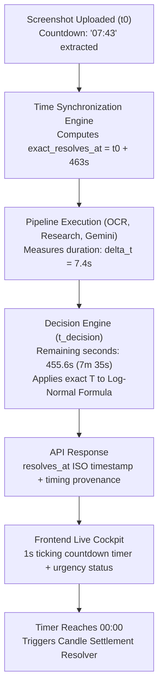
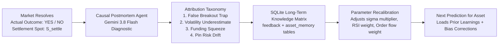

# Self-Improving Feedback Loop & Real-Time Temporal Engine
## Technical Specification & Implementation Plan

> **Status:** APPROVED FOR IMPLEMENTATION  
> **Target System:** Prediction Intelligence Platform  
> **Governing Rules:** [`AGENTS.md`](file:///Users/mac/prediction-market/AGENTS.md), [`CRYPTO_RESEARCH_AND_FORECASTING_STRATEGY.md`](file:///Users/mac/prediction-market/docs/CRYPTO_RESEARCH_AND_FORECASTING_STRATEGY.md)  
> **Date:** November 2026

---

## 1. Executive Summary & Strategic Objective

Prediction markets on short horizons (such as Bayse 15-minute UP/DOWN contracts or Polymarket hourly crypto strikes) are governed by two physical laws of financial mathematics:

1. **Deterministic Time Decay ($\Theta$ Acceleration):** As expiry approaches ($T \to 0$), the denominator $\sigma\sqrt{T}$ shrinks, causing the theoretical probability $P(\text{YES}) = \Phi(d_2)$ to rapidly converge toward either $1.0$ (if $S_t > K$) or $0.0$ (if $S_t < K$). An analysis performed with $7\text{m }43\text{s}$ remaining has a radically different risk profile and probability distribution than one evaluated at $6\text{m }10\text{s}$ or $1\text{m }30\text{s}$.
2. **Causal Learning & Empirical Self-Correction:** When real capital is at stake, static models degrade because market regimes shift (e.g., funding rate squeezes, weekend liquidity drains, news volatility bursts). Rather than relying on static canned feedback strings, our AI must conduct **causal postmortems** upon settlement, attributing discrepancies to specific structural phenomena and dynamically updating quantitative calibration parameters in SQLite memory.

This document operationalizes both pillars:
* **The Real-Time Temporal Engine:** Point-in-time synchronization from screenshot capture through backend pipeline latency to a live-ticking UI countdown timer.
* **The Causal Feedback & Self-Correction Loop:** An automated LLM postmortem reflection agent that evaluates settlements, recalibrates feature weights, and maintains long-term asset-specific memory.

---

## 2. Pillar I: The Real-Time Temporal Engine



### 2.1 Countdown Parsing & Resolution Anchoring

When a screenshot is ingested, the VLM or OCR extracts the visible countdown text (e.g., `"07:43"`, `"7m 43s"`, `"45s"`). Instead of treating this as dead descriptive text, the backend converts it into an absolute, immutable target timestamp:

$$\text{exact\_resolves\_at} = t_{\text{upload}} + \Delta t_{\text{countdown}}$$

Where:
* $t_{\text{upload}}$ is the UTC timestamp when the user created the analysis.
* $\Delta t_{\text{countdown}}$ is the parsed countdown in integer seconds.

Even if downstream vision models, market matchers, and LLM calls take $5$ to $15$ seconds to complete, the resolution timestamp $\text{exact\_resolves\_at}$ never drifts.

### 2.2 Time-To-Expiry Tracking Specification

At decision time ($t_{\text{decision}}$):

$$\text{decision\_seconds\_remaining} = \max\left(0, \text{exact\_resolves\_at} - t_{\text{decision}}\right)$$

$$\text{pipeline\_latency\_seconds} = t_{\text{decision}} - t_{\text{upload}}$$

The backend injects this exact remaining time $T = \frac{\text{decision\_seconds\_remaining}}{31,536,000}$ directly into the log-normal digital option formula:

$$d_2 = \frac{\ln(S / K) - \frac{1}{2}\sigma^2 T}{\sigma\sqrt{T}}$$

### 2.3 Trading Window Phases

The Temporal Engine classifies the interval into distinct risk regimes:

| Phase | Time Remaining (15m Interval) | Quantitative Behavior | Decision Rule |
|---|---|---|---|
| **Phase 1: Capital Accumulation** | $> 10\text{ min}$ ($> 66\%$) | Stable liquidity, moderate drift sensitivity | Standard EV evaluation |
| **Phase 2: Momentum Formation** | $5 - 10\text{ min}$ ($33\% - 66\%$) | Trend established, order flow imbalance peaks | Primary entry window |
| **Phase 3: Late Decay** | $2 - 5\text{ min}$ ($13\% - 33\%$) | $\Theta$ acceleration, spread widening on book | Penalty on thin depth, require higher net edge ($+2\%$) |
| **Phase 4: Pin Risk / Lock-In** | $< 2\text{ min}$ ($< 13\%$) | High gamma, extreme probability polarization | If $|S - K| / S < 0.1\% \to \text{NO\_TRADE}$ (pin risk). If deep ITM $\to P \to 0.99$. |
| **Phase 5: Candle Closed** | $\le 0\text{s}$ | Trading halted, awaiting oracle settlement | Trigger Auto-Settlement Resolver |

### 2.4 Live Frontend Countdown Cockpit

The frontend receives `forecast.market.resolves_at` and renders a live, second-by-second countdown widget:
* **Ticking Clock:** Decrements every 1,000ms using a clean client-side interval synchronized to system UTC.
* **Latency Provenance:** Displays `⚡ Analyzed in 6.4s (captured at 07:43, 07:36 at forecast)`.
* **Visual States:**
  * **Green (Active Window):** Time remaining $> 3\text{ minutes}$.
  * **Amber (Late Interval):** Time remaining $1 - 3\text{ minutes}$.
  * **Red Pulse (Final Expiry / Pin Risk):** Time remaining $< 1\text{ minute}$.
* **Zero-Crossing Event:** When the counter reaches `00:00`, the cockpit automatically shifts state to `"Candle Closed — Settling Outcome"`.

---

## 3. Pillar II: The Causal Feedback & Self-Correction Loop

### 3.1 The Problem with Static Feedback
Previously, when a user reported settlement outcome, the system recorded a hardcoded text template:
> *"Prediction discrepancy identified: recommended BUY_NO but market settled as YES. Likely driven by late interval volatility, tail news event, or order book liquidity evaporation."*

This template never varied, provided no genuine analytical value, and did not alter any quantitative parameters for subsequent trades.

### 3.2 The Self-Improving Architecture



### 3.3 The Causal Postmortem Agent

When an analysis is settled, the `PostmortemAgent` is invoked with the full feature context:
* **Initial State:** $S_{\text{entry}}$, Strike $K$, Expiry $T$, Volatility $\sigma$, Order book imbalance ratio, Funding rate, RSI.
* **Forecast Made:** $P(\text{YES})$, Recommendation (`BUY_YES` / `BUY_NO` / `NO_TRADE`), Expected Value.
* **Settlement State:** $S_{\text{settle}}$, Actual Outcome (`YES` / `NO`), Settlement Timestamp.

The agent applies a strict financial taxonomy:

1. **`VOLATILITY_BURST`:** Market moved $> 2.5\sigma\sqrt{T}$ beyond expectations. Action: Increase realized volatility scaling factor for this asset.
2. **`FALSE_BREAKOUT_TRAP`:** RSI and order book indicated continuation, but price mean-reverted before close. Action: Increase mean-reversion weight and reduce momentum weight.
3. **`FUNDING_RATE_SQUEEZE`:** Heavy positive (negative) funding led to sudden cascade liquidation. Action: Elevate funding rate penalty in directional bias.
4. **`LIQUIDITY_EVAPORATION`:** Thin order-book depth allowed small market orders to swing the price past the strike in the final 60 seconds. Action: Tighten minimum depth threshold for the decision engine.
5. **`ACCURATE_CONVICTION`:** Prediction was correct and edge was realized. Action: Reinforce signal weight vector.

### 3.4 Dynamic Parameter Updating in SQLite

We introduce a persistent `asset_calibration` table in SQLite:

```sql
CREATE TABLE IF NOT EXISTS asset_calibration (
    symbol TEXT NOT NULL,
    interval_type TEXT NOT NULL, -- '15m', '1h', 'daily'
    sample_count INTEGER NOT NULL DEFAULT 0,
    brier_score REAL NOT NULL DEFAULT 0.25,
    win_rate REAL NOT NULL DEFAULT 0.50,
    vol_multiplier REAL NOT NULL DEFAULT 1.0,
    momentum_weight REAL NOT NULL DEFAULT 0.35,
    order_flow_weight REAL NOT NULL DEFAULT 0.30,
    directional_bias REAL NOT NULL DEFAULT 0.0,
    updated_at TEXT NOT NULL,
    PRIMARY KEY (symbol, interval_type)
);
```

When `gather_crypto_intelligence()` runs for BTC on a 15-minute horizon, it reads `asset_calibration`:
* If past postmortems show an annualized volatility underestimate, $\sigma$ is multiplied by `vol_multiplier` (e.g. $1.15$).
* If the model has an empirical upward drift bias on this asset, `directional_bias` is applied as a shrinkage correction.

### 3.5 Automated Settlement Resolver (Zero Manual Clicks)

For live markets where the contract specifies a strike $K$ and an expiry timestamp $t_{\text{expiry}}$:
* A background task wakes up at $t_{\text{expiry}} + 5\text{s}$.
* It queries the Binance/Coinbase public ticker endpoint for the closing spot price $S_{\text{close}}$.
* If $S_{\text{close}} \ge K$, `actual_outcome = "YES"`; otherwise `"NO"`.
* It automatically triggers the `PostmortemAgent`, writes the feedback and calibration records, and emits an event to the frontend.

---

## 4. Implementation Steps & File Modifications

### Step 1: Create Temporal Engine Module
* **File:** `backend/src/prediction_ai/specialists/crypto/time_tracking.py`
* Implement regex-based countdown parsing (`07:43`, `7m 43s`, `45s`, `01:15:30`).
* Implement `resolve_market_timing()` computing `exact_resolves_at`, `pipeline_latency_seconds`, and `decision_seconds_remaining`.

### Step 2: Wire Time Tracking into Orchestration Runner
* **File:** `backend/src/prediction_ai/orchestration/runner.py`
* Capture `start_time` at workflow start.
* Parse `candidate.countdown_text` or `candidate.displayed_expiry` to establish `exact_resolves_at`.
* Populate `best_market.resolves_at` and `best_market.closes_at` with the resolved timestamp.
* Supply exact remaining seconds $T$ to `specialist_service.gather_context()`.
* Store timing provenance in `forecast_doc`.

### Step 3: Implement Dynamic Causal Postmortem Agent
* **File:** `backend/src/prediction_ai/learning/postmortem_agent.py`
* Replace static strings in `api/v1/analyses.py` with an intelligent Gemini reflection prompt.
* Formulate diagnostic root cause and extract parameter calibration adjustments.

### Step 4: Implement Persistent Asset Calibration Matrix
* **File:** `backend/src/prediction_ai/db/sqlite.py`
* Add `asset_calibration` table and helper methods (`get_calibration()`, `update_calibration()`).
* Ingest calibration adjustments in [`features.py`](file:///Users/mac/prediction-market/backend/src/prediction_ai/specialists/crypto/features.py).

### Step 5: Add Live Countdown Component to Frontend
* **File:** `apps/web/app/page.tsx`
* Embed a live ticking countdown widget directly into the Forecast Cockpit.
* Display pipeline processing latency badge.
* Add auto-settling state when the counter reaches 00:00.

---

## 5. Verification & Acceptance Criteria

1. **Countdown Parsing:** Parsing `"07:43"` yields exactly `463` seconds; `"12m 30s"` yields `750` seconds.
2. **No Time Drift:** If uploaded at `12:00:00` with 463s remaining, `resolves_at` is set to `12:07:43 UTC`. When pipeline completes at `12:00:08`, `decision_seconds_remaining` is exactly `455` seconds.
3. **Live UI Ticking:** Frontend counts down 1 second at a time, displays green/amber/red urgency, and does not flicker or trigger re-fetches.
4. **Causal Reflection:** Submitting feedback invokes the postmortem agent, stores diagnostic root cause and structured learnings, and updates `asset_calibration`.
5. **No Regressions:** All existing unit tests pass without error.
