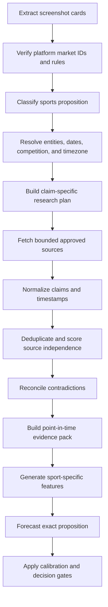

# Sports Research and Forecasting Plan

> **Status:** Proposed implementation plan  
> **Date:** 2026-11-05  
> **Scope:** Deep research, evidence validation, and calibrated forecasting for sports prediction markets  
> **Governing documents:** [Engineering Rules](prediction-intelligence-engineering-rules.md), [Technical Plan](prediction-intelligence-platform-technical-plan.md), [Architecture](ARCHITECTURE.md), [Integrations Guide](INTEGRATIONS_GUIDE.md), [Forecasting and Scoring](FORECASTING_AND_SCORING.md), [Edge Cases](EDGE_CASES.md)

## 1. Objective and Non-Negotiable Boundary

Sports markets require more than a generic YES/NO interpretation. A market may ask about a transfer, lineup, match result, player appearance, award, statistic, tournament qualification, manager status, or a deadline-specific event. The system must identify the exact proposition, collect evidence that was available before the forecast cutoff, reconcile contradictory reports, and produce a calibrated probability with uncertainty and an explicit abstention path.

The platform must not claim certainty, a guaranteed winner, or a universal "most accurate source." Source quality is conditional on the claim. An official club announcement is strongest for an official transfer, while a league or competition authority may be strongest for fixture status or disciplinary decisions. Journalism, specialist reporting, and odds are useful evidence but are not automatically truth.

The product boundary remains analysis and decision support. It does not place sports bets, guarantee returns, or convert an LLM's confidence language into a recommendation.

## 2. Attached Screenshot Example: Carrick Market

The screenshot appears to show a Bayse event titled approximately:

> `When Will Michael Carrick Leave Manchester United?`

It contains multiple date-specific contracts/cards, including:

- `Dec 31, 2026` with displayed chance `74%`.
- `Feb 28, 2027` with displayed chance `92%`.
- `Apr 30, 2027` with displayed chance `96%`.
- Additional later dates below the visible viewport.
- Separate `Buy Yes` and `Buy No` prices for each date.
- A total trade count and a visible event date.

This is not one binary question. It is a family of deadline propositions, likely of the form:

- `YES`: Michael Carrick leaves Manchester United on or before the card's deadline, or another exact rule defined by the platform.
- `NO`: He remains in the relevant role through that deadline.

The screenshot alone cannot establish:

- Whether "leave" means dismissal, resignation, contract expiry, reassignment, or any departure from the club.
- Whether the deadline is inclusive and at what timezone.
- Whether the market resolves on an official announcement, employment status, registration record, or another source.
- Whether the displayed chance is an implied price, a platform estimate, or a user-interface probability.
- Whether all cards are active, mutually exclusive, cumulative, or independently resolved.

The system must extract each visible card as a separate candidate, verify it against the platform API, and never merge the cards into a single probability.

## 3. System Alignment

| Existing boundary | Existing responsibility | Sports extension |
|---|---|---|
| `prediction_ai.vision` | Gemini extracts structured screenshot candidates | Extract event title, person/team/competition, card deadlines, outcomes, prices, visible source/date, and evidence regions |
| `prediction_ai.markets` | Matches screenshot candidates to official platform markets | Match each date card to its exact platform market ID and resolution terms |
| `prediction_ai.integrations` | Normalizes provider responses and order books | Add typed sports source adapters and provider capability metadata |
| `prediction_ai.specialists` | Domain-specific research context | Replace placeholder sports context with evidence packs, status timelines, and sport-specific features |
| `prediction_ai.forecasting` | Probability and uncertainty | Use a target-specific sports model and calibrated probability; LLM summarizes evidence only |
| `prediction_ai.decision` | EV, spread, liquidity, and fail-closed gates | Apply the same execution gates and add evidence completeness/contradiction gates |
| `research_sources` / evidence store | Source registry and point-in-time evidence | Store source authority, claim type, timestamps, licensing, and corroboration |
| `analysis_events` / SSE | Durable progress and replay | Show research stages, evidence completeness, contradiction status, and final abstention reasons |

No direct sports HTTP calls belong in the route handler or generic research service. Every provider must be isolated behind a typed adapter and validated response model.

## 4. Sports Market Taxonomy

Before research begins, classify the exact proposition. The classifier must be deterministic where possible and must emit `UNSUPPORTED_MARKET` or `NEEDS_USER_CONFIRMATION` when the proposition cannot be normalized safely.

### 4.1 Initial supported classes

1. **Transfer or departure by deadline**
   - Example: person leaves club by `2026-12-31`.
   - Evidence: official club/person announcement, registration/league record, reputable reporting of completed agreement.
2. **Appointment or dismissal by deadline**
   - Example: manager leaves, joins, or is replaced before a date.
   - Evidence: official club announcement and employment-status confirmation.
3. **Player appearance or participation**
   - Example: player starts, appears, or records minutes in a match.
   - Evidence: official lineup, match report, competition record.
4. **Match result, winner, qualification, or advancement**
   - Evidence: official fixture, competition state, lineups, injuries, historical and live performance data.
5. **Player/team statistics**
   - Example: goals, assists, cards, shots, passing, clean sheets.
   - Evidence: official match data or approved statistical provider with documented definitions.
6. **Awards, rankings, or season outcomes**
   - Evidence: governing body rules, official standings, schedule, and current results.

### 4.2 Unsupported or review-required classes

- Ambiguous language such as "leave," "win," "qualify," or "play" without a resolution definition.
- Markets whose outcome depends on an unverified social-media rumor.
- Props where the platform's statistic definition conflicts with available provider definitions.
- Markets requiring private medical, legal, or employment information.
- Markets with unresolved postponement, appeal, disciplinary, or governing-body status.
- Markets where the card's deadline, outcome mapping, or settlement source cannot be verified.

## 5. Evidence and Source Strategy

### 5.1 Source hierarchy by claim

The source registry must classify sources by claim ownership, not publish one global accuracy ranking.

| Claim | Tier 1 | Tier 2 | Tier 3 | Use rule |
|---|---|---|---|---|
| Official transfer/appointment/dismissal | Club, league, competition, or governing-body announcement | Multiple reputable sports desks | Specialist reporters and aggregators | Tier 3 cannot alone mark a completed event |
| Player availability/injury | Club or national-team update, official lineup | Reputable beat reporting with named sources | Aggregators/social posts | Unknown status widens uncertainty or abstains |
| Fixture/result/standing | Competition authority or official match report | Approved statistics provider | News report | Official result controls labels |
| Historical performance/statistics | Official competition data | Licensed statistics provider | Reputable databases | Definition and timestamp must match market rule |
| Transfer rumor or negotiation | Several independent reputable reports | Specialist reporter with clear sourcing | Social media | Rumor is evidence of possibility, never completed truth |
| Market price/liquidity | Platform CLOB/order book | Platform official quote endpoint | Screenshot | Screenshot is historical only |

The source registry must record provider, domain, source type, authority tier, permitted access method, rate limit, licensing/retention restrictions, update cadence, and historical evaluation results.

### 5.2 Claim-level evidence model

Do not pass a pile of URLs to Gemini. Normalize research into claims:

```json
{
  "claim_id": "claim-uuid",
  "claim_type": "employment_status",
  "subject": "person-or-team-id",
  "predicate": "currently_manager_of",
  "object": "club-id",
  "stance": "supports_yes | supports_no | neutral | unresolved",
  "claim_text": "Source-supported statement",
  "source_id": "approved-source-id",
  "published_at": "2026-11-05T08:00:00Z",
  "observed_at": "2026-11-05T08:00:00Z",
  "retrieved_at": "2026-11-05T08:01:00Z",
  "as_of_cutoff": true,
  "authority_tier": 1,
  "independence_group": "club-official",
  "content_hash": "sha256",
  "quality_flags": []
}
```

The evidence pack must separate:

- Confirmed facts.
- Reported but unconfirmed claims.
- Contradictory claims.
- Missing evidence.
- Market-rule interpretation.

### 5.3 Independence and corroboration

Three syndicated copies of one wire story do not equal three independent sources. Group evidence by origin, reporter, official source, and underlying document. A claim is corroborated only when independent sources add information or when an authoritative source confirms it.

The research service must detect:

- Duplicate URLs and syndicated copies.
- Publication-time conflicts.
- Revisions or deleted pages where detectable.
- Sources reporting an opinion as fact.
- Rumor language: `could`, `expected`, `in talks`, `understands`, `reportedly`, and similar qualifiers.
- Old stories being incorrectly treated as current.

## 6. Deep Research Workflow



### 6.1 Research-plan generation

The research planner must be deterministic and proposition-specific before any LLM synthesis. It should produce:

- Entity IDs: person, club, opponent, league, competition, season.
- Proposition type and exact target definition.
- Deadline, timezone, and cutoff.
- Required facts.
- Preferred source types for each fact.
- Maximum source count and follow-up rounds.
- Stop conditions.
- Failure conditions requiring abstention.

Example for Carrick departure:

1. Retrieve the exact Bayse market rule and deadline.
2. Identify the person, club, role, and current employment status.
3. Check official Manchester United and relevant competition/league sources.
4. Search approved high-quality sports desks for current reporting, explicitly preserving rumor qualifiers.
5. Check recent appointment, contract, interim-role, and club statement timelines.
6. Determine whether the deadline is cumulative and whether the card is active.
7. Build separate evidence for each visible deadline card.

### 6.2 Bounded research policy

Per analysis, enforce:

- Maximum research rounds: 2 by default.
- Maximum source documents: configurable, initial target 12.
- Maximum passages per source: configurable, initial target 3.
- Maximum provider calls per source class.
- Maximum wall-clock time.
- Maximum LLM calls and tokens.
- Maximum parallel calls.

Stop early when required facts are confirmed with sufficient independent evidence. Do not keep searching to manufacture certainty.

### 6.3 Freshness and point-in-time cutoff

Every source must be filtered by availability at the forecast cutoff:

$$
\text{usable evidence} = \{e : e.published\_at \le t_{\text{cutoff}}\ \text{or}\ e.observed\_at \le t_{\text{cutoff}}\}
$$

Retrieval time after the cutoff does not make a later-published article eligible. Revisions must be tracked where possible. Backtests must use the historical source version available at that time.

## 7. Contradiction and Resolution Rules

The agent must not average contradictory reports into a false consensus.

### 7.1 Conflict states

- `CONFIRMED`: authoritative source or qualifying evidence directly establishes the fact.
- `PROBABLE`: several independent reputable reports agree, but no authoritative confirmation exists.
- `CONTESTED`: credible sources materially disagree.
- `UNRESOLVED`: required evidence is absent or too ambiguous.
- `STALE`: evidence is outside the proposition's freshness window.

### 7.2 Conflict handling

1. Preserve every material claim and source.
2. Compare claim timestamps and whether each source had first-hand authority.
3. Prefer the source that owns the fact, not merely the source with the strongest language.
4. Distinguish an agreement from a completed event.
5. Widen uncertainty for `PROBABLE` and `CONTESTED` states.
6. Force `NO_TRADE` when the market resolution depends on an unresolved contradiction.
7. Let official settlement data override media narrative for post-event labels.

A sports LLM may summarize why a claim is contested, but it may not resolve a dispute by intuition.

## 8. Exact Market Semantics

### 8.1 Date-card markets

For markets like the attached screenshot, define each card independently:

```json
{
  "market_id": "bayse:verified-id",
  "proposition_type": "person_departure_by_deadline",
  "subject": "michael-carrick",
  "organization": "manchester-united",
  "role": "manager-or-defined-role",
  "operator": "on_or_before",
  "deadline": "2026-12-31T23:59:59Z",
  "yes_definition": "Officially leaves the defined role before or at deadline under platform rules",
  "no_definition": "Does not satisfy the YES condition by deadline",
  "resolution_source": "verified platform rule",
  "outcome_ids": {"yes": "...", "no": "..."}
}
```

If the platform definition is not exact, stop before forecasting. Do not infer the meaning of "leave" from the card title.

### 8.2 Correlated date cards

Date cards may be nested or correlated. For example, `leaves by Dec 31` logically includes `leaves by Feb 28` if the definitions are cumulative. The system must not treat each card as independent evidence.

Research and evaluation must model:

- Monotonicity constraints where the proposition logically implies them.
- Conditional probability between deadlines.
- Different liquidity and market-maker quality per card.
- The possibility that cards use different resolution definitions.

If observed prices violate a known logical constraint, flag a market/data inconsistency. Do not automatically "correct" the prices.

## 9. Sports Feature Families

Features must be versioned, point-in-time, and tied to the exact proposition.

### 9.1 Transfer and employment markets

- Current official employment status.
- Contract end date if publicly documented and relevant.
- Appointment or dismissal history.
- Recent official statements.
- Reports of negotiations, with rumor qualifiers retained.
- Role stability, interim status, and successor process.
- Club performance and management pressure only as secondary features.
- Deadline distance in days and relevant transfer/registration windows.
- Market-implied probability and liquidity.

### 9.2 Match and team markets

- Confirmed lineups and formation.
- Injuries, suspensions, rotation, and rest days.
- Home/away and travel schedule.
- Recent performance with time-decayed weighting.
- Opponent strength and tactical matchup.
- Expected goals or equivalent approved metrics.
- Weather/pitch only when relevant and sourced.
- Competition incentives, qualification state, and schedule congestion.
- Odds/market price as a benchmark, not as ground truth.

### 9.3 Player markets

- Player availability and confirmed participation.
- Expected minutes and role.
- Opponent matchup and defensive assignment.
- Recent usage and minutes, adjusted for opponent and game state.
- Historical event rate with shrinkage for small samples.
- Official statistic definition matching the resolution rule.

Do not double-count correlated features such as multiple versions of recent win rate, possession, and expected-goal measures. Cluster or regularize feature groups.

## 10. Forecasting Architecture

The forecasting path must remain separate from research synthesis:

1. **Target builder:** Converts verified market rules into a typed outcome target.
2. **Feature builder:** Produces point-in-time sports features and evidence-state flags.
3. **Baseline:** Market-implied executable probability and a simple historical base-rate model.
4. **Sport model:** A validated statistical model appropriate to proposition type.
5. **Calibration:** Platt or isotonic calibration selected by sample size and validated chronologically.
6. **Uncertainty:** Confidence/credible interval widened for missing, stale, or contested evidence.
7. **Explanation layer:** LLM produces a concise evidence-linked explanation after the numeric probability exists.
8. **Decision engine:** Applies spread, depth, fees, edge, freshness, and evidence gates.

The LLM must not invent a probability from prose. If a quantitative model is unavailable for a proposition type, the system must produce a transparent baseline or `NO_TRADE`, not an unsupported confident forecast.

## 11. Research Output Contract

The specialist should return a validated `SportsEvidencePack`, not an untyped dictionary:

```json
{
  "pack_version": "sports_evidence_v1",
  "proposition_type": "person_departure_by_deadline",
  "cutoff_at": "2026-11-05T10:00:00Z",
  "identity": {
    "subject": "michael-carrick",
    "organization": "manchester-united",
    "competition": null
  },
  "claims": [],
  "required_facts": {
    "current_status": "confirmed | probable | contested | unresolved",
    "resolution_definition_verified": true,
    "deadline_verified": true
  },
  "contradictions": [],
  "source_quality": {
    "tier_1_count": 0,
    "independent_source_groups": 0,
    "freshest_source_at": null
  },
  "features": {},
  "quality_flags": [],
  "recommendation_gate": "eligible | abstain"
}
```

Pydantic validation must reject missing cutoff, invalid stance values, post-cutoff claims, unbounded source lists, and missing resolution-definition verification.

## 12. API, UI, and Event Plan

### 12.1 Progress stages

Add explicit stages without pretending that research is a measured percentage:

1. `SCREENSHOT_EXTRACTION`
2. `MARKET_IDENTIFICATION`
3. `MARKET_VERIFICATION`
4. `SPORTS_TARGET_CLASSIFICATION`
5. `SPORTS_RESEARCH_PLAN`
6. `SPORTS_EVIDENCE_COLLECTION`
7. `SPORTS_CONTRADICTION_REVIEW`
8. `FEATURE_BUILDING`
9. `FORECASTING`
10. `DECISION_EVALUATION`

The UI should show named stages, source counts, freshness, and whether research is complete. It must not display unsupported accuracy percentages.

### 12.2 Result presentation

For every sports result, show:

- Exact market proposition and deadline.
- Resolution definition and source.
- Forecast probability and uncertainty interval.
- Recommendation or `NO_TRADE`.
- Evidence grouped by supporting, contradicting, and unresolved claims.
- Source tier, publication time, retrieval time, and point-in-time eligibility.
- Current market price, executable price, spread, depth, and timestamp.
- Key features used by the model.
- What would invalidate the forecast.
- Model, calibration, evidence-pack, and context versions.

Do not show a green recommendation badge for `NO_TRADE`. Do not hide contradictory evidence behind a generic confidence score.

## 13. Persistence and Schema Changes

Use versioned migrations and an expand-contract rollout. Recommended entities:

- `research_sources`: approved source registry and provider capabilities.
- `research_documents`: content hash, timestamps, canonical URL, licensing metadata.
- `sports_claims`: normalized claim, subject/object, stance, source, timestamps, independence group.
- `sports_evidence_packs`: immutable pack, cutoff, quality flags, pack hash.
- `sports_targets`: exact proposition, entities, operator, deadline, resolution source.
- `forecast_inputs`: feature set, evidence pack ID/hash, market snapshot ID, model versions.

Existing analysis and forecast records should reference the evidence-pack and target IDs. Never overwrite historical evidence after a forecast is produced.

## 14. Testing and Evaluation Matrix

### Unit tests

- Proposition classification for transfer, match, player, award, and statistic markets.
- Entity and date normalization.
- Inclusive/exclusive deadline semantics.
- Claim stance and rumor-language detection.
- Source-tier and independence scoring.
- Duplicate/syndicated article detection.
- Point-in-time cutoff filtering.
- Contradiction-state calculation.
- Correlated date-card constraints.
- Evidence completeness and abstention gates.

### Adapter and contract tests

- Official club/league/competition fixture payloads.
- Approved sports news provider payloads.
- Statistics provider definitions and timestamps.
- Malformed, stale, duplicate, revised, and rate-limited provider responses.
- Provider terms and response-size limits.
- No direct HTTP calls from specialist or route modules.

### End-to-end scenarios

1. Carrick card with official confirmation: forecast eligible after rule verification.
2. Carrick card with only transfer rumors: probability may be estimated only if the model supports it; no claim may be labeled confirmed.
3. Two cards with nested deadlines: model dependency and price inconsistency are surfaced.
4. Screenshot shows one deadline while platform returns several active cards: exact card confirmation required.
5. Official source contradicts a reputable reporter: state is `CONTESTED` or authoritative resolution wins according to claim type.
6. Fixture postponed after screenshot capture: current fixture status replaces stale screenshot state.
7. Player listed in a rumor but absent from official lineup: official lineup controls the match target.
8. Source outage: required evidence pack incomplete, with explicit abstention or widened uncertainty.
9. Browser reconnects during research: persisted evidence-pack progress is restored.
10. Prompt injection in article or screenshot: content remains data and cannot change tools, policies, or target definition.

### Forecast metrics

Report by sport, league, proposition type, horizon, evidence quality, and liquidity bucket:

- Brier score and log loss.
- Expected calibration error and reliability curve.
- Coverage and interval calibration.
- Market-baseline skill score.
- Abstention and safe-abstention rate.
- Recommendation performance after spread, fees, and slippage.
- Source freshness and contradiction-detection precision.
- Extraction accuracy for entity, deadline, outcome, and resolution rule.
- Latency, provider calls, token use, and cost per analysis.

No model promotion occurs without a chronological holdout, leakage review, baseline comparison, and explicit approval.

## 15. Rollout Plan

### Phase 0: Source and contract inventory

- Verify official provider documentation, terms, rate limits, and allowed access methods.
- Define the first supported sport and proposition class.
- Create sanitized fixtures and a source-quality evaluation set.
- Record unresolved provider assumptions in an ADR.

### Phase 1: Exact screenshot and market target

- Extend extraction for cards, dates, entities, outcomes, and evidence regions.
- Match each card to a verified platform market.
- Block ambiguous or semantically incomplete markets.

### Phase 2: Evidence pack in shadow mode

- Build sports research packs without changing recommendations.
- Measure source freshness, duplication, contradiction detection, latency, and cost.
- Review a human sample for claim correctness and citation quality.

### Phase 3: Target-specific baselines

- Implement historical and market-implied baselines per proposition type.
- Persist forecasts and evidence packs immutably.
- Run chronological evaluation before any production recommendation.

### Phase 4: Calibrated sports models

- Train or configure sport-specific models only where sufficient verified labels exist.
- Use champion/challenger evaluation and frozen holdouts.
- Promote only after calibration, leakage, operational, and safety gates pass.

### Phase 5: Controlled user rollout

- Enable one sport/proposition class behind a feature flag.
- Start with read-only evidence and `NO_TRADE` for incomplete packs.
- Expand only when source quality, latency, calibration, and abstention metrics meet predeclared thresholds.

### Rollback

Disable the sports feature flag, retain immutable records, and fall back to analysis-only evidence display or `NO_TRADE`. Do not delete evidence or reverse migrations destructively.

## 16. Definition of Done

- [ ] Screenshot card, entity, outcome, deadline, and resolution rule are extracted and verified.
- [ ] The exact proposition is represented as a typed target.
- [ ] Sources are allowlisted, claim-appropriate, timestamped, and point-in-time filtered.
- [ ] Research is bounded by source count, rounds, tokens, calls, concurrency, and wall time.
- [ ] Claims are deduplicated and independent-source groups are tracked.
- [ ] Contradictions are preserved and affect uncertainty or abstention.
- [ ] Official settlement facts are separated from rumors and user feedback.
- [ ] Numeric probability comes from a validated forecasting/calibration path.
- [ ] The LLM only summarizes evidence and explains model output.
- [ ] Missing resolution semantics, stale data, or incomplete evidence fail closed.
- [ ] Evidence packs, target definitions, and forecast inputs are immutable and hashable.
- [ ] UI displays sources, timestamps, contradictions, uncertainty, and abstention reasons.
- [ ] Unit, adapter, integration, end-to-end, failure, security, and AI-evaluation tests pass.
- [ ] Rollout, rollback, provider terms, cost budgets, and operational runbooks are documented.

## 17. Open Decisions Before Coding

These must be verified from official provider documentation and captured in an ADR:

1. Which sports data provider is licensed and permitted for the initial launch?
2. Which source owns each fact: club, league, competition, governing body, or statistics provider?
3. Which exact Bayse fields define card identity, settlement deadline, outcome semantics, and resolution source?
4. Does each transfer/departure market resolve on announcement, registration, employment state, or another event?
5. Which sport and proposition class has enough verified historical labels for a calibrated model?
6. What source freshness window is appropriate for rumors, lineups, fixtures, and statistics?
7. How will revised or deleted articles be retained for point-in-time evaluation?
8. What evidence completeness threshold permits a forecast, and what conditions force `NO_TRADE`?
9. How are nested date-card probabilities evaluated without treating them as independent?
10. What human review process approves source-registry changes and model promotion?

Until these are answered, the system may display extracted market facts and research status but must not present a confident sports recommendation based on unverified reporting.
