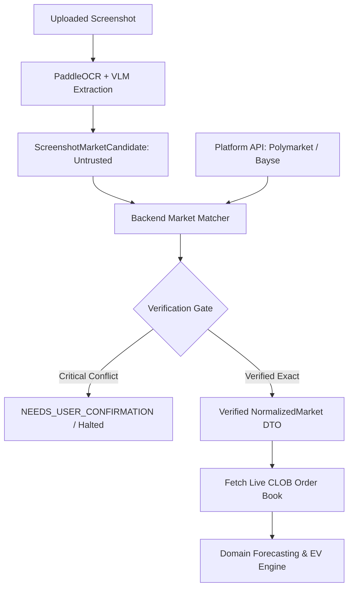

# ADR 0001: Server-Side Authoritative Verification (Server is the Referee)

- **Status:** Accepted
- **Date:** 2026-11-04
- **Deciders:** Architecture Core Team
- **Consulted:** Security, Prediction Market Integration Specialists, ML Engineers

---

## 1. Context and Problem Statement

In a screenshot-driven prediction intelligence platform, the user's primary interface is an image of a prediction market UI (from Polymarket or Bayse).

Screenshots present severe integrity challenges:
- **OCR Inaccuracy:** Small fonts, dark mode, compression artifacts, and mobile layouts can cause OCR engines to misread decimal prices (e.g., confusing `$0.48` with `$0.43`), switch YES and NO odds, or misread expiration dates.
- **Client Manipulation / Spoofing:** A user or attacker may upload doctored images, fabricated price displays, or non-existent markets.
- **Staleness:** A screenshot captures a single millisecond in the past; real-time order-book odds and executable depth move continuously.
- **Resolution Ambiguity:** Prediction market rules often hinge on precise legal phrasing and specified oracle sources (e.g., UMA Optimistic Oracle resolving via Binance 1-minute close vs CME index price).

We must decide how the system treats the uploaded screenshot and whether a forecast can ever be based solely on client-provided or vision-extracted data.

---

## 2. Decision Drivers

- **Zero Tolerance for Hallucinated Targets:** Forecasting an outcome for a misinterpreted or non-existent contract leads to catastrophic decision error.
- **Contract Integrity:** The resolution criteria specified on-chain or in the platform's official database is the sole arbiter of market settlement.
- **Security & Anti-Spoofing:** Client inputs must always be treated as untrusted suggestions, never ground truth.

---

## 3. Considered Options

- **Option A (Vision as Source of Truth):** Trust the OCR/VLM extraction directly. Use the extracted price and question to generate a forecast without checking platform APIs.
- **Option B (Server is the Referee — Authoritative Cross-Verification):** Treat the screenshot and OCR output strictly as *candidate query parameters*. The backend server independently searches official platform APIs (Polymarket Gamma, CLOB, Bayse API), retrieves official market metadata, verifies active status, resolution criteria, and live order books. Only verified platform contracts proceed to the forecasting pipeline.

---

## 4. Decision Outcome

We adopt **Option B: Server is the Referee**.

1. **Extraction Yields Candidates Only:** The vision/OCR pipeline emits a `ScreenshotMarketCandidate` containing raw extracted strings and confidence scores. It is explicitly marked unverified.
2. **Server-Side Platform Lookup:** The orchestrator queries the platform adapter using extracted titles, slugs, market IDs, and asset names.
3. **Deterministic Verification Gate:** A candidate must achieve `VERIFIED_EXACT` or `VERIFIED_WITH_NONCRITICAL_DIFFERENCES` status against official platform records:
   - Match criteria: Question text, outcome token definitions, expiration timestamp/timezone, and resolution source.
   - Any critical conflict (e.g., mismatched expiry date, different underlying strike price, unreadable outcome labels) triggers an immediate transition to `NEEDS_USER_CONFIRMATION` or halts at `UNVERIFIED`.
4. **Execution Prices from Live Book:** The decision engine never uses the price visible in the screenshot. It uses the real-time executable depth from the official platform CLOB order book snapshot at the exact moment of analysis.

---

## 5. Consequences & Trade-offs

### Positive
- **Guaranteed Contract Alignment:** The forecast model trains and infers against the exact, verified resolution terms, eliminating errors caused by visual misinterpretation.
- **Immunity to Screenshot Tampering:** A user who tampers with a screenshot cannot fool the engine into evaluating a fictitious price or payout rule.
- **Freshness Assurance:** By fetching the real-time order book from the platform API, the decision engine evaluates live bid/ask quotes and slippage rather than historical screenshot pixels.

### Negative / Risks & Mitigations
- **API Dependency:** If Polymarket or Bayse APIs suffer outages or rate-limiting, the system cannot verify markets and must halt.
  - *Mitigation:* Implement caching of static market metadata, exponential backoff retries, and clear `PROVIDER_UNAVAILABLE` error messaging.
- **User Friction on Ambiguous Matches:** Similar contracts (e.g., "Will BTC hit \$100k by Nov 15?" vs "by Nov 30?") may require user confirmation.
  - *Mitigation:* Deliver an interactive confirmation modal with high-clarity diff highlights showing the extracted screenshot text versus the platform candidate.

---

## 6. Revisit Triggers

- Introduction of decentralized prediction markets lacking REST APIs, requiring direct on-chain smart contract state reads via RPC.
