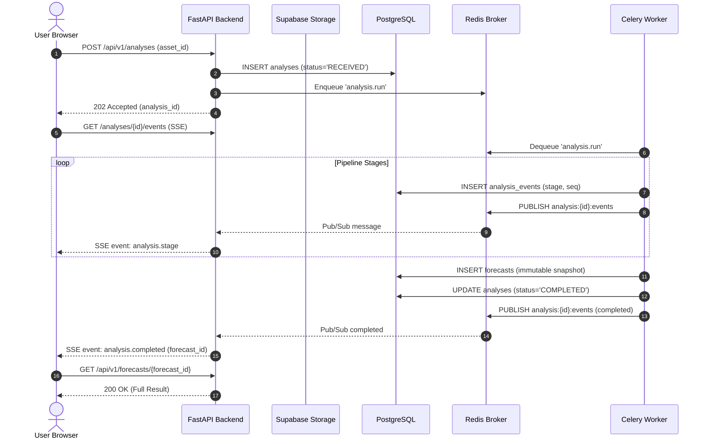

# ADR 0002: Asynchronous Job Orchestration with SSE Progress Replay

- **Status:** Accepted
- **Date:** 2026-11-04
- **Deciders:** Architecture Core Team
- **Consulted:** Backend, Frontend, DevOps

---

## 1. Context and Problem Statement

Executing a full prediction intelligence analysis is a multi-stage, I/O- and compute-intensive workflow:
1. Validating and storing the screenshot in private object storage.
2. Executing dual-pass OCR and VLM structured extraction.
3. Querying prediction market APIs to identify and verify the contract.
4. Ingesting live and historical exchange order books, trade flows, and candles.
5. Performing semantic document retrieval (`pgvector`) and evidence ranking.
6. Running statistical GBDT inference and probability calibration.
7. Calculating executable fees, spread, slippage, and expected-value decision policy.

This entire pipeline typically requires between **4 and 25 seconds** depending on external API latencies and research depth. 

Holding a synchronous HTTP request open for this duration leads to:
- Edge proxy timeouts (e.g., Cloudflare 100s timeout, reverse proxy 30s timeouts).
- Frontend connection resets when mobile clients switch networks or screen states.
- FastAPI thread/connection exhaustion under concurrent load.
- Inability to deliver fine-grained progress feedback to the user.

---

## 2. Decision Drivers

- **Client Resilience:** User sessions must be able to disconnect, reload, or navigate away without terminating or corrupting the analysis in progress.
- **Observability & UX:** Users must see real-time progress indicators reflecting actual pipeline stages (`VALIDATING`, `MATCHING_MARKET`, `INGESTING_EXCHANGE_DATA`, `EVALUATING_EVIDENCE`, `CALIBRATING_FORECAST`).
- **Bounded HTTP Deadlines:** API endpoints must return within standard SLO limits ($< 500\text{ ms}$).

---

## 3. Considered Options

- **Option A (Synchronous HTTP with Long Timeouts):** Client holds `POST /api/v1/analyses` open until completion.
- **Option B (Asynchronous Task Queue with Polling Only):** `POST` returns `202 Accepted`; client polls `GET /api/v1/analyses/{id}` every 1–2 seconds.
- **Option C (Asynchronous Task Queue with SSE Stream and Polling Fallback):** `POST` returns `202 Accepted`. Celery worker executes the workflow and publishes stage events to Redis Pub/Sub and PostgreSQL `analysis_events`. Next.js client connects to an SSE endpoint (`/events`) with replay capability (`Last-Event-ID`), with polling as a fallback.

---

## 4. Decision Outcome

We adopt **Option C: Asynchronous Job Orchestration with SSE Replay**.

1. **Immediate Job Acceptance:** 
   - `POST /api/v1/analyses` validates the upload intent, creates an `analyses` record in state `RECEIVED`, enqueues a Celery task `analysis.run`, and returns `202 Accepted` in $< 200\text{ ms}$ with:
     ```json
     {
       "analysis_id": "9b1deb4d-3b7d-4bad-9bdd-2b0d7b3dcb6d",
       "status": "RECEIVED",
       "status_url": "/api/v1/analyses/9b1deb4d-3b7d-4bad-9bdd-2b0d7b3dcb6d",
       "events_url": "/api/v1/analyses/9b1deb4d-3b7d-4bad-9bdd-2b0d7b3dcb6d/events"
     }
     ```
2. **Worker Execution:**
   - Dedicated Celery worker pools process the pipeline.
   - At each stage transition, the worker writes an append-only event to the `analysis_events` table (providing auditability and replay) and broadcasts it to a Redis channel `analysis:{id}:events`.
3. **SSE Delivery with Event IDs:**
   - The client connects to `GET /api/v1/analyses/{id}/events`.
   - The SSE handler checks the `Last-Event-ID` header. If reconnecting, it replays missed events from `analysis_events` before tailing the live Redis pub/sub channel.
4. **Authoritative State:**
   - SSE is purely an acceleration layer for UX. The durable source of truth is always PostgreSQL. When the client receives `event: analysis.completed`, it fetches the verified snapshot via `GET /api/v1/forecasts/{id}`.



---

## 5. Consequences & Trade-offs

### Positive
- **Zero HTTP Timeouts:** HTTP requests complete in sub-second timeframes, completely eliminating reverse-proxy gateway timeouts.
- **Seamless Recovery:** If the user refreshes the page or walks into an elevator, the browser reconnects with `Last-Event-ID` and resumes the exact visual stage.
- **Resource Protection:** Worker concurrency and API connection pools are decoupled; an influx of analysis requests does not degrade API availability.

### Negative / Risks & Mitigations
- **SSE Connection Overhead:** Persistent SSE connections consume server sockets.
  - *Mitigation:* Configure FastAPI with `uvicorn` worker concurrency limits, keep-alive ping headers every 15 seconds, and automatic connection close upon reaching terminal states (`COMPLETED`, `FAILED`, `CANCELLED`).
- **Distributed State Management:** Requires Redis pub/sub alongside PostgreSQL.
  - *Mitigation:* Ensure Redis channel failures trigger safe client fallback to polling `GET /analyses/{id}` every 2 seconds.

---

## 6. Revisit Triggers

- Shift to high-frequency live websocket analysis monitoring where bidirectional client interaction is necessary during the forecast run.
