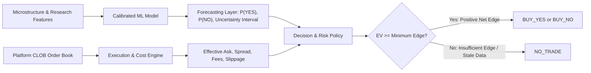

# ADR 0003: Strict Decoupling of Probabilistic Forecasting and Decision Engine

- **Status:** Accepted
- **Date:** 2026-11-04
- **Deciders:** Architecture Core Team
- **Consulted:** Quantitative Researchers, Machine Learning Engineers, Financial Risk Specialists

---

## 1. Context and Problem Statement

A naive prediction tool frequently collapses probabilistic inference and trading decisions into a single opaque output (e.g., an LLM prompt returning "Strong Buy YES with 90% confidence!").

This conflation creates severe vulnerabilities:
- **Ignorance of Executable Friction:** A market may have a true $P(\text{YES}) = 0.65$, but if the executable YES contract asks for $\$0.68$, buying YES has negative expected value ($EV < 0$).
- **Obfuscation of Root-Cause Attribution:** When a trade loses, it is impossible to determine whether the failure was caused by miscalibrated probabilities, excessive slippage, unexpected fee structures, or bad decision thresholds.
- **Uncontrolled Risk & Lack of Abstention:** Without an explicit mathematical decision layer, systems fail to abstain (`NO_TRADE`) in the presence of wide spreads, low order-book depth, or high model uncertainty.

---

## 2. Decision Drivers

- **Proper Scoring Rule Validity:** Probability estimates must be evaluable strictly using proper scoring rules (Brier score, Log loss, Expected Calibration Error) independent of platform market prices.
- **Realistic Economic Accounting:** Expected value must incorporate taker fees, order-book depth, and liquidity slippage.
- **Abstention as a First-Class Output:** The engine must enforce `NO_TRADE` whenever edge is insufficient, data is stale, or uncertainty is elevated.

---

## 3. Considered Options

- **Option A (Coupled End-to-End Decision Model):** A single model directly outputs trade signals (`BUY_YES`, `BUY_NO`, `NO_TRADE`) based on price and features.
- **Option B (Two-Stage Decoupled Architecture):**
  - **Stage 1 (Forecasting Engine):** Produces purely objective, calibrated probabilities $P(\text{YES}) \in [0, 1]$ and uncertainty bounds.
  - **Stage 2 (Decision & Risk Policy):** Consumes $P(\text{YES})$, current CLOB order-book depth, fees, and risk parameters to compute Expected Value ($EV$) and output the recommendation.

---

## 4. Decision Outcome

We adopt **Option B: Two-Stage Decoupled Architecture**.

### 4.1 Mathematical Formulation of Decision Engine

For a binary contract settling at $\$1.00$ on victory and $\$0.00$ on defeat:

1. **Effective Entry Cost:**
   $$\text{Cost}_{\text{YES}} = \text{Ask}_{\text{YES}} + \text{Fee}_{\text{taker}} + \text{Slippage}(V)$$
   Where $\text{Ask}_{\text{YES}}$ is obtained by walking the CLOB order book for a standard order size $V$, $\text{Fee}_{\text{taker}}$ is the platform fee, and $\text{Slippage}(V)$ is the liquidity penalty.

2. **Expected Value ($EV$) Calculation:**
   $$EV_{\text{YES}} = P(\text{YES}) \cdot 1.00 - \text{Cost}_{\text{YES}} = P(\text{YES}) - \text{Cost}_{\text{YES}}$$
   $$EV_{\text{NO}} = P(\text{NO}) \cdot 1.00 - \text{Cost}_{\text{NO}} = (1 - P(\text{YES})) - \text{Cost}_{\text{NO}}$$

3. **Gating Criteria for Execution:**
   A recommendation of `BUY_YES` is emitted if and only if:
   $$EV_{\text{YES}} \ge \delta_{\text{min}} + U_{\text{margin}}$$
   Where:
   - $\delta_{\text{min}}$ is the minimum required edge (e.g., $0.04$ or $4\%$).
   - $U_{\text{margin}}$ is an uncertainty penalty derived from calibration variance and model disagreement.
   - All data-quality flags (`market_verified`, `critical_feeds_fresh`, `sufficient_depth`) are `true`.
   
   If these conditions are not satisfied, the engine strictly outputs **`NO_TRADE`**.

---

## 5. Consequences & Trade-offs

### Positive
- **Independent Model Evaluation:** Models can be evaluated, calibrated, and promoted based solely on statistical accuracy and Brier score without market price confounding.
- **Dynamic Policy Tuning:** Risk parameters ($\delta_{\text{min}}$, maximum allowable spread, position sizing formulas) can be updated in the decision policy without retraining underlying forecasting models.
- **Clear Postmortem Diagnostics:** When an analysis fails, postmortems can isolate whether the forecast was inaccurate ($|P(\text{YES}) - y| \gg 0$) or if the decision policy underestimated execution slippage.

### Negative / Risks & Mitigations
- **Complexity in Snapshot Storage:** Both the probability distribution and the execution cost metrics must be serialized into the immutable forecast record.
  - *Mitigation:* The `forecasts` schema contains explicit, typed columns for `probability_yes`, `probability_no`, `uncertainty_interval`, and `decision_metrics`.

---

## 6. Revisit Triggers

- Introduction of multi-outcome categorical prediction markets (e.g., 5-candidate political primaries) requiring multi-asset portfolio optimization and Dirichlet probability modeling.
