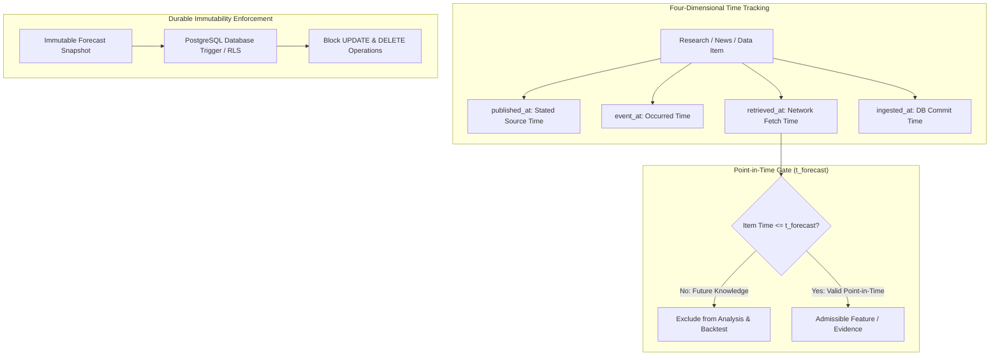

# ADR 0004: Point-in-Time Data Immutability and Anti-Leakage Controls

- **Status:** Accepted
- **Date:** 2026-11-04
- **Deciders:** Architecture Core Team
- **Consulted:** Quantitative Engineers, Database Architects, Security

---

## 1. Context and Problem Statement

In probabilistic forecasting and quantitative decision support, **look-ahead bias** and **data leakage** are the leading causes of model collapse upon production deployment. 

Leakage manifests in subtle ways:
- Joining document research or news articles using publication dates where the actual article was edited, syndicated, or crawled hours *after* market resolution.
- Joining high-frequency exchange candles using arrival time rather than event timestamp.
- Normalizing or scaling training datasets across global time horizons rather than strictly within the historical training window.
- Mutating historical forecast records post-resolution to align with observed results, destroying historical auditability.
- Allowing user feedback or sentiment reports to overwrite the official settlement record.

---

## 2. Decision Drivers

- **Zero Information Leakage:** Historical backtests and model evaluations must use strictly the information that was available at forecast timestamp $t_{\text{forecast}}$.
- **Auditable Forecast Immutability:** Once an analysis is finalized, its forecast record must never be altered, updated, or rewritten.
- **Independent Verification:** Official market resolution must originate from verified platform settlement or official oracle contracts, cleanly separated from user feedback.

---

## 3. Considered Options

- **Option A (Mutable Relational Snapshot):** Keep a single `predictions` record updated as new data, user feedback, and market resolution arrive.
- **Option B (Immutable Event & Snapshot Ledger with Point-in-Time Joins):**
  - Forecast snapshots are append-only and strictly immutable.
  - Resolutions and user feedback are stored in separate relational tables linked by foreign key.
  - Research document ingestion distinguishes four separate timestamps: `published_at`, `event_at`, `retrieved_at`, and `ingested_at`.
  - Machine learning evaluation enforces walk-forward chronological splits with purged embargo windows.

---

## 4. Decision Outcome

We adopt **Option B: Immutable Event & Snapshot Ledger with Point-in-Time Joins**.

### 4.1 Strict Snapshot Immutability
- The `forecasts` table records the complete state of the analysis: `market_id`, `target_definition`, `probability_yes`, `probability_no`, `uncertainty_interval`, `decision_metrics`, `data_quality`, `model_version`, `prompt_version`, and `input_snapshot`.
- Application-level rules and database triggers reject any `UPDATE` or `DELETE` statements on the `forecasts` table.
- Subsequent events (e.g., official settlement, user dispute, postmortem evaluation) are inserted into linked tables (`market_resolutions`, `user_prediction_feedback`, `forecast_postmortems`).

### 4.2 Time Invariant for Retrieval & Backtesting
For any historical forecast or backtest conducted as of time $t_{\text{forecast}}$:
$$\text{Admissible Documents} = \{ D \mid \max(D.\text{published\_at}, D.\text{retrieved\_at}) \le t_{\text{forecast}} \}$$
If $D.\text{published\_at}$ is unknown, the document cannot be backtested prior to its verified $D.\text{retrieved\_at}$.

### 4.3 Purged & Embargoed Cross-Validation
To prevent information leakage across overlapping forecast horizons (e.g., 15-minute and 1-hour BTC markets):
- **Purging:** Training observations whose label horizons overlap with the test set window are eliminated.
- **Embargoing:** A buffer period equal to the maximum forecast horizon is enforced between training and testing sets to eliminate autoregressive serial correlation.

---

## 5. Consequences & Trade-offs

### Positive
- **Guaranteed Real-World Reproducibility:** Historical performance metrics match real-time production performance; backtests are immune to survivorship and look-ahead bias.
- **Regulatory & Audit Readiness:** Every recommendation is permanently auditable against the exact evidence pack and model weights present at the moment of emission.
- **Uncompromised Truth:** Official market resolution cannot be corrupted by malicious or mistaken user feedback.

### Negative / Risks & Mitigations
- **Increased Storage Requirements:** Retaining immutable feature snapshots and raw input references increases database footprint.
  - *Mitigation:* Store heavy raw documents in Supabase Storage with cryptographic hashes (`sha256`) in the database; partition high-volume time-series tables by month.

---

## 6. Revisit Triggers

- Regulatory mandate requiring cryptographic proof-of-forecast (e.g., publishing Merkle root hashes of forecast snapshots to an immutable blockchain L2).
