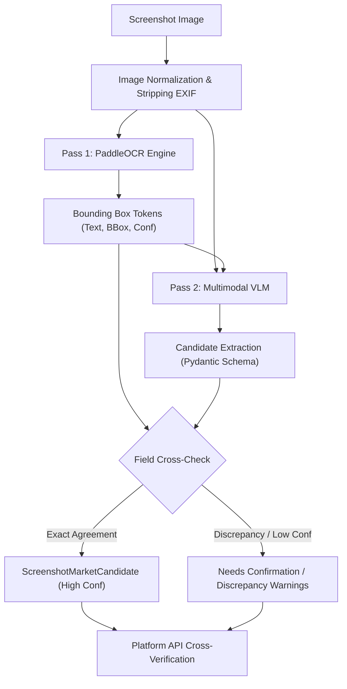

# ADR 0005: Hybrid PaddleOCR and Vision-Language Model Pipeline

- **Status:** Accepted
- **Date:** 2026-11-04
- **Deciders:** Architecture Core Team
- **Consulted:** Computer Vision Engineers, ML Engineers, Backend Developers

---

## 1. Context and Problem Statement

Extracting structured prediction-market parameters from user screenshots presents severe edge-case risks:
- Financial web UIs (Polymarket, Bayse) display dense, high-frequency graphical information: question titles, multi-outcome probability bars, bid/ask buttons, order-book ladders, expiration countdowns, 24-hour volume, and trading charts.
- Generic image captioning (e.g., standard BLIP) emits vague descriptions ("a crypto prediction market interface") and is completely incapable of exact decimal or timestamp extraction.
- Vision-Language Models (VLMs) used in isolation frequently hallucinate small digits, invert binary YES/NO coordinates, or miss tiny UTC time indicators in dark-mode themes.
- Pure OCR engines (e.g., Tesseract, PaddleOCR) extract text strings and bounding boxes with high character fidelity, but lack spatial and semantic understanding of which number corresponds to the YES outcome price versus trading volume.

---

## 2. Decision Drivers

- **Sub-Pixel Numeric Accuracy:** Decimal prices (e.g., `$0.54` vs `$0.59`) and expiration dates must be extracted with near-zero character hallucination.
- **Semantic Understanding:** The system must accurately associate outcome labels, probabilities, and order-book buttons with their corresponding entities.
- **Fail-Closed Discrepancy Detection:** If character extraction and visual semantic layout disagree, the system must detect the conflict and halt rather than silently guessing.

---

## 3. Considered Options

- **Option A (Pure VLM Extraction):** Pass the screenshot directly to a multimodal LLM with a JSON prompt schema.
- **Option B (Pure OCR with Heuristic Geometry Parsing):** Use an OCR library and write hardcoded bounding-box geometric rules for Polymarket and Bayse layouts.
- **Option C (Hybrid Dual-Pass Pipeline):** 
  - Pass 1: Run PaddleOCR to extract text tokens, bounding boxes $(x, y, w, h)$, and confidence scores.
  - Pass 2: Provide the multimodal VLM with both the raw image and the structured OCR bounding-box token list.
  - Pass 3: Cross-validate critical numerical fields between OCR tokens and VLM interpretation; flag discrepancies.

---

## 4. Decision Outcome

We adopt **Option C: Hybrid Dual-Pass Pipeline**.

### 4.1 Pipeline Specifications

1. **Image Preprocessing:**
   - Enforce MIME validation (PNG, JPEG, WebP) from byte signatures.
   - Restrict image dimensions to $\le 4096 \times 4096$ and maximum file size to $10\text{ MB}$.
   - Strip all EXIF metadata to protect user privacy.
2. **Pass 1: Optical Character Recognition:**
   - Execute **PaddleOCR** (PP-OCRv4 detection and recognition models) inside a dedicated, resource-bounded worker process.
   - Output normalized bounding-box coordinates $[x, y, w, h] \in [0, 1]$ and per-word character recognition confidence scores.
3. **Pass 2: Visual-Semantic Extraction:**
   - Pass the normalized image alongside the OCR bounding-box catalog into the VLM adapter.
   - Enforce output constraints using a strict Pydantic v2 schema (`ScreenshotMarketCandidate`).
4. **Pass 3: Deterministic Field Reconciliation:**
   - For every critical extracted field (market title, outcome prices, expiry), compare the VLM string with the overlapping OCR bounding-box token text.
   - If Levenshtein distance $> 0$ on numeric digits or outcome labels, append a warning to `extraction_warnings` and set `needs_user_confirmation = true`.

---

## 5. Consequences & Trade-offs

### Positive
- **Elimination of Visual Hallucinations:** Grounding the VLM with verified OCR bounding-box coordinates prevents the model from generating plausible-looking but fictitious prices.
- **Explainable Provenance:** Every extracted field contains an `evidence_regions` record linking directly to image pixel coordinates for visual UI highlighting.
- **Robustness Across Theme Variants:** Layout-agnostic semantic fusion handles dark mode, mobile screenshots, and compressed desktop captures.

### Negative / Risks & Mitigations
- **Increased Processing Latency:** Running both OCR and a VLM sequentially increases stage latency by $1.5\text{ to }3.5\text{ seconds}$.
  - *Mitigation:* OCR and image preprocessing are executed on Celery worker processes with asynchronous progress emitted via Server-Sent Events.

---

## 6. Revisit Triggers

- Release of lightweight, locally hosted open-weights vision models demonstrating $> 99.5\%$ exact-match accuracy on dense financial UI benchmarks without requiring preliminary OCR passes.
